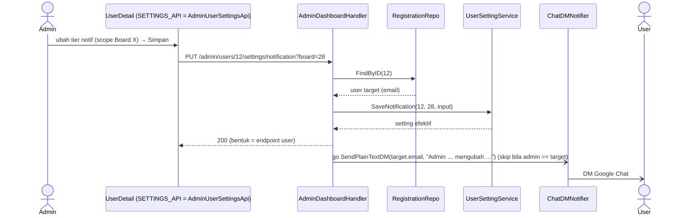

# Tech Spec — Admin Panel Revamp

> **Date:** 2026-11-14
> **PRD Link:** — (hasil brainstorming di sesi Claude Code, disetujui user per section)
> **STP Link:** —
> **Epic / Task:** Nudge — admin panel dengan shell & sidebar sendiri, menu User/Broadcast terpisah, admin dapat mengatur setting milik user
> **Document Status:** `Implemented` (branch `feature/nudge/admin-panel-revamp`)
> **Document Owner:** Yusuf Wijaya
> **Need Review:** —
> **Depends on:** [Tech Spec — Per-Board Settings & Active Sprint Dashboard](../per-board-settings/Tech%20Spec%20-%20Per-Board%20Settings%20%26%20Active%20Sprint%20Dashboard.md). Implementasi **baru dimulai setelah** fitur per-board selesai & di-commit (saat spec ini ditulis, fitur itu masih dikerjakan di working tree oleh agent lain).

---

## 📋 Background, Problem & Solution

| | |
|---|---|
| **Why** | Halaman admin sekarang berupa satu halaman panjang di dalam shell user: statistik, tabel user, dan broadcast ditumpuk jadi satu. Tidak ada navigasi khusus admin, tidak ada jalan cepat kembali ke dashboard umum, dan admin tidak bisa membantu user mengatur notifikasi, mute, atau Jira credential mereka. |
| **Current condition** | Route `dashboard/admin` adalah child `DashboardShellComponent` (`frontend/src/app/app.routes.ts`), komponen `frontend/src/app/features/dashboard/admin/admin.component.*` + `broadcast.component.*`. Backend `modules/admin_dashboard/router.go`: `GET /api/dashboard/admin/users`, `POST /users/:userID/active`, `POST /users/:userID/jira-account-id`, `DELETE /users/:userID/credential`, `DELETE /users/:userID`, `POST /broadcast`. Pengaturan user (`modules/user_dashboard`, `modules/user_setting`, `modules/jira_credential`) hanya bisa diubah oleh user itu sendiri lewat sesi. Service-nya sudah di-key per `userID` (`SaveNotification(userID, boardID, …)`, `MuteUntil`, `UpsertCredential`, dll.). |
| **Solution** | (1) Admin mendapat shell sendiri di `/admin` dengan sidebar **Dashboard / User / Broadcast Message**. (2) Navbar admin punya tombol **"Dashboard Utama"** ke `/dashboard`. (3) Menu User punya halaman detail `/admin/users/:id`. Di sana admin bisa mengatur **semua** setting dinamis user tersebut: notifikasi per scope (default & per board), mute global & per board, dan Jira credential (isi/ganti/hapus). Setiap perubahan oleh admin memicu DM Google Chat ke user. Form Pengaturan **dipakai ulang** lewat adapter DI, tanpa form duplikat. |

---

## 🗺️ Domain Mapping

| User Story | Domain | Sub-module |
|------------|--------|------------|
| US-1 Admin shell + sidebar (Dashboard, User, Broadcast Message) | Admin | frontend `layouts/admin-shell`, routing |
| US-2 Navbar admin dengan tombol ke dashboard umum | Admin | frontend `layouts/admin-shell` |
| US-3 Admin mengatur notifikasi, mute & credential user lain | Admin / Notification | `admin_dashboard`, `user_dashboard`, `user_setting`, `jira_credential`, frontend settings (adapter) |
| US-4 User diberi tahu saat admin mengubah setting-nya | Admin / Notification | `admin_dashboard`, `chat_dm_notifier` |

**Acceptance Criteria**

- **AC1.1** Route `/admin` memakai `AdminShellComponent` (guard `AuthGuard` + `AdminGuard`) dengan child: `''` (Dashboard), `users`, `users/:id`, `broadcast`.
- **AC1.2** Sidebar admin menampilkan tiga menu: Dashboard, User, Broadcast Message. Menu aktif disorot (`routerLinkActive`; menu User juga aktif di `users/:id`). Ada badge "Admin" di bawah logo.
- **AC1.3** `/dashboard/admin` (URL lama) redirect ke `/admin`. Link "Admin" di user menu `dashboard-shell` mengarah ke `/admin`.
- **AC1.4** Non-admin yang membuka `/admin/**` ditolak `AdminGuard` (perilaku sama dengan sekarang).
- **AC1.5** Admin › Dashboard menampilkan kartu statistik (Total user, User aktif, Punya credential) + dua daftar pintas: "User tanpa credential" dan "User nonaktif" (maks 5 item per daftar, tiap item link ke detail).
- **AC1.6** Admin › Broadcast Message = `BroadcastComponent` yang sudah ada sebagai halaman sendiri. Perilakunya tidak berubah.
- **AC1.7** Layout responsif: di layar < `lg`, sidebar menjadi drawer (tombol hamburger di navbar), sama dengan pola `dashboard-shell`.
- **AC2.1** Navbar admin: kiri berisi judul halaman + breadcrumb (`Admin › User › <email>`), kanan berisi tombol **"Dashboard Utama"** (→ `/dashboard`) dan user menu (email, badge Administrator, Logout).
- **AC2.2** Board picker navbar user **tidak** tampil di shell admin.
- **AC3.1** Admin › User: tabel user (search email/nama, status, Jira account ID, credential, aksi aktif/nonaktif/hapus) dengan perilaku sama seperti sekarang. Klik baris (atau tombol "Atur") membuka `/admin/users/:id`. Tombol aksi di baris tidak memicu navigasi.
- **AC3.2** Detail user: kartu profil (email, nama, status aktif + toggle, Jira account ID + edit, credential masked + **Isi/Ganti** + Hapus).
- **AC3.3** Detail user: pemilih scope lokal ("Default semua board" + board dari `GET /admin/users/:id/boards`) yang tersimpan di `?board=` URL halaman detail. Scope **tidak** memengaruhi pilihan board milik admin di `/dashboard`.
- **AC3.4** Detail user: form notifikasi, "Atur khusus board ini" / "Kembalikan ke default", mute global & board. Perilaku dan validasinya identik dengan halaman Pengaturan user (AC3.x & AC4.x spec per-board), tetapi diterapkan ke user target.
- **AC3.5** Perubahan mute oleh admin **tidak** mengubah banner status mute milik admin sendiri (`MuteStateService`).
- **AC3.6** `:id` tidak ada → halaman detail menampilkan state "User tidak ditemukan" + link kembali ke daftar user.
- **AC3.7** Endpoint user (`/api/dashboard/settings…`, `/credential`) tidak berubah dan tetap scoped ke sesi.
- **AC4.1** Setelah operasi tulis admin pada user target berhasil, user target menerima DM Google Chat yang menyebut admin dan bagian yang diubah (lihat template di State Management).
- **AC4.2** DM bersifat best-effort dan async. Kegagalan DM (atau DM notifier tidak dikonfigurasi) hanya di-log dan tidak mengubah respons (`200`).
- **AC4.3** Admin yang mengubah setting dirinya sendiri lewat halaman admin tidak dikirimi DM.
- **AC4.4** Endpoint lama `DELETE /users/:userID/credential` juga mengirim DM (AC4.1–AC4.3).

---

## 🔀 Cross-repo Impact

| Repo | Impact | Detail | Priority |
|------|--------|--------|----------|
| `jira-u-bot` (Go) | `YES` | `admin_dashboard` (endpoint & handler baru, DM), `user_dashboard` (ekstrak helper parsing/response supaya dipakai bersama), wiring di `main.go` | `HIGH` |
| `jira-u-bot/frontend` (Angular) | `YES` | shell admin baru, routing, halaman admin baru, adapter `SETTINGS_API` / `SETTINGS_SCOPE` di komponen Pengaturan | `HIGH` |
| `fnb-backend` / `go-core-api` / `phantom-lancer` | `NO` | tidak terkait | — |

---

## 🗄️ DB Schema Changes

**No schema changes required.** Semua data (`ms_user`/registrasi, `ms_user_setting` per board, credential) sudah ada setelah fitur per-board. Spec ini tidak menambah tabel audit (keputusan brainstorming: jejak perubahan cukup lewat DM).

---

## 📡 API Contract

Semua endpoint baru ada di `apiGroup` admin yang sudah ada: `{BASE_PATH}/api/dashboard/admin`, sudah memakai `AuthMiddlewareAPI` + `AdminMiddleware` (`modules/admin_dashboard/router.go`).

Aturan umum untuk semua endpoint `/users/:userId/...`:

| Code | Condition |
|------|-----------|
| `400` | `userId` bukan angka, atau `board` bukan angka (aturan `board` sama dengan endpoint user) |
| `401` | Tidak login |
| `403` | Bukan admin (`AdminMiddleware`) |
| `404` | User dengan `userId` tersebut tidak ada |

### `GET /api/dashboard/admin/users/:userId` *(baru)*

**Response 200:** satu `UserRow` (DTO yang sama dengan item `GET /users`).
```json
{
  "userId": 12,
  "email": "fernando.marco@esb.co.id",
  "userName": "Marco",
  "flagActive": true,
  "createdDate": "2026-10-01T09:00:00+07:00",
  "jiraAccountId": "712020:8ca409d4-…",
  "hasCredential": false,
  "credentialMasked": ""
}
```

### `GET /api/dashboard/admin/users/:userId/boards` *(baru)*

Response **identik** dengan `GET /api/dashboard/boards`, tetapi dihitung untuk user target (assignee = Jira account user target; `hasCustomSettings` & `muted` dari setting user target).

### `GET /api/dashboard/admin/users/:userId/settings?board=X` *(baru)*

Response **identik** dengan `GET /api/dashboard/settings?board=X` (`scope`, `boardId`, `useDefault`, `notification`, `mute.global`, `mute.board`, `credential`) untuk user target.

### `PUT /api/dashboard/admin/users/:userId/settings/notification?board=X` *(baru)*

Body, validasi, error `400` per field, dan response identik dengan `PUT /api/dashboard/settings/notification?board=X`. DM: `notification`.

### `DELETE /api/dashboard/admin/users/:userId/settings/notification?board=X` *(baru)*

Identik dengan `DELETE /api/dashboard/settings/notification?board=X` (`400` bila tanpa `board`). DM: `reset`.

### `POST / DELETE /api/dashboard/admin/users/:userId/settings/mute?board=X` *(baru)*

Body & response identik dengan `POST / DELETE /api/dashboard/settings/mute?board=X`. DM: `mute` / `unmute`.

### `PUT /api/dashboard/admin/users/:userId/credential` *(baru)*

**Request:**
```json
{
  "jiraEmail": "string — email akun Jira user target",
  "apiToken": "string — Jira API token"
}
```

**Response 200:** sama dengan `POST /api/dashboard/credential` (credential masked preview).

| Code | Condition |
|------|-----------|
| `400` | `jiraEmail` / `apiToken` kosong (pesan sama dengan endpoint user) |

DM: `credential_updated`. Token tidak pernah dikembalikan atau di-log.

### `DELETE /api/dashboard/admin/users/:userId/credential` *(diubah)*

Perilaku tetap. Tambahannya: DM `credential_deleted` (AC4.4).

### Endpoint admin lain *(tetap)*

`GET /users`, `POST /users/:userID/active`, `POST /users/:userID/jira-account-id`, `DELETE /users/:userID`, `POST /broadcast` tidak berubah.

### Prinsip implementasi

- Handler admin **tidak** menduplikasi logika. Parsing `board`, parsing body notifikasi/mute, dan pembentukan response settings diekstrak dari `user_dashboard_handler` ke helper bersama (mis. `user_dashboard_dto` / paket helper kecil). Handler user dan handler admin sama-sama memanggil helper tersebut + method service yang sama dengan `userID` berbeda: dari sesi untuk user, dari `:userId` untuk admin.
- Jika `user_dashboard_service` saat ini menerima identitas dari sesi (email), tambahkan varian berbasis `userID`/registrasi target, tanpa mengubah perilaku endpoint user.

---

## 🔐 Access Control Matrix

| Action | Rule | Behavior if Denied |
|--------|------|--------------------|
| Buka `/admin/**` (UI) | Login + `isAdmin` (`AdminGuard`) | Redirect ke `/dashboard` (perilaku guard sekarang) |
| Endpoint `/api/dashboard/admin/**` | `AuthMiddlewareAPI` + `AdminMiddleware` | `401` / `403` |
| Ubah setting/credential user lain | Hanya admin, lewat endpoint admin | `403` |
| Endpoint setting user (`/api/dashboard/settings…`, `/credential`) | Tetap scoped ke sesi; tidak menerima `userId` | — |

> Tidak ada mekanisme impersonation. Endpoint user tidak tahu soal admin.

---

## 🔄 Sequence Diagram



---

## 🧠 State Management & UI Logic

```
Routing (app.routes.ts)
  /admin            → AdminShellComponent [AuthGuard, AdminGuard]
    ''              → AdminOverviewComponent      data.heading 'Dashboard'
    users           → AdminUsersComponent         data.heading 'User'
    users/:id       → AdminUserDetailComponent    data.heading 'Detail User' (breadcrumb pakai email)
    broadcast       → AdminBroadcastPageComponent data.heading 'Broadcast Message'
  /dashboard/admin  → redirectTo '/admin'

AdminShellComponent
  Sidebar        : logo Nudge + badge "Admin"; menu Dashboard / User / Broadcast Message
  Navbar kiri    : heading + breadcrumb dari route data
  Navbar kanan   : [← Dashboard Utama] (routerLink /dashboard) · user menu (email, Administrator, Logout)
  Mobile (<lg)   : sidebar → drawer, buka via hamburger (pola dashboard-shell)

DI adapter (core/tokens/settings.tokens.ts)
  SETTINGS_API   : InjectionToken<SettingsApi>
     getSettings(board) · saveNotification(board, body) · resetNotification(board)
     mute(board, until) · unmute(board) · listBoards()
     saveCredential(body) · deleteCredential() · credentialPreview()
     Default        → SelfSettingsApi (providedIn root, membungkus BoardService → /api/dashboard/...)
     Admin detail   → AdminUserSettingsApi (providers di AdminUserDetailComponent, userId dari route)
  SETTINGS_SCOPE : InjectionToken<SettingsScope> { selected: Signal<number|null>, boards: Signal<Board[]>, select(id) }
     Default        → BoardContextService (navbar + ?board= + localStorage, seperti sekarang)
     Admin detail   → LocalScopeService (signal lokal + ?board= halaman detail, TANPA localStorage)
  SETTINGS_MODE  : 'self' | 'admin' (provider)
     self  → MuteStateService di-update setelah mute/unmute (banner navbar)
     admin → MuteStateService TIDAK disentuh; copy teks memakai nama user ("Notifikasi Marco …")

Komponen Pengaturan (settings, mute-panel, tier-picker, jira-credential)
  Hanya inject diganti: BoardService/BoardContextService → SETTINGS_API/SETTINGS_SCOPE/SETTINGS_MODE
  Template & validasi tidak berubah; mode self harus identik secara perilaku (spec lama tetap hijau)

AdminUserDetailComponent
  Load           : GET /admin/users/:id → 404 → state "User tidak ditemukan"
  Kartu profil   : toggle aktif, edit Jira account ID, credential [Isi/Ganti] [Hapus] (konfirmasi)
  Scope picker   : Default semua board + boards user target
  Isi            : <app-settings> (komponen yang sama) di dalam provider admin

AdminUsersComponent
  Tabel          : dipindah dari admin.component; klik baris → /admin/users/:id
  Aksi di baris  : stopPropagation (tidak navigasi)

DM template (backend, Bahasa Indonesia)
  notification       : "Admin {adminEmail} mengubah pengaturan notifikasi kamu ({scope})."
  reset              : "Admin {adminEmail} mengembalikan pengaturan {boardName} kamu ke default."
  mute               : "Admin {adminEmail} membungkam notifikasi kamu ({scope}) sampai {waktu WIB | selamanya}."
  unmute             : "Admin {adminEmail} mengaktifkan kembali notifikasi kamu ({scope})."
  credential_updated : "Admin {adminEmail} memperbarui Jira credential kamu."
  credential_deleted : "Admin {adminEmail} menghapus Jira credential kamu."
  {scope} = "default semua board" | "board {boardName}"
  Kirim via goroutine + context.Background() + timeout 10s; error → log saja
```

---

## ✅ Breakdown Task & Effort

> **🤖 AI** = waktu generate Claude. **👨‍💻 Dev Verify** = waktu developer memverifikasi, menjalankan, dan memperbaiki.

| # | Task | Repo | AC Coverage | 🤖 AI | 👨‍💻 Dev Verify | Blocked By |
|---|------|------|-------------|-------|----------------|------------|
| 0 | Gate: fitur per-board selesai & di-commit; rebase/branch baru dari hasilnya | `jira-u-bot` | — | — | `~10m` | — |
| 1 | `user_dashboard`: ekstrak helper parsing `board`/body & builder response settings; varian service berbasis userID target + test (perilaku endpoint user tetap) | `jira-u-bot` | AC3.4, AC3.7 | `~2m` | `~45m` | #0 |
| 2 | `admin_dashboard`: endpoint `GET users/:id`, `boards`, `settings`, `PUT/DELETE notification`, `POST/DELETE mute`, `PUT credential` + router + wiring `main.go` + handler test (400/403/404/happy) | `jira-u-bot` | AC3.2–AC3.4, AC3.6 | `~3m` | `~1.5h` | #1 |
| 3 | `admin_dashboard`: DM notifier helper (template, skip self, async, error di-log) + DM di `DELETE credential` + test | `jira-u-bot` | AC4.1–AC4.4 | `~2m` | `~45m` | #2 |
| 4 | Frontend: token `SETTINGS_API`/`SETTINGS_SCOPE`/`SETTINGS_MODE`, `SelfSettingsApi`, refactor 4 komponen Pengaturan; semua spec lama tetap hijau | `frontend` | AC3.4, AC3.5 | `~3m` | `~1.5h` | #0 |
| 5 | Frontend: `AdminShellComponent` (sidebar, navbar, Dashboard Utama, drawer mobile) + routing `/admin` + redirect + link user menu + spec | `frontend` | AC1.1–AC1.4, AC1.7, AC2.1, AC2.2 | `~3m` | `~1h` | #0 |
| 6 | Frontend: halaman Overview, Users (pindahan tabel), Broadcast (pindahan) + spec | `frontend` | AC1.5, AC1.6, AC3.1 | `~3m` | `~1h` | #5 |
| 7 | Frontend: `AdminUserSettingsApi`, `LocalScopeService`, `AdminUserDetailComponent` (profil, credential isi/ganti, scope, settings) + spec | `frontend` | AC3.2–AC3.6 | `~3m` | `~1.5h` | #2, #4, #6 |
| 8 | Hapus `features/dashboard/admin/*` lama + README (bagian admin) | `jira-u-bot` | AC1.3 | `~1m` | `~15m` | #6, #7 |

> **🤖 AI generates code: ~0.4h**
>
> **👨‍💻 Dev verify & fix: ~8.3h** (jalankan `go test ./...`, `ng test`, `ng build`; cek manual alur admin ↔ user di browser; cek DM terkirim)
>
> **Combined: ~8.7h** (~1–1.5 hari kerja)
>
> ⚠️ Uncovered ACs: —

### Dependency Chain
```
#0 ─┬─> #1 ─> #2 ─> #3
    │          └──────────────┐
    ├─> #4 ───────────────────┼─> #7 ─> #8
    └─> #5 ─> #6 ─────────────┘
```

---

## 🔗 Dependencies

**Internal:**
- Spec per-board (`user_setting` per `(userID, boardID)`, `/boards`, `GetEffective`, mute dua level) **wajib** sudah ada.
- `chat_dm_notifier_service.SendPlainTextDM`, sudah di-inject ke `admin_dashboard_service`.
- `jira_credential_service.UpsertCredential` / `DeleteCredential` / `MaskedPreview`.
- `AdminMiddleware` (backend) & `AdminGuard` (frontend), sudah ada.

**Cross-repo:** None.

**External:** Google Chat API (DM), Jira (daftar board user target). Sama dengan fitur yang sudah ada.

---

## 🚀 Milestone / Deployment Strategy

1. Tunggu fitur per-board selesai dan di-commit. Buat branch baru `feature/nudge/admin-panel-revamp` dari hasilnya.
2. Backend (#1–#3) dan frontend (#4–#5) bisa paralel setelah #0. #7 menunggu keduanya.
3. Tidak ada migration. Rollback = deploy build sebelumnya (tidak ada perubahan data).
4. Piloting flag: tidak diperlukan (fitur khusus admin).

---

## ⚠️ Drawbacks / Risks

| Category | Risk |
|----------|------|
| **Security** | Admin bisa mengisi Jira token user lain. Token hanya dikirim via HTTPS, dienkripsi seperti sekarang (`jira_credential_crypto`), tidak pernah di-log atau dikembalikan. User selalu diberi tahu via DM. |
| **Regresi Pengaturan user** | Refactor DI (#4) menyentuh semua komponen Pengaturan. Mitigasi: default provider = perilaku lama, dan semua spec lama harus hijau tanpa diubah (kecuali setup provider). |
| **Drift admin vs user** | Kalau endpoint user berubah tanpa helper bersama, respons admin bisa melenceng. Mitigasi: helper bersama (#1) + test yang membandingkan bentuk respons. |
| **Jira rate/latency** | `GET /admin/users/:id/boards` memanggil Jira untuk user target. Cache yang sama dengan `/boards`. Hanya dipanggil saat admin membuka detail. |
| **DM spam** | Setiap simpan memicu satu DM. Diterima (perubahan admin jarang). Lihat Future. |
| **Konflik kerja paralel** | Spec ditulis saat agent lain masih mengubah `user_setting`, `settings.component`, `dashboard-shell`, `app.routes.ts`. Mitigasi: gate #0. Signature service di spec ini perlu diverifikasi ulang setelah per-board final. |

---

## 📝 Implementation Notes (deviasi dari spec)

| # | Spec | Implementasi | Alasan |
|---|------|--------------|--------|
| 1 | Path param `:userId` | `:userID` | gin mewajibkan nama wildcard sama dengan route admin yang sudah ada (`/users/:userID/active`, dst.) |
| 2 | Helper parsing di `user_dashboard_dto` | `user_dashboard_handler.SettingsHandler` dengan `TargetResolver` + `ChangeListener` | Satu kode handler untuk dua mount (sesi vs `:userID`) — tidak ada duplikasi, bentuk respons pasti identik |
| 3 | `core/tokens/settings.tokens.ts`, `SelfSettingsApi` | `core/services/settings-api.ts`: abstract class `SettingsApi` / `SettingsScope` dengan `useExisting` ke `BoardService` / `BoardContextService` + token `SETTINGS_MODE` | Default = service lama, sehingga spec lama tetap hijau tanpa diubah |
| 4 | Copy teks "kamu" → nama user di mode admin | Tidak diubah; diganti banner "Kamu sedang mengatur pengaturan milik …" di halaman detail | YAGNI — konteks sudah jelas dari banner |
| 5 | `NewAdminDashboardService(..., boards)` | Variadic option `WithBoardNamer(boardSvc)` | Tidak mengubah 13 call site constructor |
| 6 | — | Route admin di-lazy-load (`loadComponent`) | Bundle awal melewati budget 500 kB; sekarang ±476 kB, kode admin hanya diunduh admin |
| 7 | — (permintaan tambahan) | **Foto profil user dari Jira**: `GET /api/dashboard/me/avatar`, `GET /api/dashboard/admin/users/:userID/avatar` (modul `user_avatar`, cache 24 jam / miss 1 jam), komponen `app-user-avatar` di shell, tabel user, overview, detail | Avatar user Jira Cloud di-host di CDN Atlassian / Gravatar, bukan di situs Jira: diambil tanpa kredensial dari host allowlist (`*.atl-paas.net`, `secure.gravatar.com`), situs Jira dengan kredensial bot, host/redirect lain ditolak |
| 8 | Unresolved #2 | `GetUser` = filter `ListUsers` (FindAll + MaskedPreview per user) | Tanpa query repository baru; biaya linear terhadap jumlah user — tambah `FindUserByID` bila user bertambah banyak |

---

## ❓ Unresolved / Pending Clarification

| # | Location | Contradiction / Ambiguity | Assumption Made |
|---|----------|---------------------------|-----------------|
| 1 | AC3.3 | `/boards` hanya berisi board dengan tiket user di sprint aktif. User tanpa tiket aktif hanya punya scope "Default", sehingga admin tidak bisa mengatur board khusus yang belum ada | Diterima. Sama dengan perilaku halaman Pengaturan user |
| 2 | API #1 | Signature final `user_dashboard_service` (berbasis email sesi vs userID) baru pasti setelah per-board selesai | Tambahkan varian berbasis target tanpa mengubah perilaku endpoint user. Verifikasi saat #0 |
| 3 | AC4.1 | DM saat admin hanya toggle aktif/nonaktif atau edit Jira account ID? | Tidak (di luar "setting dinamis user"). Hanya notifikasi, mute, credential |
| 4 | AC1.5 | Isi Admin › Dashboard selain statistik | Statistik + dua daftar pintas (tanpa credential, nonaktif) |

> **Future possibilities:** tabel audit perubahan admin (siapa/kapan/sebelum-sesudah), DM yang di-debounce/digabung, bulk edit setting untuk banyak user, statistik reminder per user di Admin › Dashboard.

---

## 📁 Files to Modify

| File | Change |
|------|--------|
| `modules/user_dashboard/user_dashboard_handler/user_dashboard_handler_impl.go` | Pakai helper bersama untuk parsing & response settings |
| `modules/user_dashboard/user_dashboard_dto/user_dashboard_dto.go` (atau helper baru) | Helper parsing `board`, body notif/mute, builder response settings |
| `modules/user_dashboard/user_dashboard_service/*` | Varian berbasis user target (boards, settings) bila perlu |
| `modules/admin_dashboard/router.go` | Route `users/:userId`, `boards`, `settings…`, `credential` |
| `modules/admin_dashboard/admin_dashboard_handler/*` | Handler baru + test |
| `modules/admin_dashboard/admin_dashboard_service/*` | Resolve user target, DM helper + template, DM di delete credential + test |
| `main.go` | Inject `user_setting_service`, `user_dashboard_service` ke admin dashboard |
| `frontend/src/app/app.routes.ts` | Route `/admin` + children, redirect `/dashboard/admin` |
| `frontend/src/app/core/tokens/settings.tokens.ts` *(baru)* | `SETTINGS_API`, `SETTINGS_SCOPE`, `SETTINGS_MODE` |
| `frontend/src/app/core/services/self-settings.api.ts` *(baru)* | Adapter default → `BoardService` |
| `frontend/src/app/core/services/admin-user-settings.api.ts` *(baru)* | Adapter admin → `/api/dashboard/admin/users/:id/...` |
| `frontend/src/app/core/services/local-scope.service.ts` *(baru)* | Scope lokal halaman detail |
| `frontend/src/app/core/services/admin.service.ts` | `getUser(id)`, `listUserBoards(id)` |
| `frontend/src/app/features/dashboard/settings/*.ts` | Inject token alih-alih service langsung; input/provider mode |
| `frontend/src/app/layouts/admin-shell/*` *(baru)* | Shell admin (sidebar, navbar, drawer) + spec |
| `frontend/src/app/features/admin/{overview,users,user-detail,broadcast}/*` *(baru)* | Halaman admin + spec |
| `frontend/src/app/features/dashboard/admin/*` | Dihapus (dipindah ke `features/admin/*`) |
| `frontend/src/app/layouts/dashboard-shell/dashboard-shell.component.html` | Link "Admin" → `/admin` |
| `README.md` | Bagian admin panel |
