# Tech Spec - Angular Dashboard Revamp

**Date** 2026-11-02 · **Author** Yusuf Wijaya (with Claude Code) · **Status** Ready for Technical Review · **Confidence** Medium
**PRD** (tidak ada — hasil brainstorming langsung, lihat kesepakatan di Background)
**Target Release** Belum dijadwalkan — menunggu persetujuan spec ini dan prioritas dari user

## Open Questions / Pending Decisions

| # | Question | Options | Rekomendasi | Status |
|---|---|---|---|---|
| 1 | Error message saat Google Sign-In gagal (domain ditolak, sesi invalid, dll) — sekarang dirender server-side di `login.html`. Di dunia full-Angular, bagaimana error ini sampai ke Angular? | (a) Redirect ke `{BasePath}/?error=<pesan>` lalu Angular baca query param dan tampilkan di Login Screen; (b) Flash message lewat cookie sementara | (a) — paling simpel, tidak perlu cookie tambahan | **Resolved** — pakai (a), lihat Chapter 1 |
| 2 | Apakah endpoint admin write (`POST/DELETE /dashboard/admin/...`) perlu dipindah ke bawah `/api/` demi konsistensi dengan endpoint baru (`/api/dashboard/admin/users`)? | (a) Pindah semua endpoint admin ke `/api/dashboard/admin/*`; (b) Biarkan endpoint lama tetap di `/dashboard/admin/*`, cuma GET baru yang masuk `/api/` | (b) — minimalkan perubahan pada endpoint yang sudah bekerja dan sudah dipakai | **Resolved** — pakai (b), dicatat sebagai inkonsistensi minor di Notes & Recommendations |
| 3 | Apakah Angular `dist/` di-embed ke binary (`go:embed`) atau dibaca dari disk saat runtime? | (a) `go:embed` — konsisten dengan pola template yang sudah ada di semua module lain; (b) baca dari folder `frontend/dist` di disk saat runtime | (a) | **Resolved** — pakai (a), lihat Chapter 10 (Build & Deploy) |
| 4 | Apakah perlu endpoint logout terpisah untuk Angular, atau pakai yang sudah ada? | — | Pakai `GET /auth/logout` yang sudah ada (tetap redirect browser biasa, bukan AJAX — cukup set `<a href>` di Angular) | **Resolved** — tidak ada endpoint baru |

## Background

> **Non-Technical Summary:** Dashboard jira-u-bot yang sekarang statis dan render HTML langsung dari server akan diganti seluruhnya dengan aplikasi Angular modern (SPA), tapi tetap jalan di 1 server yang sama tanpa infrastruktur tambahan — jadi tampilannya lebih enak dipakai tanpa menambah beban operasional.

jira-u-bot saat ini melayani 5 halaman dashboard lewat **server-rendered HTML** (`html/template` + `embed.FS` per module, CSS inline, vanilla JS `fetch()` untuk aksi POST/DELETE):

- `modules/auth/auth_handler` — halaman login (`login.html`), ditambahkan di sesi sebelumnya sebagai landing page sebelum redirect ke Google OAuth
- `modules/user_dashboard/user_dashboard_handler` — My Board (`dashboard.html`, baru saja direvamp jadi tabel), Team (`team.html`), Overdue (`overdue.html`)
- `modules/admin_dashboard/admin_dashboard_handler` — Admin Dashboard (`admin.html`)
- `modules/sprint_report/sprint_report_handler` — Sprint Report (`report.html`)

Sebagian besar **aksi** (ubah preference, geser status tiket, simpan/hapus credential, kelola user, broadcast) **sudah berupa endpoint JSON murni** (POST/DELETE) — vanilla JS di tiap halaman sudah memanggilnya lewat `fetch()`. Yang belum JSON adalah **GET halaman itu sendiri**: tiap `GET /dashboard*` saat ini merender HTML langsung di server, data dan tampilan tercampur dalam satu `template.Execute()` call.

**Technical gap yang memotivasi perubahan:**
1. Tampilan vanilla JS + CSS manual sudah mulai terasa terbatas untuk interaksi yang lebih kaya (filter, sort, state transition halus) dibanding komponen Angular reusable.
2. Tidak ada state management terstruktur di client — tiap halaman reload penuh (`location.reload()`) setelah aksi berhasil, bukan update state lokal.
3. Tim sudah familiar dengan konvensi Angular terbaru ESB (`oms-setting-angular` — standalone components) untuk project lain, sehingga pola yang sama di sini mempermudah maintenance jangka panjang.

**Arsitektur yang disepakati** (hasil brainstorming, bukan dari PRD terpisah):
- Angular SPA di-build jadi static files dan **di-embed ke binary Go yang sama** (`go:embed`, pola yang sama persis dengan `modules/*/templates/embed.go` yang sudah ada) — **bukan** proses/container terpisah seperti pola `esb-lms` (yang punya `api/` + `frontend/` sebagai dua service Docker berbeda). Ini menjaga model deploy jira-u-bot yang sudah ada: 1 binary, `systemctl restart`, tanpa Docker.
- **Semua halaman masuk Angular, termasuk login** — tidak ada pengecualian. Go tidak lagi merender HTML apapun; satu handler catch-all mengirim `index.html` yang sama untuk semua path di bawah `cfg.BasePath` (kecuali `/api/*` dan `/auth/google/*` yang tetap endpoint/redirect server biasa).
- Angular menentukan status login lewat endpoint baru `GET /api/auth/me` saat pertama kali load — 200 berarti sudah login (tampilkan dashboard), 401 berarti belum (tampilkan Login Screen).
- Tombol "Sign in with Google" tetap **navigasi browser asli** (`<a href>`, bukan `fetch()`) ke `/auth/google/login` — OAuth secara fundamental butuh redirect browser sungguhan ke accounts.google.com, tidak bisa lewat AJAX.
- `AuthMiddleware` untuk route `/api/dashboard/*` dan `/api/auth/me` berubah dari **redirect ke halaman login** menjadi **return 401 JSON** — `fetch()` tidak bisa mengikuti redirect ke halaman HTML dengan berguna. `AdminMiddleware` tidak berubah (sudah `AbortWithStatus`, tidak pernah redirect).
- Handler GET yang sekarang merender HTML (`Dashboard`, `TeamView`, `OverdueView`, admin's `UserList`, `Report`) **diganti** jadi handler JSON baru — bukan ditambah paralel. Template HTML dan handler lama dihapus.
- Endpoint POST/DELETE yang sudah ada **tidak berubah sama sekali** — Angular memanggilnya persis seperti vanilla JS sekarang.

**Acceptance Criteria** (karena tidak ada PRD terpisah, didefinisikan langsung di sini — dipakai sebagai acuan kolom AC di semua Task Breakdown):

| AC | Deskripsi |
|---|---|
| AC1.1 | Visitor yang belum login, buka path manapun di bawah `cfg.BasePath`, tetap mendapat shell Angular (bukan 404/redirect server-side) |
| AC1.2 | Angular memanggil `GET /api/auth/me` saat app pertama kali load untuk cek status login |
| AC1.3 | Jika belum login (401), tampilkan Login Screen dengan tombol "Sign in with Google" |
| AC1.4 | Tombol "Sign in with Google" adalah navigasi browser asli (bukan AJAX) ke `/auth/google/login` |
| AC1.5 | Jika sudah login (200), tampilkan Dashboard Shell dengan navigasi ke semua halaman |
| AC1.6 | Endpoint `/api/dashboard/*` dan `/api/auth/me` mengembalikan 401 JSON (bukan redirect) saat sesi tidak valid |
| AC1.7 | Endpoint admin (`/api/dashboard/admin/*`, `/dashboard/admin/*`) tetap 403 untuk non-admin, ditegakkan server-side |
| AC2.1 | My Board menampilkan semua tiket milik user yang login, lintas status, sebagai tabel (bukan kanban kolom) |
| AC2.2 | Baris tabel My Board punya kolom Status (badge), Issue Key, Summary, SP, Elapsed, Sisa, Aksi |
| AC2.3 | Tombol aksi "→ Todo"/"→ Code Review" di My Board memanggil endpoint transition yang sudah ada |
| AC3.1 | Team menampilkan semua tiket aktif (Code Process) dikelompokkan per assignee |
| AC4.1 | Overdue menampilkan tiket aktif yang elapsed-nya sudah lewat budget |
| AC5.1 | User bisa pilih subset tier reminder (checkbox, termasuk nol dicentang) dan simpan preference |
| AC5.2 | Checkbox pre-checked sesuai preference tersimpan, default semua checked jika belum pernah set |
| AC6.1 | User bisa input email Jira + API token pribadi dan simpan |
| AC6.2 | Jika sudah ada credential, tampilkan masked preview + tombol hapus |
| AC7.1 | Admin (hanya `AdminEmail`) bisa lihat daftar semua user terdaftar |
| AC7.2 | Admin bisa aktifkan/nonaktifkan user |
| AC7.3 | Admin bisa edit Jira Account ID user |
| AC7.4 | Admin bisa hapus credential pribadi user |
| AC7.5 | Admin bisa hapus user permanen |
| AC8.1 | Admin bisa kirim broadcast message ke semua user aktif |
| AC8.2 | Hasil broadcast (sent count, failed emails) ditampilkan ke admin |
| AC9.1 | User bisa pilih satu atau lebih sprint dari daftar yang tersedia |
| AC9.2 | Report menampilkan Aggregate Deviation, Achievement %, dan tabel per-tiket Estimated vs Actual |
| AC10.1 | Angular build (`ng build`) di-embed ke binary Go yang sama via `go:embed`, serve lewat 1 handler catch-all |
| AC10.2 | Deploy pipeline tetap `git pull` + build + `systemctl restart`, tanpa Docker/container tambahan |

## Feature Type

Frontend rewrite / UI migration — bukan fitur bisnis baru. Semua business logic (perhitungan budget, reminder, sprint report, dll.) di service layer Go **tidak berubah sama sekali**; yang berubah murni cara data itu disajikan (JSON vs HTML) dan dirender (Angular vs `html/template`).

## Architecture Overview

> **Non-Technical Summary:** Walaupun pakai Angular, aplikasinya tetap 1 program yang jalan di 1 server — Angular cuma jadi "wajah" baru yang bicara ke backend yang sama lewat API, bukan 2 aplikasi terpisah yang saling kirim data lewat jaringan.

jira-u-bot tetap **satu repo, satu binary Go** — bukan dua service seperti pola `esb-lms` (`api/` + `frontend/` sebagai container Docker terpisah berkomunikasi lewat network). Angular SPA di-build sebagai static assets lalu di-*embed* ke dalam binary yang sama. Komunikasi Angular ↔ Go API terjadi di proses yang sama (localhost, in-process routing lewat `gin`), bukan network call lintas service — sehingga tidak perlu CORS, load balancer, atau service discovery tambahan.

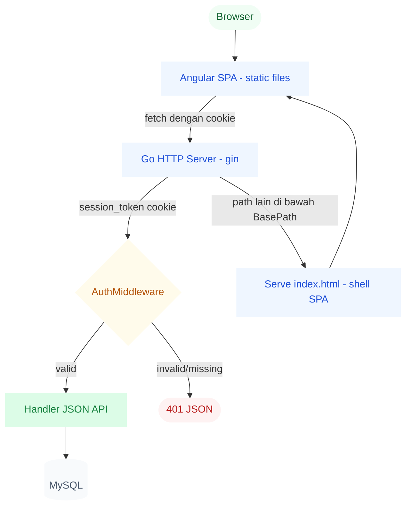

> **Preview:** [View diagram](https://mermaid.live/view#base64:Zmxvd2NoYXJ0IFRECiAgICBVKFtCcm93c2VyXSk6Ojp0ZXJtaW5hbCAtLT4gQVtBbmd1bGFyIFNQQSAtIHN0YXRpYyBmaWxlc106OjppbmZvCiAgICBBIC0tPnxmZXRjaCBkZW5nYW4gY29va2llfCBHW0dvIEhUVFAgU2VydmVyIC0gZ2luXTo6OmluZm8KICAgIEcgLS0+fHNlc3Npb25fdG9rZW4gY29va2llfCBNe0F1dGhNaWRkbGV3YXJlfTo6OmRlY2lzaW9uCiAgICBNIC0tPnx2YWxpZHwgSFtIYW5kbGVyIEpTT04gQVBJXTo6OnN1Y2Nlc3MKICAgIE0gLS0+fGludmFsaWQvbWlzc2luZ3wgRShbNDAxIEpTT05dKTo6OmRhbmdlcgogICAgSCAtLT4gRFsoTXlTUUwpXTo6Om11dGVkCiAgICBHIC0tPnxwYXRoIGxhaW4gZGkgYmF3YWggQmFzZVBhdGh8IFNbU2VydmUgaW5kZXguaHRtbCAtIHNoZWxsIFNQQV06OjppbmZvCiAgICBTIC0tPiBBCgogICAgY2xhc3NEZWYgZGVjaXNpb24gIGZpbGw6I0ZGRkJFQixzdHJva2U6I0ZGRkJFQixjb2xvcjojQjQ1MzA5LHN0cm9rZS13aWR0aDowcHgKICAgIGNsYXNzRGVmIHRlcm1pbmFsICBmaWxsOiNGMEZERjQsc3Ryb2tlOiNGMEZERjQsY29sb3I6IzE2NjUzNCxzdHJva2Utd2lkdGg6MHB4CiAgICBjbGFzc0RlZiBzdWNjZXNzICAgZmlsbDojRENGQ0U3LHN0cm9rZTojRENGQ0U3LGNvbG9yOiMxNTgwM0Qsc3Ryb2tlLXdpZHRoOjBweAogICAgY2xhc3NEZWYgZGFuZ2VyICAgIGZpbGw6I0ZFRjJGMixzdHJva2U6I0ZFRjJGMixjb2xvcjojQjkxQzFDLHN0cm9rZS13aWR0aDowcHgKICAgIGNsYXNzRGVmIGluZm8gICAgICBmaWxsOiNFRkY2RkYsc3Ryb2tlOiNFRkY2RkYsY29sb3I6IzFENEVEOCxzdHJva2Utd2lkdGg6MHB4CiAgICBjbGFzc0RlZiBtdXRlZCAgICAgZmlsbDojRjhGQUZDLHN0cm9rZTojRjhGQUZDLGNvbG9yOiM0NzU1Njksc3Ryb2tlLXdpZHRoOjBweAo=)

## Sequence Diagrams

> **Non-Technical Summary:** Diagram ini menunjukkan urutan kejadian saat user membuka dashboard — dari cek status login, sampai tampilan akhir yang dia lihat.


> **Preview:** [View diagram](https://mermaid.live/view#base64:Zmxvd2NoYXJ0IFRECiAgICBBKFtCdWthIC9qaXJhLW5vdGlmL2FwYSBzYWphXSk6Ojp0ZXJtaW5hbCAtLT4gQltBbmd1bGFyIEFwcCBsb2FkXTo6OmluZm8KICAgIEIgLS0+IENbQ2FsbCBHRVQgL2FwaS9hdXRoL21lXTo6OmluZm8KICAgIEMgLS0+IER7MjAwIE9LP306OjpkZWNpc2lvbgogICAgRCAtLT58VGlkYWssIDQwMXwgRVtUYW1waWxrYW4gTG9naW4gU2NyZWVuXTo6Om11dGVkCiAgICBFIC0tPiBGW0tsaWsgU2lnbiBpbiB3aXRoIEdvb2dsZV06OjppbmZvCiAgICBGIC0tPiBHKFtSZWRpcmVjdCBicm93c2VyIGtlIC9hdXRoL2dvb2dsZS9sb2dpbl0pOjo6dGVybWluYWwKICAgIEQgLS0+fFlhfCBIW1RhbXBpbGthbiBEYXNoYm9hcmQgU2hlbGwgcGx1cyBOYXZdOjo6c3VjY2VzcwogICAgSCAtLT4gSXtSb3V0ZSBkaXBpbGlofTo6OmRlY2lzaW9uCiAgICBJIC0tPnxNeSBCb2FyZHwgSltMaXN0OiBNeSBCb2FyZF06OjppbmZvCiAgICBJIC0tPnxUZWFtfCBLW0xpc3Q6IFRlYW1dOjo6aW5mbwogICAgSSAtLT58T3ZlcmR1ZXwgTFtMaXN0OiBPdmVyZHVlXTo6OmluZm8KICAgIEkgLS0+fEFkbWluLCBoYW55YSBhZG1pbnwgTVtBZG1pbiBVc2VyIE1hbmFnZW1lbnRdOjo6aW5mbwogICAgSSAtLT58U3ByaW50IFJlcG9ydHwgTltTcHJpbnQgUmVwb3J0XTo6OmluZm8KCiAgICBjbGFzc0RlZiBkZWNpc2lvbiAgZmlsbDojRkZGQkVCLHN0cm9rZTojRkZGQkVCLGNvbG9yOiNCNDUzMDksc3Ryb2tlLXdpZHRoOjBweAogICAgY2xhc3NEZWYgdGVybWluYWwgIGZpbGw6I0YwRkRGNCxzdHJva2U6I0YwRkRGNCxjb2xvcjojMTY2NTM0LHN0cm9rZS13aWR0aDowcHgKICAgIGNsYXNzRGVmIHN1Y2Nlc3MgICBmaWxsOiNEQ0ZDRTcsc3Ryb2tlOiNEQ0ZDRTcsY29sb3I6IzE1ODAzRCxzdHJva2Utd2lkdGg6MHB4CiAgICBjbGFzc0RlZiBkYW5nZXIgICAgZmlsbDojRkVGMkYyLHN0cm9rZTojRkVGMkYyLGNvbG9yOiNCOTFDMUMsc3Ryb2tlLXdpZHRoOjBweAogICAgY2xhc3NEZWYgaW5mbyAgICAgIGZpbGw6I0VGRjZGRixzdHJva2U6I0VGRjZGRixjb2xvcjojMUQ0RUQ4LHN0cm9rZS13aWR0aDowcHgKICAgIGNsYXNzRGVmIG11dGVkICAgICBmaWxsOiNGOEZBRkMsc3Ryb2tlOiNGOEZBRkMsY29sb3I6IzQ3NTU2OSxzdHJva2Utd2lkdGg6MHB4Cg==)

## Database Changes

> **Non-Technical Summary:** Tidak ada perubahan struktur database sama sekali — fitur ini murni mengganti cara data yang sudah ada ditampilkan.

No schema changes required. Semua tabel yang dipakai (`tr_usersession`, `tr_issuesession`, `ms_user`, `tr_reminderlog`, `tr_usercredential`, `tr_registration`) sudah ada dan tidak berubah skema maupun query dasarnya — handler baru memanggil service layer (`UserDashboardService`, `AdminDashboardService`, `SprintReportService`, `AuthService`) yang **sudah ada dan sudah teruji**, hanya mengubah bagaimana hasilnya diserialisasi (JSON, bukan `template.Execute`).

### Tables Used

| Table | Operation | Catatan |
|---|---|---|
| `tr_usersession` | SELECT | Via `AuthService.FindSession` — tidak berubah |
| `ms_user` | SELECT | Via berbagai service — tidak berubah |
| `tr_issuesession` | SELECT | Via `UserDashboardService`/`SprintReportService` — tidak berubah |
| `tr_reminderlog` | — | Tidak disentuh fitur ini |
| `tr_usercredential` | SELECT | Via `JiraCredentialService.MaskedPreview` — tidak berubah |

## Repository 1 — jira-u-bot API (Go / Gin)

> **Non-Technical Summary:** Ini bagian backend yang menyediakan data ke Angular — setiap halaman yang tadinya dirender langsung di server sekarang punya endpoint data (JSON) sendiri yang dipanggil Angular.

Semua endpoint baru di chapter ini **tidak menambah business logic baru** — masing-masing adalah wrapper tipis di atas service layer yang sudah ada (`AuthService`, `UserDashboardService`, `AdminDashboardService`, `SprintReportService`), yang menukar output dari `template.Execute(...)` (HTML) menjadi `c.JSON(...)`. Satu perubahan non-wrapper: `AuthMiddleware` (dipakai semua endpoint di bawah `/api/*`) berubah dari redirect ke halaman login menjadi **return 401 JSON** — didokumentasikan di Security section Chapter 1 dan berlaku untuk seluruh chapter di repository ini.

Endpoint lama yang **dihapus** (diganti oleh chapter-chapter di bawah): `GET /dashboard`, `GET /dashboard/team`, `GET /dashboard/overdue`, `GET /dashboard/admin`, `GET /dashboard/report`, `GET /auth/login`. Endpoint POST/DELETE yang sudah ada **tidak ada di chapter manapun di bawah ini** karena memang tidak berubah — didaftar di [Impact on Existing Features](#impact-on-existing-features).

### API: GET /api/auth/me — Session Check

#### Flowchart — Session Check

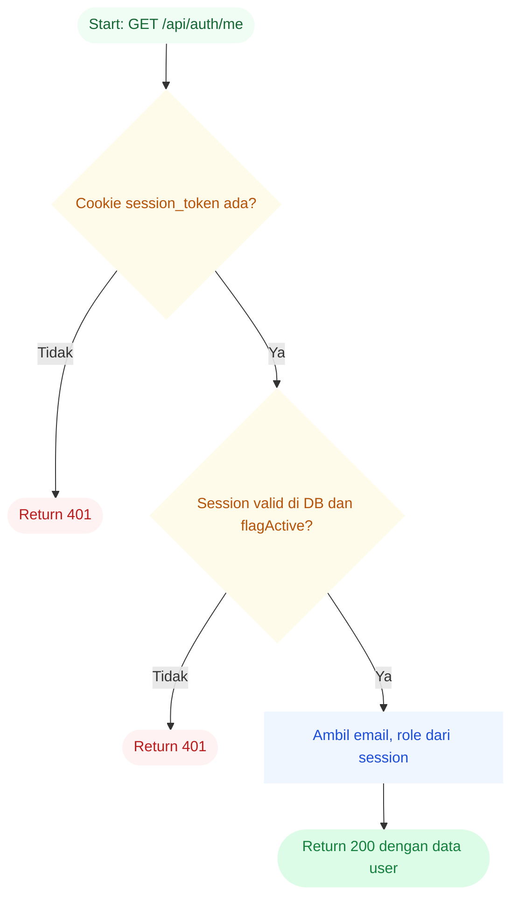

> **Preview:** [View diagram](https://mermaid.live/view#base64:Zmxvd2NoYXJ0IFRECiAgICBGMShbU3RhcnQ6IEdFVCAvYXBpL2F1dGgvbWVdKTo6OnRlcm1pbmFsCiAgICBGMntDb29raWUgc2Vzc2lvbl90b2tlbiBhZGE/fTo6OmRlY2lzaW9uCiAgICBGMyhbUmV0dXJuIDQwMV0pOjo6ZGFuZ2VyCiAgICBGNHtTZXNzaW9uIHZhbGlkIGRpIERCIGRhbiBmbGFnQWN0aXZlP306OjpkZWNpc2lvbgogICAgRjUoW1JldHVybiA0MDFdKTo6OmRhbmdlcgogICAgRjZbQW1iaWwgZW1haWwsIHJvbGUgZGFyaSBzZXNzaW9uXTo6OmluZm8KICAgIEY3KFtSZXR1cm4gMjAwIGRlbmdhbiBkYXRhIHVzZXJdKTo6OnN1Y2Nlc3MKCiAgICBGMSAtLT4gRjIKICAgIEYyIC0tPnxUaWRha3wgRjMKICAgIEYyIC0tPnxZYXwgRjQKICAgIEY0IC0tPnxUaWRha3wgRjUKICAgIEY0IC0tPnxZYXwgRjYKICAgIEY2IC0tPiBGNwoKICAgIGNsYXNzRGVmIGRlY2lzaW9uICBmaWxsOiNGRkZCRUIsc3Ryb2tlOiNGRkZCRUIsY29sb3I6I0I0NTMwOSxzdHJva2Utd2lkdGg6MHB4CiAgICBjbGFzc0RlZiB0ZXJtaW5hbCAgZmlsbDojRjBGREY0LHN0cm9rZTojRjBGREY0LGNvbG9yOiMxNjY1MzQsc3Ryb2tlLXdpZHRoOjBweAogICAgY2xhc3NEZWYgc3VjY2VzcyAgIGZpbGw6I0RDRkNFNyxzdHJva2U6I0RDRkNFNyxjb2xvcjojMTU4MDNELHN0cm9rZS13aWR0aDowcHgKICAgIGNsYXNzRGVmIGRhbmdlciAgICBmaWxsOiNGRUYyRjIsc3Ryb2tlOiNGRUYyRjIsY29sb3I6I0I5MUMxQyxzdHJva2Utd2lkdGg6MHB4CiAgICBjbGFzc0RlZiBpbmZvICAgICAgZmlsbDojRUZGNkZGLHN0cm9rZTojRUZGNkZGLGNvbG9yOiMxRDRFRDgsc3Ryb2tlLXdpZHRoOjBweAogICAgY2xhc3NEZWYgbXV0ZWQgICAgIGZpbGw6I0Y4RkFGQyxzdHJva2U6I0Y4RkFGQyxjb2xvcjojNDc1NTY5LHN0cm9rZS13aWR0aDowcHgK)

#### Contract

**Request**

```
// GET /jira-notif/api/auth/me
// Cookie: session_token=<opaque token>
// Tidak ada query/body
```

**Response Success**

```json
// HTTP 200
{
  "email": "yusuf.wijaya@esb.co.id",
  "isAdmin": true
}
```

**Response Properties**

| Property | Data Type | Description |
|---|---|---|
| `email` | `string` | Email user yang sedang login |
| `isAdmin` | `boolean` | `true` jika `email` sama dengan `cfg.AdminEmail` — dipakai Angular untuk tampil/sembunyikan menu Admin (keamanan sebenarnya tetap di server lewat `AdminMiddleware`, ini murni untuk UI) |

**Response Error**

```json
// HTTP 401
{
  "error": "unauthorized"
}
```

**Error Contract**

| Code | HTTP | Message | Trigger |
|---|---:|---|---|
| `unauthorized` | 401 | unauthorized | Cookie `session_token` tidak ada, atau sesi tidak ditemukan/expired di DB, atau user sudah dinonaktifkan admin (`flagActive = false`) |

#### Security

| Guard | Required | Detail |
|---|---|---|
| **Auth** | Yes | Cookie `session_token` (HttpOnly, Secure, SameSite=Lax) — divalidasi `AuthService.FindSession`, bukan JWT |
| **Signature** | — | Tidak berlaku |
| **Rate-limit** | — | Tidak berlaku — dipanggil 1x per page load oleh Angular, bukan hot path |
| **CORS** | — | Tidak berlaku — Angular di-serve dari origin yang sama (`labcup.tech/jira-notif`), bukan cross-origin |

> **Perubahan penting yang berlaku untuk SEMUA chapter di repository ini:** `AuthMiddleware` (`modules/auth/auth_middleware/auth_middleware.go`) sebelumnya `c.Redirect(302, loginURL)` saat sesi tidak valid — sekarang untuk grup route `/api/*` berubah jadi `c.JSON(401, gin.H{"error": "unauthorized"})` lalu `c.Abort()`. Alasan: `fetch()` di Angular tidak bisa "mengikuti" redirect 302 ke halaman HTML dengan berguna (response body-nya jadi HTML, bukan JSON, dan `fetch()` tidak otomatis treat redirect sebagai gagal). `AdminMiddleware` **tidak berubah** — sudah `c.AbortWithStatus(403)` tanpa redirect sejak awal.

#### Validation

**Input Validation** — tidak ada input (GET tanpa query/body).

**Service Validation**

1. Cek cookie `session_token` ada di request — tidak ada → `unauthorized`
2. `AuthService.FindSession(ctx, token)` — tidak ditemukan ATAU `flagActive = false` → `unauthorized`

#### Business Logic

1. Ambil `auth_dto.Session` dari context (`auth_middleware.CurrentUserKey`, sudah di-set `AuthMiddleware` setelah validasi di atas)
2. Hitung `isAdmin := session.Email == cfg.AdminEmail`
3. Return `{email, isAdmin}` sebagai JSON 200

#### Concurrency

Tidak ada — operasi baca murni, tidak ada write, tidak ada race condition yang mungkin (R1–R6 semua ❌).

#### Reliability

Tidak ada — satu query `SELECT` lewat `AuthService.FindSession` yang sudah ada, tidak ada external call, tidak ada multi-step operation.

#### Performance

Tidak ada — single-row lookup by primary key (session token), dipanggil sekali per page load, bukan hot path berulang.

#### Observability

Tidak ada logging tambahan — kegagalan auth (401) adalah kondisi normal (user belum login), bukan error yang perlu di-log.

#### Testing

| No | Type | Scenario | Expected | AC |
|---:|---|---|---|---|
| 1 | Unit | Cookie tidak ada | HTTP 401 | AC1.6 |
| 2 | Unit | Cookie ada tapi sesi tidak ditemukan | HTTP 401 | AC1.6 |
| 3 | Unit | Sesi valid tapi `flagActive = false` | HTTP 401 | AC1.6 |
| 4 | Unit | Sesi valid, email = AdminEmail | HTTP 200, `isAdmin: true` | AC1.2 |
| 5 | Unit | Sesi valid, email bukan AdminEmail | HTTP 200, `isAdmin: false` | AC1.2 |

#### Affected Functions

| Status | Function | File | Line | Notes |
|---|---|---|---|---|
| New | `Me` | `modules/auth/auth_handler/auth_handler_impl.go` | — | Handler baru untuk `GET /api/auth/me` |
| Modified | `AuthHandler` (interface) | `modules/auth/auth_handler/auth_handler.go` | 5-10 | Tambah method `Me(c *gin.Context)`, hapus `LoginPage` |
| Modified | `AuthMiddleware` | `modules/auth/auth_middleware/auth_middleware.go` | 24-44 | Return 401 JSON untuk grup `/api/*` alih-alih redirect |
| Removed | `LoginPage` | `modules/auth/auth_handler/auth_handler_impl.go` | 60-62 | Halaman login server-rendered tidak dipakai lagi — diganti Login Screen Angular (lihat Repository 2, Chapter 1) |
| Modified | `SetupRouter` | `router.go` | 27-64 | Tambah grup `/api/auth` dengan `AuthMiddleware`, daftarkan `GET /api/auth/me` |

#### Task Breakdown

| No | Task | File | AC | SP |
|---|---|---|---|---:|
| T1.1 | **[TDD]** Tulis failing tests: semua skenario dari `#### Testing` chapter ini | `modules/auth/auth_handler/auth_handler_test.go`, `modules/auth/auth_middleware/auth_middleware_test.go` | AC1.2, AC1.6 | 0.5 |
| 1.1 | Business Logic: `AuthHandler.Me` — ambil session dari context, hitung `isAdmin`, return JSON | `modules/auth/auth_handler/auth_handler_impl.go` | AC1.2 | 0.5 |
| 1.2 | Middleware: ubah `AuthMiddleware` jadi 401 JSON untuk grup API | `modules/auth/auth_middleware/auth_middleware.go` | AC1.6 | 1 |
| 1.3 | Router: daftarkan `GET /api/auth/me` dengan `AuthMiddleware` | `router.go` | AC1.2, AC1.6 | 0.5 |
| 1.x | **[Dev Test]** — self-test mandiri | - | - | — |
| | **Subtotal Chapter 1** | | | **2.5 SP** |

### API: GET /api/dashboard/board — My Board

#### Flowchart — My Board

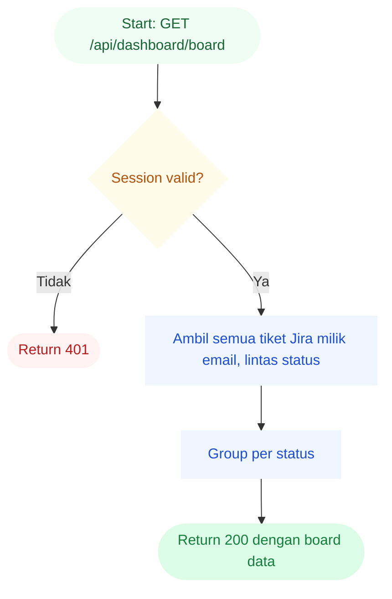

> **Preview:** [View diagram](https://mermaid.live/view#base64:Zmxvd2NoYXJ0IFRECiAgICBGMShbU3RhcnQ6IEdFVCAvYXBpL2Rhc2hib2FyZC9ib2FyZF0pOjo6dGVybWluYWwKICAgIEYye1Nlc3Npb24gdmFsaWQ/fTo6OmRlY2lzaW9uCiAgICBGMyhbUmV0dXJuIDQwMV0pOjo6ZGFuZ2VyCiAgICBGNFtBbWJpbCBzZW11YSB0aWtldCBKaXJhIG1pbGlrIGVtYWlsLCBsaW50YXMgc3RhdHVzXTo6OmluZm8KICAgIEY1W0dyb3VwIHBlciBzdGF0dXNdOjo6aW5mbwogICAgRjYoW1JldHVybiAyMDAgZGVuZ2FuIGJvYXJkIGRhdGFdKTo6OnN1Y2Nlc3MKCiAgICBGMSAtLT4gRjIKICAgIEYyIC0tPnxUaWRha3wgRjMKICAgIEYyIC0tPnxZYXwgRjQKICAgIEY0IC0tPiBGNQogICAgRjUgLS0+IEY2CgogICAgY2xhc3NEZWYgZGVjaXNpb24gIGZpbGw6I0ZGRkJFQixzdHJva2U6I0ZGRkJFQixjb2xvcjojQjQ1MzA5LHN0cm9rZS13aWR0aDowcHgKICAgIGNsYXNzRGVmIHRlcm1pbmFsICBmaWxsOiNGMEZERjQsc3Ryb2tlOiNGMEZERjQsY29sb3I6IzE2NjUzNCxzdHJva2Utd2lkdGg6MHB4CiAgICBjbGFzc0RlZiBzdWNjZXNzICAgZmlsbDojRENGQ0U3LHN0cm9rZTojRENGQ0U3LGNvbG9yOiMxNTgwM0Qsc3Ryb2tlLXdpZHRoOjBweAogICAgY2xhc3NEZWYgZGFuZ2VyICAgIGZpbGw6I0ZFRjJGMixzdHJva2U6I0ZFRjJGMixjb2xvcjojQjkxQzFDLHN0cm9rZS13aWR0aDowcHgKICAgIGNsYXNzRGVmIGluZm8gICAgICBmaWxsOiNFRkY2RkYsc3Ryb2tlOiNFRkY2RkYsY29sb3I6IzFENEVEOCxzdHJva2Utd2lkdGg6MHB4CiAgICBjbGFzc0RlZiBtdXRlZCAgICAgZmlsbDojRjhGQUZDLHN0cm9rZTojRjhGQUZDLGNvbG9yOiM0NzU1Njksc3Ryb2tlLXdpZHRoOjBweAo=)

#### Contract

**Request**

```
// GET /jira-notif/api/dashboard/board
// Cookie: session_token=<opaque token>
```

**Response Success**

```json
// HTTP 200
{
  "columns": [
    {
      "status": "Code Process",
      "cards": [
        {
          "issueKey": "OMS-12594",
          "summary": "EXEC PLAN: Branch, Code Review Cycle & Handover",
          "status": "Code Process",
          "hasBudgetDetail": true,
          "storyPoints": 4,
          "elapsedLabel": "0 hari 0 jam 44 menit 2 detik",
          "remainingLabel": "0 hari 3 jam 15 menit 58 detik",
          "deadlineLabel": "Senin, 02 Nov 2026 12:00:00 WIB"
        }
      ]
    }
  ],
  "tierPreference": {
    "tiers": ["2h", "1h", "30m", "15m", "5m", "1m"]
  },
  "credential": {
    "hasCredential": false,
    "maskedPreview": ""
  }
}
```

**Response Properties**

| Property | Data Type | Description |
|---|---|---|
| `columns[].status` | `string` | Nama status Jira, urutan sama dengan urutan first-seen dari Jira API |
| `columns[].cards[]` | `array` | Tiket dalam status ini — field persis sama dengan `user_dashboard_dto.Card` |
| `tierPreference.tiers[]` | `string[]` | Kode tier yang dicentang — semua 6 tier jika belum pernah di-set (default) |
| `credential.hasCredential` | `boolean` | `true` jika user punya Jira API key pribadi tersimpan |
| `credential.maskedPreview` | `string` | Preview token ter-mask, kosong jika `hasCredential = false` |

**Response Error**

```json
// HTTP 401
{ "error": "unauthorized" }
```

```json
// HTTP 500
{ "error": "failed to load board" }
```

**Error Contract**

| Code | HTTP | Message | Trigger |
|---|---:|---|---|
| `unauthorized` | 401 | unauthorized | Sesi tidak valid (lihat Chapter 1) |
| `failed to load board` | 500 | failed to load board | `UserDashboardService.GetMyBoard`, `GetReminderTierPreference`, atau `JiraCredentialService.MaskedPreview` mengembalikan error (biasanya Jira API down/timeout) |

#### Security

| Guard | Required | Detail |
|---|---|---|
| **Auth** | Yes | Sama seperti Chapter 1 |
| **Signature** | — | Tidak berlaku |
| **Rate-limit** | — | Tidak berlaku |
| **CORS** | — | Tidak berlaku — same-origin |

#### Validation

**Input Validation** — tidak ada input.

**Service Validation** — tidak ada (tidak ada state/keberadaan yang perlu dicek sebelum baca — `email` sudah pasti valid karena berasal dari sesi yang sudah divalidasi `AuthMiddleware`).

#### Business Logic

1. Ambil `email` dari `auth_dto.Session` di context
2. Panggil `UserDashboardService.GetMyBoard(ctx, email)` — **tidak berubah**, logic sama persis dengan handler HTML lama
3. Panggil `UserDashboardService.GetReminderTierPreference(ctx, email)` — **tidak berubah**
4. Panggil `JiraCredentialService.MaskedPreview(ctx, userID)` — **tidak berubah**
5. Susun ketiga hasil jadi satu JSON response, return 200. Error dari langkah manapun → 500 `failed to load board`

#### Concurrency

Tidak ada — operasi baca murni.

#### Reliability

Tidak ada partial-failure case — tiga pemanggilan service independen, kegagalan salah satu langsung return 500 (tidak ada state yang ditulis, tidak ada rollback yang diperlukan).

#### Performance

Tidak ada — query sama persis dengan handler HTML lama yang sudah berjalan di production, tidak ada N+1 baru.

#### Observability

Tidak ada logging tambahan — error 500 di sini sudah cukup terlihat dari response status; tidak ada goroutine atau proses background yang perlu di-trace.

#### Testing

| No | Type | Scenario | Expected | AC |
|---:|---|---|---|---|
| 1 | Unit | Happy path — board, preference, credential semua sukses | HTTP 200 dengan 3 bagian data lengkap | AC2.1 |
| 2 | Unit | `GetMyBoard` error | HTTP 500 | — |
| 3 | Unit | User belum pernah set preference | `tiers` berisi semua 6 kode (default) | AC5.2 |
| 4 | Unit | User belum punya credential | `credential.hasCredential = false` | AC6.2 |
| 5 | Unit | Token tidak ada / invalid | HTTP 401 | AC1.6 |

#### Affected Functions

| Status | Function | File | Line | Notes |
|---|---|---|---|---|
| New | `GetBoard` | `modules/user_dashboard/user_dashboard_handler/user_dashboard_handler_impl.go` | — | Menggantikan `Dashboard` — return JSON, bukan render template |
| Removed | `Dashboard` | `modules/user_dashboard/user_dashboard_handler/user_dashboard_handler_impl.go` | 89-130 | Diganti `GetBoard` |
| Modified | `UserDashboardHandler` (interface) | `modules/user_dashboard/user_dashboard_handler/user_dashboard_handler.go` | 5-13 | `Dashboard` → `GetBoard` |
| Modified | `Router` | `modules/user_dashboard/router.go` | 13-22 | `dashboard.GET("", handler.Dashboard)` → `api.GET("/board", handler.GetBoard)` |
| Unchanged | `GetMyBoard` | `modules/user_dashboard/user_dashboard_service/user_dashboard_service.go` | 14-16 | Dipanggil persis sama |
| Unchanged | `GetReminderTierPreference` | `modules/user_dashboard/user_dashboard_service/user_dashboard_service.go` | 23-26 | Dipanggil persis sama |
| Unchanged | `MaskedPreview` | `modules/jira_credential/jira_credential_service/jira_credential_service.go` | 18-19 | Dipanggil persis sama |

#### Task Breakdown

| No | Task | File | AC | SP |
|---|---|---|---|---:|
| T2.1 | **[TDD]** Tulis failing tests: semua skenario dari `#### Testing` chapter ini | `modules/user_dashboard/user_dashboard_handler/user_dashboard_handler_test.go` | AC2.1, AC5.2, AC6.2 | 0.5 |
| 2.1 | Business Logic: `GetBoard` — panggil 3 service, susun JSON response | `modules/user_dashboard/user_dashboard_handler/user_dashboard_handler_impl.go` | AC2.1, AC5.2, AC6.2 | 1 |
| 2.2 | Router: ganti route lama dengan `GET /api/dashboard/board` | `modules/user_dashboard/router.go` | AC2.1 | 0.5 |
| 2.x | **[Dev Test]** — self-test mandiri | - | - | — |
| | **Subtotal Chapter 2** | | | **2 SP** |

### API: GET /api/dashboard/team — Team View

#### Flowchart — Team View

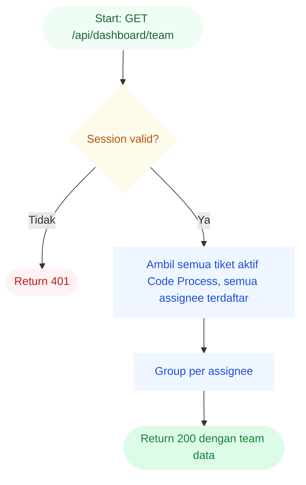

> **Preview:** [View diagram](https://mermaid.live/view#base64:Zmxvd2NoYXJ0IFRECiAgICBGMShbU3RhcnQ6IEdFVCAvYXBpL2Rhc2hib2FyZC90ZWFtXSk6Ojp0ZXJtaW5hbAogICAgRjJ7U2Vzc2lvbiB2YWxpZD99Ojo6ZGVjaXNpb24KICAgIEYzKFtSZXR1cm4gNDAxXSk6OjpkYW5nZXIKICAgIEY0W0FtYmlsIHNlbXVhIHRpa2V0IGFrdGlmIENvZGUgUHJvY2Vzcywgc2VtdWEgYXNzaWduZWUgdGVyZGFmdGFyXTo6OmluZm8KICAgIEY1W0dyb3VwIHBlciBhc3NpZ25lZV06OjppbmZvCiAgICBGNihbUmV0dXJuIDIwMCBkZW5nYW4gdGVhbSBkYXRhXSk6OjpzdWNjZXNzCgogICAgRjEgLS0+IEYyCiAgICBGMiAtLT58VGlkYWt8IEYzCiAgICBGMiAtLT58WWF8IEY0CiAgICBGNCAtLT4gRjUKICAgIEY1IC0tPiBGNgoKICAgIGNsYXNzRGVmIGRlY2lzaW9uICBmaWxsOiNGRkZCRUIsc3Ryb2tlOiNGRkZCRUIsY29sb3I6I0I0NTMwOSxzdHJva2Utd2lkdGg6MHB4CiAgICBjbGFzc0RlZiB0ZXJtaW5hbCAgZmlsbDojRjBGREY0LHN0cm9rZTojRjBGREY0LGNvbG9yOiMxNjY1MzQsc3Ryb2tlLXdpZHRoOjBweAogICAgY2xhc3NEZWYgc3VjY2VzcyAgIGZpbGw6I0RDRkNFNyxzdHJva2U6I0RDRkNFNyxjb2xvcjojMTU4MDNELHN0cm9rZS13aWR0aDowcHgKICAgIGNsYXNzRGVmIGRhbmdlciAgICBmaWxsOiNGRUYyRjIsc3Ryb2tlOiNGRUYyRjIsY29sb3I6I0I5MUMxQyxzdHJva2Utd2lkdGg6MHB4CiAgICBjbGFzc0RlZiBpbmZvICAgICAgZmlsbDojRUZGNkZGLHN0cm9rZTojRUZGNkZGLGNvbG9yOiMxRDRFRDgsc3Ryb2tlLXdpZHRoOjBweAogICAgY2xhc3NEZWYgbXV0ZWQgICAgIGZpbGw6I0Y4RkFGQyxzdHJva2U6I0Y4RkFGQyxjb2xvcjojNDc1NTY5LHN0cm9rZS13aWR0aDowcHgK)

#### Contract

**Request**

```
// GET /jira-notif/api/dashboard/team
// Cookie: session_token=<opaque token>
```

**Response Success**

```json
// HTTP 200
{
  "groups": [
    {
      "assigneeEmail": "teammate@esb.co.id",
      "cards": [
        { "issueKey": "OMS-1", "summary": "...", "status": "Code Process", "hasBudgetDetail": true, "storyPoints": 3, "elapsedLabel": "...", "remainingLabel": "..." }
      ]
    }
  ]
}
```

**Response Properties**

| Property | Data Type | Description |
|---|---|---|
| `groups[].assigneeEmail` | `string` | Email assignee |
| `groups[].cards[]` | `array` | Tiket aktif assignee ini — field sama dengan `Card` di Chapter 2 |

**Response Error**

```json
// HTTP 401
{ "error": "unauthorized" }
```

```json
// HTTP 500
{ "error": "failed to load team data" }
```

**Error Contract**

| Code | HTTP | Message | Trigger |
|---|---:|---|---|
| `unauthorized` | 401 | unauthorized | Sesi tidak valid |
| `failed to load team data` | 500 | failed to load team data | `UserDashboardService.GetTeamView` error |

#### Security

| Guard | Required | Detail |
|---|---|---|
| **Auth** | Yes | Sama seperti Chapter 1 — tiap user terdaftar boleh akses, tidak ada pembatasan tambahan (perilaku ini sudah ada sejak Tech Spec "Dashboard Jira Manage" sebelumnya, bukan AC baru di spec ini) |
| **Signature** | — | Tidak berlaku |
| **Rate-limit** | — | Tidak berlaku |
| **CORS** | — | Tidak berlaku |

#### Validation

**Input Validation** — tidak ada input.

**Service Validation** — tidak ada.

#### Business Logic

1. Panggil `UserDashboardService.GetTeamView(ctx)` — **tidak berubah**
2. Return 200 dengan hasilnya sebagai JSON; error → 500 `failed to load team data`

#### Concurrency

Tidak ada.

#### Reliability

Tidak ada.

#### Performance

Tidak ada — query sama dengan handler HTML lama.

#### Observability

Tidak ada tambahan.

#### Testing

| No | Type | Scenario | Expected | AC |
|---:|---|---|---|---|
| 1 | Unit | Happy path — ada tiket aktif | HTTP 200 dengan groups terisi | AC3.1 |
| 2 | Unit | Tidak ada tiket aktif sama sekali | HTTP 200, `groups: []` | AC3.1 |
| 3 | Unit | `GetTeamView` error | HTTP 500 | — |
| 4 | Unit | Token tidak ada / invalid | HTTP 401 | AC1.6 |

#### Affected Functions

| Status | Function | File | Line | Notes |
|---|---|---|---|---|
| New | `GetTeam` | `modules/user_dashboard/user_dashboard_handler/user_dashboard_handler_impl.go` | — | Menggantikan `TeamView` |
| Removed | `TeamView` | `modules/user_dashboard/user_dashboard_handler/user_dashboard_handler_impl.go` | 132-141 | Diganti `GetTeam` |
| Modified | `UserDashboardHandler` (interface) | `modules/user_dashboard/user_dashboard_handler/user_dashboard_handler.go` | 5-13 | `TeamView` → `GetTeam` |
| Modified | `Router` | `modules/user_dashboard/router.go` | 13-22 | `dashboard.GET("/team", ...)` → `api.GET("/team", handler.GetTeam)` |
| Unchanged | `GetTeamView` | `modules/user_dashboard/user_dashboard_service/user_dashboard_service.go` | 17-19 | Dipanggil persis sama |

#### Task Breakdown

| No | Task | File | AC | SP |
|---|---|---|---|---:|
| T3.1 | **[TDD]** Tulis failing tests: semua skenario dari `#### Testing` chapter ini | `modules/user_dashboard/user_dashboard_handler/user_dashboard_handler_test.go` | AC3.1 | 0.5 |
| 3.1 | Business Logic: `GetTeam` — panggil service, return JSON | `modules/user_dashboard/user_dashboard_handler/user_dashboard_handler_impl.go` | AC3.1 | 0.5 |
| 3.2 | Router: ganti route lama dengan `GET /api/dashboard/team` | `modules/user_dashboard/router.go` | AC3.1 | 0.5 |
| 3.x | **[Dev Test]** — self-test mandiri | - | - | — |
| | **Subtotal Chapter 3** | | | **1.5 SP** |

### API: GET /api/dashboard/overdue — Overdue View

#### Flowchart — Overdue View

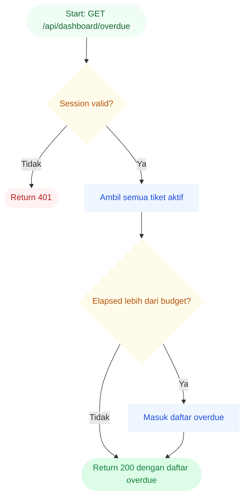

> **Preview:** [View diagram](https://mermaid.live/view#base64:Zmxvd2NoYXJ0IFRECiAgICBGMShbU3RhcnQ6IEdFVCAvYXBpL2Rhc2hib2FyZC9vdmVyZHVlXSk6Ojp0ZXJtaW5hbAogICAgRjJ7U2Vzc2lvbiB2YWxpZD99Ojo6ZGVjaXNpb24KICAgIEYzKFtSZXR1cm4gNDAxXSk6OjpkYW5nZXIKICAgIEY0W0FtYmlsIHNlbXVhIHRpa2V0IGFrdGlmXTo6OmluZm8KICAgIEY1e0VsYXBzZWQgbGViaWggZGFyaSBidWRnZXQ/fTo6OmRlY2lzaW9uCiAgICBGNltNYXN1ayBkYWZ0YXIgb3ZlcmR1ZV06OjppbmZvCiAgICBGNyhbUmV0dXJuIDIwMCBkZW5nYW4gZGFmdGFyIG92ZXJkdWVdKTo6OnN1Y2Nlc3MKCiAgICBGMSAtLT4gRjIKICAgIEYyIC0tPnxUaWRha3wgRjMKICAgIEYyIC0tPnxZYXwgRjQKICAgIEY0IC0tPiBGNQogICAgRjUgLS0+fFlhfCBGNgogICAgRjUgLS0+fFRpZGFrfCBGNwogICAgRjYgLS0+IEY3CgogICAgY2xhc3NEZWYgZGVjaXNpb24gIGZpbGw6I0ZGRkJFQixzdHJva2U6I0ZGRkJFQixjb2xvcjojQjQ1MzA5LHN0cm9rZS13aWR0aDowcHgKICAgIGNsYXNzRGVmIHRlcm1pbmFsICBmaWxsOiNGMEZERjQsc3Ryb2tlOiNGMEZERjQsY29sb3I6IzE2NjUzNCxzdHJva2Utd2lkdGg6MHB4CiAgICBjbGFzc0RlZiBzdWNjZXNzICAgZmlsbDojRENGQ0U3LHN0cm9rZTojRENGQ0U3LGNvbG9yOiMxNTgwM0Qsc3Ryb2tlLXdpZHRoOjBweAogICAgY2xhc3NEZWYgZGFuZ2VyICAgIGZpbGw6I0ZFRjJGMixzdHJva2U6I0ZFRjJGMixjb2xvcjojQjkxQzFDLHN0cm9rZS13aWR0aDowcHgKICAgIGNsYXNzRGVmIGluZm8gICAgICBmaWxsOiNFRkY2RkYsc3Ryb2tlOiNFRkY2RkYsY29sb3I6IzFENEVEOCxzdHJva2Utd2lkdGg6MHB4CiAgICBjbGFzc0RlZiBtdXRlZCAgICAgZmlsbDojRjhGQUZDLHN0cm9rZTojRjhGQUZDLGNvbG9yOiM0NzU1Njksc3Ryb2tlLXdpZHRoOjBweAo=)

#### Contract

**Request**

```
// GET /jira-notif/api/dashboard/overdue
// Cookie: session_token=<opaque token>
```

**Response Success**

```json
// HTTP 200
{
  "items": [
    { "issueKey": "OMS-1", "summary": "...", "status": "Code Process", "assigneeEmail": "teammate@esb.co.id", "hasBudgetDetail": true, "storyPoints": 2, "elapsedLabel": "..." }
  ]
}
```

**Response Properties**

| Property | Data Type | Description |
|---|---|---|
| `items[]` | `array` | Tiket aktif yang elapsed-nya sudah lewat budget — `Card` fields + `assigneeEmail` |

**Response Error**

```json
// HTTP 401
{ "error": "unauthorized" }
```

```json
// HTTP 500
{ "error": "failed to load overdue data" }
```

**Error Contract**

| Code | HTTP | Message | Trigger |
|---|---:|---|---|
| `unauthorized` | 401 | unauthorized | Sesi tidak valid |
| `failed to load overdue data` | 500 | failed to load overdue data | `UserDashboardService.GetOverdueView` error |

#### Security

| Guard | Required | Detail |
|---|---|---|
| **Auth** | Yes | Sama seperti Chapter 3 — tiap user terdaftar boleh akses |
| **Signature** | — | Tidak berlaku |
| **Rate-limit** | — | Tidak berlaku |
| **CORS** | — | Tidak berlaku |

#### Validation

**Input Validation** — tidak ada input.

**Service Validation** — tidak ada.

#### Business Logic

1. Panggil `UserDashboardService.GetOverdueView(ctx)` — **tidak berubah**
2. Return 200; error → 500 `failed to load overdue data`

#### Concurrency

Tidak ada.

#### Reliability

Tidak ada.

#### Performance

Tidak ada — sama dengan handler HTML lama.

#### Observability

Tidak ada tambahan.

#### Testing

| No | Type | Scenario | Expected | AC |
|---:|---|---|---|---|
| 1 | Unit | Ada tiket overdue | HTTP 200 dengan items terisi | AC4.1 |
| 2 | Unit | Tidak ada tiket overdue | HTTP 200, `items: []` | AC4.1 |
| 3 | Unit | `GetOverdueView` error | HTTP 500 | — |
| 4 | Unit | Token tidak ada / invalid | HTTP 401 | AC1.6 |

#### Affected Functions

| Status | Function | File | Line | Notes |
|---|---|---|---|---|
| New | `GetOverdue` | `modules/user_dashboard/user_dashboard_handler/user_dashboard_handler_impl.go` | — | Menggantikan `OverdueView` |
| Removed | `OverdueView` | `modules/user_dashboard/user_dashboard_handler/user_dashboard_handler_impl.go` | 143-152 | Diganti `GetOverdue` |
| Modified | `UserDashboardHandler` (interface) | `modules/user_dashboard/user_dashboard_handler/user_dashboard_handler.go` | 5-13 | `OverdueView` → `GetOverdue` |
| Modified | `Router` | `modules/user_dashboard/router.go` | 13-22 | `dashboard.GET("/overdue", ...)` → `api.GET("/overdue", handler.GetOverdue)` |
| Unchanged | `GetOverdueView` | `modules/user_dashboard/user_dashboard_service/user_dashboard_service.go` | 20-22 | Dipanggil persis sama |

#### Task Breakdown

| No | Task | File | AC | SP |
|---|---|---|---|---:|
| T4.1 | **[TDD]** Tulis failing tests: semua skenario dari `#### Testing` chapter ini | `modules/user_dashboard/user_dashboard_handler/user_dashboard_handler_test.go` | AC4.1 | 0.5 |
| 4.1 | Business Logic: `GetOverdue` — panggil service, return JSON | `modules/user_dashboard/user_dashboard_handler/user_dashboard_handler_impl.go` | AC4.1 | 0.5 |
| 4.2 | Router: ganti route lama dengan `GET /api/dashboard/overdue` | `modules/user_dashboard/router.go` | AC4.1 | 0.5 |
| 4.x | **[Dev Test]** — self-test mandiri | - | - | — |
| | **Subtotal Chapter 4** | | | **1.5 SP** |

### API: GET /api/dashboard/admin/users — Admin User List

#### Flowchart — Admin User List

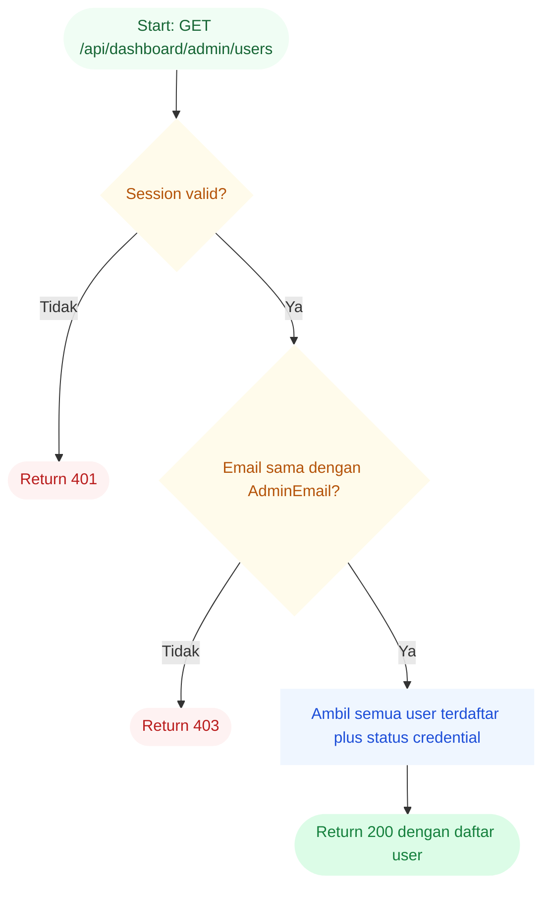

> **Preview:** [View diagram](https://mermaid.live/view#base64:Zmxvd2NoYXJ0IFRECiAgICBGMShbU3RhcnQ6IEdFVCAvYXBpL2Rhc2hib2FyZC9hZG1pbi91c2Vyc10pOjo6dGVybWluYWwKICAgIEYye1Nlc3Npb24gdmFsaWQ/fTo6OmRlY2lzaW9uCiAgICBGMyhbUmV0dXJuIDQwMV0pOjo6ZGFuZ2VyCiAgICBGNHtFbWFpbCBzYW1hIGRlbmdhbiBBZG1pbkVtYWlsP306OjpkZWNpc2lvbgogICAgRjUoW1JldHVybiA0MDNdKTo6OmRhbmdlcgogICAgRjZbQW1iaWwgc2VtdWEgdXNlciB0ZXJkYWZ0YXIgcGx1cyBzdGF0dXMgY3JlZGVudGlhbF06OjppbmZvCiAgICBGNyhbUmV0dXJuIDIwMCBkZW5nYW4gZGFmdGFyIHVzZXJdKTo6OnN1Y2Nlc3MKCiAgICBGMSAtLT4gRjIKICAgIEYyIC0tPnxUaWRha3wgRjMKICAgIEYyIC0tPnxZYXwgRjQKICAgIEY0IC0tPnxUaWRha3wgRjUKICAgIEY0IC0tPnxZYXwgRjYKICAgIEY2IC0tPiBGNwoKICAgIGNsYXNzRGVmIGRlY2lzaW9uICBmaWxsOiNGRkZCRUIsc3Ryb2tlOiNGRkZCRUIsY29sb3I6I0I0NTMwOSxzdHJva2Utd2lkdGg6MHB4CiAgICBjbGFzc0RlZiB0ZXJtaW5hbCAgZmlsbDojRjBGREY0LHN0cm9rZTojRjBGREY0LGNvbG9yOiMxNjY1MzQsc3Ryb2tlLXdpZHRoOjBweAogICAgY2xhc3NEZWYgc3VjY2VzcyAgIGZpbGw6I0RDRkNFNyxzdHJva2U6I0RDRkNFNyxjb2xvcjojMTU4MDNELHN0cm9rZS13aWR0aDowcHgKICAgIGNsYXNzRGVmIGRhbmdlciAgICBmaWxsOiNGRUYyRjIsc3Ryb2tlOiNGRUYyRjIsY29sb3I6I0I5MUMxQyxzdHJva2Utd2lkdGg6MHB4CiAgICBjbGFzc0RlZiBpbmZvICAgICAgZmlsbDojRUZGNkZGLHN0cm9rZTojRUZGNkZGLGNvbG9yOiMxRDRFRDgsc3Ryb2tlLXdpZHRoOjBweAogICAgY2xhc3NEZWYgbXV0ZWQgICAgIGZpbGw6I0Y4RkFGQyxzdHJva2U6I0Y4RkFGQyxjb2xvcjojNDc1NTY5LHN0cm9rZS13aWR0aDowcHgK)

#### Contract

**Request**

```
// GET /jira-notif/api/dashboard/admin/users
// Cookie: session_token=<opaque token> (harus milik AdminEmail)
```

**Response Success**

```json
// HTTP 200
{
  "users": [
    {
      "userID": 2,
      "email": "dev@esb.co.id",
      "userName": "Dev",
      "flagActive": true,
      "createdDate": "2026-10-01T08:00:00+07:00",
      "jiraAccountID": "abc123",
      "hasCredential": true,
      "credentialMasked": "••••••••ab3f"
    }
  ]
}
```

**Response Properties**

| Property | Data Type | Description |
|---|---|---|
| `users[]` | `array` | Field sama persis dengan `admin_dashboard_dto.UserRow` |

**Response Error**

```json
// HTTP 401
{ "error": "unauthorized" }
```

```json
// HTTP 403 (body kosong — AdminMiddleware sudah begini sejak awal, Angular cukup cek status code)
```

```json
// HTTP 500
{ "error": "Gagal memuat daftar user, coba lagi" }
```

**Error Contract**

| Code | HTTP | Message | Trigger |
|---|---:|---|---|
| `unauthorized` | 401 | unauthorized | Sesi tidak valid |
| — | 403 | (empty body) | `email` sesi bukan `cfg.AdminEmail` — `AdminMiddleware`, tidak berubah dari sebelumnya |
| `Gagal memuat daftar user, coba lagi` | 500 | Gagal memuat daftar user, coba lagi | `AdminDashboardService.ListUsers` error |

#### Security

| Guard | Required | Detail |
|---|---|---|
| **Auth** | Yes | Sama seperti chapter lain |
| **Signature** | — | Tidak berlaku |
| **Rate-limit** | — | Tidak berlaku |
| **CORS** | — | Tidak berlaku |

> Endpoint ini **juga** dilindungi `AdminMiddleware` (403 untuk non-admin) — tidak berubah dari implementasi yang sudah ada, didaftarkan lagi di sini karena berlaku untuk endpoint baru ini.

#### Validation

**Input Validation** — tidak ada input.

**Service Validation** — dicek lewat `AdminMiddleware` (sudah ada): `session.Email != cfg.AdminEmail` → 403.

#### Business Logic

1. `AdminMiddleware` sudah memvalidasi pemanggil adalah admin sebelum handler ini jalan
2. Panggil `AdminDashboardService.ListUsers(ctx)` — **tidak berubah**
3. Return 200; error → 500

#### Concurrency

Tidak ada.

#### Reliability

Tidak ada.

#### Performance

Tidak ada — jumlah user terdaftar kecil (puluhan), tidak perlu pagination.

#### Observability

Tidak ada tambahan.

#### Testing

| No | Type | Scenario | Expected | AC |
|---:|---|---|---|---|
| 1 | Unit | Admin, ada user dengan dan tanpa credential | HTTP 200, field `hasCredential`/`credentialMasked` sesuai | AC7.1 |
| 2 | Unit | Non-admin | HTTP 403 | AC1.7 |
| 3 | Unit | Token tidak ada / invalid | HTTP 401 | AC1.6 |
| 4 | Unit | `ListUsers` error | HTTP 500 | — |

#### Affected Functions

| Status | Function | File | Line | Notes |
|---|---|---|---|---|
| New | `ListUsers` (handler) | `modules/admin_dashboard/admin_dashboard_handler/admin_dashboard_handler_impl.go` | — | Menggantikan `UserList` — return JSON. Nama method sengaja sama dengan service-nya (`AdminDashboardService.ListUsers`) karena beda package, tidak ambigu |
| Removed | `UserList` | `modules/admin_dashboard/admin_dashboard_handler/admin_dashboard_handler_impl.go` | 44-52 | Diganti `ListUsers` |
| Modified | `AdminDashboardHandler` (interface) | `modules/admin_dashboard/admin_dashboard_handler/admin_dashboard_handler.go` | 5-12 | `UserList` → `ListUsers` |
| Modified | `Router` | `modules/admin_dashboard/router.go` | 15-22 | `group.GET("", handler.UserList)` → `group.GET("/users", handler.ListUsers)` |
| Unchanged | `ListUsers` (service) | `modules/admin_dashboard/admin_dashboard_service/admin_dashboard_service.go` | 16 | Dipanggil persis sama |

#### Task Breakdown

| No | Task | File | AC | SP |
|---|---|---|---|---:|
| T5.1 | **[TDD]** Tulis failing tests: semua skenario dari `#### Testing` chapter ini | `modules/admin_dashboard/admin_dashboard_handler/admin_dashboard_handler_test.go` | AC7.1, AC1.7 | 0.5 |
| 5.1 | Business Logic: `ListUsers` handler — panggil service, return JSON | `modules/admin_dashboard/admin_dashboard_handler/admin_dashboard_handler_impl.go` | AC7.1 | 0.5 |
| 5.2 | Router: ganti route lama dengan `GET /api/dashboard/admin/users`, pastikan tetap di bawah `AdminMiddleware` | `modules/admin_dashboard/router.go` | AC1.7, AC7.1 | 0.5 |
| 5.x | **[Dev Test]** — self-test mandiri | - | - | — |
| | **Subtotal Chapter 5** | | | **1.5 SP** |

### API: GET /api/dashboard/report — Sprint Report

#### Flowchart — Sprint Report

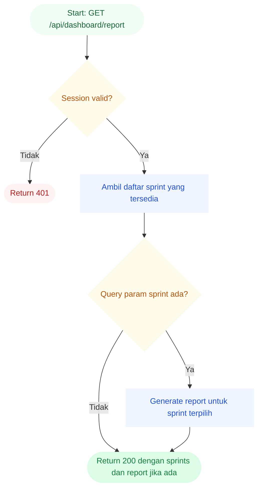

> **Preview:** [View diagram](https://mermaid.live/view#base64:Zmxvd2NoYXJ0IFRECiAgICBGMShbU3RhcnQ6IEdFVCAvYXBpL2Rhc2hib2FyZC9yZXBvcnRdKTo6OnRlcm1pbmFsCiAgICBGMntTZXNzaW9uIHZhbGlkP306OjpkZWNpc2lvbgogICAgRjMoW1JldHVybiA0MDFdKTo6OmRhbmdlcgogICAgRjRbQW1iaWwgZGFmdGFyIHNwcmludCB5YW5nIHRlcnNlZGlhXTo6OmluZm8KICAgIEY1e1F1ZXJ5IHBhcmFtIHNwcmludCBhZGE/fTo6OmRlY2lzaW9uCiAgICBGNltHZW5lcmF0ZSByZXBvcnQgdW50dWsgc3ByaW50IHRlcnBpbGloXTo6OmluZm8KICAgIEY3KFtSZXR1cm4gMjAwIGRlbmdhbiBzcHJpbnRzIGRhbiByZXBvcnQgamlrYSBhZGFdKTo6OnN1Y2Nlc3MKCiAgICBGMSAtLT4gRjIKICAgIEYyIC0tPnxUaWRha3wgRjMKICAgIEYyIC0tPnxZYXwgRjQKICAgIEY0IC0tPiBGNQogICAgRjUgLS0+fFRpZGFrfCBGNwogICAgRjUgLS0+fFlhfCBGNgogICAgRjYgLS0+IEY3CgogICAgY2xhc3NEZWYgZGVjaXNpb24gIGZpbGw6I0ZGRkJFQixzdHJva2U6I0ZGRkJFQixjb2xvcjojQjQ1MzA5LHN0cm9rZS13aWR0aDowcHgKICAgIGNsYXNzRGVmIHRlcm1pbmFsICBmaWxsOiNGMEZERjQsc3Ryb2tlOiNGMEZERjQsY29sb3I6IzE2NjUzNCxzdHJva2Utd2lkdGg6MHB4CiAgICBjbGFzc0RlZiBzdWNjZXNzICAgZmlsbDojRENGQ0U3LHN0cm9rZTojRENGQ0U3LGNvbG9yOiMxNTgwM0Qsc3Ryb2tlLXdpZHRoOjBweAogICAgY2xhc3NEZWYgZGFuZ2VyICAgIGZpbGw6I0ZFRjJGMixzdHJva2U6I0ZFRjJGMixjb2xvcjojQjkxQzFDLHN0cm9rZS13aWR0aDowcHgKICAgIGNsYXNzRGVmIGluZm8gICAgICBmaWxsOiNFRkY2RkYsc3Ryb2tlOiNFRkY2RkYsY29sb3I6IzFENEVEOCxzdHJva2Utd2lkdGg6MHB4CiAgICBjbGFzc0RlZiBtdXRlZCAgICAgZmlsbDojRjhGQUZDLHN0cm9rZTojRjhGQUZDLGNvbG9yOiM0NzU1Njksc3Ryb2tlLXdpZHRoOjBweAo=)

#### Contract

**Request**

```
// GET /jira-notif/api/dashboard/report?sprint=Sprint+42&sprint=Sprint+43&cap=12
// Cookie: session_token=<opaque token>
// Query params:
//   sprint (optional, repeatable) — nama sprint yang dipilih; kosong = belum generate
//   cap (optional, number) — persentase cap deviation, default 12 (defaultCapPercent)
```

**Response Success — tanpa `sprint` (initial load)**

```json
// HTTP 200
{
  "availableSprints": ["Sprint 42", "Sprint 43", "Sprint 44"],
  "capPercent": 12,
  "report": null
}
```

**Response Success — dengan `sprint`**

```json
// HTTP 200
{
  "availableSprints": ["Sprint 42", "Sprint 43", "Sprint 44"],
  "capPercent": 12,
  "report": {
    "rows": [
      { "sprintName": "Sprint 42", "issueKey": "OMS-1", "task": "...", "estimatedHours": 8, "actualHours": 7.5, "deviationPercent": -6.25, "within": true }
    ],
    "sumEstimatedHours": 8,
    "sumActualHours": 7.5,
    "aggregateDeviationPercent": -6.25,
    "achievementPercent": 100,
    "capPercent": 12,
    "withinCount": 1,
    "totalCount": 1
  }
}
```

**Response Properties**

| Property | Data Type | Description |
|---|---|---|
| `availableSprints[]` | `string[]` | Daftar nama sprint untuk checkbox picker |
| `capPercent` | `number` | Cap deviation yang dipakai (dari query `?cap=` atau default 12) |
| `report` | `object \| null` | `null` jika belum ada `sprint` dipilih; isi field sama dengan `sprint_report_dto.Report` jika ada |

**Response Error**

```json
// HTTP 401
{ "error": "unauthorized" }
```

```json
// HTTP 500
{ "error": "failed to load sprint list" }
```

```json
// HTTP 500
{ "error": "failed to generate report" }
```

**Error Contract**

| Code | HTTP | Message | Trigger |
|---|---:|---|---|
| `unauthorized` | 401 | unauthorized | Sesi tidak valid |
| `failed to load sprint list` | 500 | failed to load sprint list | `SprintReportService.ListAvailableSprints` error |
| `failed to generate report` | 500 | failed to generate report | `SprintReportService.GenerateReport` error (hanya dicek jika `sprint` ada) |

#### Security

| Guard | Required | Detail |
|---|---|---|
| **Auth** | Yes | Sama seperti chapter lain |
| **Signature** | — | Tidak berlaku |
| **Rate-limit** | — | Tidak berlaku |
| **CORS** | — | Tidak berlaku |

#### Validation

**Input Validation**

| Field | Required | Data Type | Validation Rules | Example |
|---|---|---|---|---|
| `sprint` | Optional | `string[]` (query, repeatable) | Tidak ada validasi format — nama sprint divalidasi implisit lewat hasil `GenerateReport` (sprint tidak dikenal = baris kosong, bukan error) | `?sprint=Sprint+42` |
| `cap` | Optional | `number` (query) | Jika tidak bisa di-parse sebagai angka atau &lt;= 0, fallback ke `defaultCapPercent` (12) — **perilaku ini sudah ada di handler lama, tidak berubah** | `?cap=15` |

**Service Validation** — tidak ada state/keberadaan yang perlu dicek (perilaku sama dengan handler lama: sprint yang tidak ada datanya cukup menghasilkan baris kosong, bukan error).

#### Business Logic

1. Panggil `SprintReportService.ListAvailableSprints(ctx)` — **tidak berubah**. Error → 500 `failed to load sprint list`
2. Parse `cap` dari query, fallback ke `defaultCapPercent` jika tidak valid — **logic sama persis dengan `sprintReportHandlerImpl.Report` yang sekarang** (`strconv.ParseFloat`)
3. Jika query `sprint` tidak ada sama sekali → `report: null`, return 200
4. Jika ada → panggil `SprintReportService.GenerateReport(ctx, selected, capPercent)` — **tidak berubah**. Error → 500 `failed to generate report`
5. Return 200 dengan `availableSprints`, `capPercent`, `report`

#### Concurrency

Tidak ada.

#### Reliability

Tidak ada — dua pemanggilan service independen (list sprint lalu generate report), tidak ada state yang ditulis.

#### Performance

Tidak ada — logic dan query sama persis dengan handler HTML lama yang sudah berjalan.

#### Observability

Tidak ada tambahan.

#### Testing

| No | Type | Scenario | Expected | AC |
|---:|---|---|---|---|
| 1 | Unit | Tanpa query `sprint` | HTTP 200, `report: null`, `availableSprints` terisi | AC9.1 |
| 2 | Unit | Dengan 1+ `sprint` valid | HTTP 200, `report` terisi lengkap | AC9.2 |
| 3 | Unit | `cap` tidak valid (huruf, negatif) | Fallback ke default 12 | AC9.2 |
| 4 | Unit | `ListAvailableSprints` error | HTTP 500 `failed to load sprint list` | — |
| 5 | Unit | `GenerateReport` error | HTTP 500 `failed to generate report` | — |
| 6 | Unit | Token tidak ada / invalid | HTTP 401 | AC1.6 |

#### Affected Functions

| Status | Function | File | Line | Notes |
|---|---|---|---|---|
| New | `GetReport` | `modules/sprint_report/sprint_report_handler/sprint_report_handler_impl.go` | — | Menggantikan `Report` — return JSON |
| Removed | `Report` | `modules/sprint_report/sprint_report_handler/sprint_report_handler_impl.go` | 61-91 | Diganti `GetReport` |
| Modified | `SprintReportHandler` (interface) | `modules/sprint_report/sprint_report_handler/sprint_report_handler.go` | 1-5 | `Report` → `GetReport` |
| Modified | `Router` | `modules/sprint_report/router.go` | 9-11 | `dashboard.GET("/report", ...)` → `api.GET("/report", handler.GetReport)` |
| Unchanged | `ListAvailableSprints` | `modules/sprint_report/sprint_report_service/sprint_report_service.go` | 13 | Dipanggil persis sama |
| Unchanged | `GenerateReport` | `modules/sprint_report/sprint_report_service/sprint_report_service.go` | 16 | Dipanggil persis sama |

#### Task Breakdown

| No | Task | File | AC | SP |
|---|---|---|---|---:|
| T6.1 | **[TDD]** Tulis failing tests: semua skenario dari `#### Testing` chapter ini | `modules/sprint_report/sprint_report_handler/sprint_report_handler_test.go` | AC9.1, AC9.2 | 0.5 |
| 6.1 | Business Logic: `GetReport` — list sprint, parse cap, generate report kondisional, return JSON | `modules/sprint_report/sprint_report_handler/sprint_report_handler_impl.go` | AC9.1, AC9.2 | 1 |
| 6.2 | Router: ganti route lama dengan `GET /api/dashboard/report` | `modules/sprint_report/router.go` | AC9.1 | 0.5 |
| 6.x | **[Dev Test]** — self-test mandiri | - | - | — |
| | **Subtotal Chapter 6** | | | **2 SP** |

### Other: Build & Deploy Integration — Embed + Catch-All Shell (Chapter 7a)

> Chapter ini bukan endpoint HTTP — ini perubahan infrastruktur build & routing yang membuat seluruh chapter di atas dan di Repository 2 bisa jalan bersamaan dalam satu binary. Ditempatkan di kategori "Other" sesuai urutan List→Detail→Create→Update→Delete→Other.
>
> Dipecah jadi 7a (embed + router shell) dan 7b (auth callback redirect + cleanup + deploy workflow) karena gabungan implementation task-nya melebihi cap 3 SP per chapter.

#### Flowchart — Build & Deploy

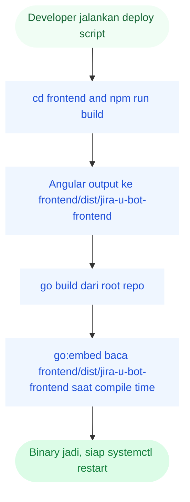

> **Preview:** [View diagram](https://mermaid.live/view#base64:Zmxvd2NoYXJ0IFRECiAgICBBKFtEZXZlbG9wZXIgamFsYW5rYW4gZGVwbG95IHNjcmlwdF0pOjo6dGVybWluYWwgLS0+IEJbY2QgZnJvbnRlbmQgYW5kIG5wbSBydW4gYnVpbGRdOjo6aW5mbwogICAgQiAtLT4gQ1tBbmd1bGFyIG91dHB1dCBrZSBmcm9udGVuZC9kaXN0L2ppcmEtdS1ib3QtZnJvbnRlbmRdOjo6aW5mbwogICAgQyAtLT4gRFtnbyBidWlsZCBkYXJpIHJvb3QgcmVwb106OjppbmZvCiAgICBEIC0tPiBFW2dvOmVtYmVkIGJhY2EgZnJvbnRlbmQvZGlzdC9qaXJhLXUtYm90LWZyb250ZW5kIHNhYXQgY29tcGlsZSB0aW1lXTo6OmluZm8KICAgIEUgLS0+IEYoW0JpbmFyeSBqYWRpLCBzaWFwIHN5c3RlbWN0bCByZXN0YXJ0XSk6OjpzdWNjZXNzCgogICAgY2xhc3NEZWYgZGVjaXNpb24gIGZpbGw6I0ZGRkJFQixzdHJva2U6I0ZGRkJFQixjb2xvcjojQjQ1MzA5LHN0cm9rZS13aWR0aDowcHgKICAgIGNsYXNzRGVmIHRlcm1pbmFsICBmaWxsOiNGMEZERjQsc3Ryb2tlOiNGMEZERjQsY29sb3I6IzE2NjUzNCxzdHJva2Utd2lkdGg6MHB4CiAgICBjbGFzc0RlZiBzdWNjZXNzICAgZmlsbDojRENGQ0U3LHN0cm9rZTojRENGQ0U3LGNvbG9yOiMxNTgwM0Qsc3Ryb2tlLXdpZHRoOjBweAogICAgY2xhc3NEZWYgZGFuZ2VyICAgIGZpbGw6I0ZFRjJGMixzdHJva2U6I0ZFRjJGMixjb2xvcjojQjkxQzFDLHN0cm9rZS13aWR0aDowcHgKICAgIGNsYXNzRGVmIGluZm8gICAgICBmaWxsOiNFRkY2RkYsc3Ryb2tlOiNFRkY2RkYsY29sb3I6IzFENEVEOCxzdHJva2Utd2lkdGg6MHB4CiAgICBjbGFzc0RlZiBtdXRlZCAgICAgZmlsbDojRjhGQUZDLHN0cm9rZTojRjhGQUZDLGNvbG9yOiM0NzU1Njksc3Ryb2tlLXdpZHRoOjBweAo=)

#### Contract

Tidak ada — bukan HTTP endpoint, ini proses build time dan satu handler catch-all (lihat Business Logic).

#### Security

| Guard | Required | Detail |
|---|---|---|
| **Auth** | No | Shell (`index.html` + static assets JS/CSS) harus bisa diakses **tanpa login** — Angular sendiri yang menampilkan Login Screen atau Dashboard berdasarkan hasil `GET /api/auth/me` (lihat Repository 2, Chapter 1). Tidak ada data sensitif di static assets. |
| **Signature** | — | Tidak berlaku |
| **Rate-limit** | — | Tidak berlaku |
| **CORS** | — | Tidak berlaku |

#### Validation

Tidak ada — tidak ada input user di layer ini.

#### Business Logic

1. **Build**: `frontend/` punya `package.json` Angular standar — `npm run build` menghasilkan static files di `frontend/dist/jira-u-bot-frontend/`
2. **Embed**: file baru `webapp/embed.go` (package `webapp`) men-declare `//go:embed dist` yang menunjuk ke hasil build Angular (disalin/dikonfigurasi lewat path relatif saat build, bukan folder `frontend/dist` langsung di-embed dari luar module path Go — detail path final ditentukan saat implementasi, lihat Task Breakdown)
3. **Routing** (`router.go`, top-level): `SetupRouter` dirombak —
   - Hapus: `dashboardPages` group + `AuthMiddleware` di level page (AC1.1, AC1.5 — proteksi pindah ke level API, bukan page)
   - Hapus: `redirectToDashboardHandler`, `notFoundHandler`, `notFoundTemplate`, konstanta `notFoundHTML` (digantikan Angular Router, lihat Repository 2 UI Flowchart)
   - Tambah: 1 handler catch-all (misal nama `serveShell`) yang men-serve `index.html` dari `webapp.FS` untuk **semua** path GET di bawah `cfg.BasePath` yang bukan `/api/*` dan bukan `/auth/google/*` dan bukan static asset Angular sendiri (JS/CSS/dll, di-serve langsung dari `webapp.FS` sesuai path aslinya)
   - Tambah: grup `/api/auth` dengan `AuthMiddleware` (lihat Backend Chapter 1)

> Perubahan "Auth callback redirect ke error" (poin 4 di versi sebelumnya) dipindah ke Chapter 7b bersama cleanup template dan update deploy workflow — lihat di bawah.

#### Concurrency

Tidak ada — static file serving dan routing, tidak ada write/race condition.

#### Reliability

Tidak ada — tidak ada external call, `go:embed` resolve saat compile time (gagal build jika folder tidak ada, bukan gagal saat runtime).

#### Performance

Tidak ada — static file serving dari memory (embed), bukan disk I/O per request.

#### Observability

Tidak ada tambahan — tidak ada logic baru yang perlu di-trace di luar yang sudah dicatat `gin.Logger()`.

#### Testing

| No | Type | Scenario | Expected | AC |
|---:|---|---|---|---|
| 1 | Unit | GET path apapun di bawah BasePath yang bukan `/api/*` atau `/auth/google/*` | Return `index.html` (shell), status 200 | AC10.1 |
| 2 | Unit | GET asset statis Angular (misal `/main.js`) | Return isi file asli dengan content-type benar, bukan `index.html` | AC10.1 |
| 3 | Integration | `go build ./...` dari root repo setelah `npm run build` di `frontend/` | Build sukses, binary memuat static assets Angular | AC10.1, AC10.2 |

#### Affected Functions

| Status | Function | File | Line | Notes |
|---|---|---|---|---|
| New | `serveShell` | `router.go` | — | Handler catch-all baru, serve `index.html` dari `webapp.FS` |
| New | `webapp.FS` (var) | `webapp/embed.go` | — | `//go:embed` hasil build Angular |
| Removed | `redirectToDashboardHandler` | `router.go` | 66-70 | Digantikan Angular Router (route `/` menampilkan Dashboard Shell atau Login Screen, bukan redirect server-side) |
| Removed | `notFoundHandler`, `notFoundTemplate`, `notFoundHTML` | `router.go` | 72-112 | Digantikan Angular Router 404 handling (client-side) |
| Modified | `SetupRouter` | `router.go` | 27-64 | Hapus `dashboardPages` group + `AuthMiddleware` di level page, tambah `serveShell` catch-all dan grup `/api/auth` |

#### Task Breakdown

| No | Task | File | AC | SP |
|---|---|---|---|---:|
| T7a.1 | **[TDD]** Tulis failing tests: semua skenario dari `#### Testing` chapter ini | `main_test.go` | AC10.1 | 0.5 |
| 7a.1 | Setup: inisialisasi project Angular baru di `frontend/` (`ng new`, standalone, routing) — bukan business logic, murni scaffolding | `frontend/package.json`, `frontend/angular.json` | AC10.1 | 1 |
| 7a.2 | Embed: buat `webapp/embed.go` dengan `//go:embed` mengarah ke hasil build Angular | `webapp/embed.go` | AC10.1, AC10.2 | 1 |
| 7a.3 | Router: rombak `SetupRouter` — hapus page-serving lama, tambah `serveShell` catch-all + grup `/api/auth` | `router.go` | AC10.1 | 1 |
| 7a.x | **[Dev Test]** — self-test mandiri: `npm run build` lalu `go build` dari awal tanpa cache, jalankan binary, akses semua route manual di browser | - | - | — |
| | **Subtotal Chapter 7a** | | | **3.5 SP** |

### Other: Build & Deploy Integration — Auth Redirect, Cleanup & Deploy Workflow (Chapter 7b)

#### Business Logic

1. **Auth callback redirect ke error** (`modules/auth/auth_handler/auth_handler_impl.go`, method `Callback`): baris yang sebelumnya `h.renderLoginPage(c, "pesan error")` diganti `c.Redirect(302, h.basePath+"/?error="+url.QueryEscape(pesan))` di semua error branch — Angular membaca query param `error` di Login Screen (lihat Repository 2, Chapter 1)
2. **Cleanup**: hapus seluruh template HTML dan `embed.go` yang sudah tidak dipakai (digantikan Chapter 7a + Repository 2)
3. **Deploy workflow**: `.github/workflows/deploy.yml` dapat step baru `npm ci && npm run build` di `frontend/`, dijalankan sebelum `go build` di server

#### Testing

| No | Type | Scenario | Expected | AC |
|---:|---|---|---|---|
| 1 | Unit | Callback OAuth gagal dengan pesan error | Redirect 302 ke `{BasePath}/?error=<pesan ter-encode>` | AC1.3 |
| 2 | Integration | Deploy script di `deploy.yml` menjalankan `npm run build` sebelum `go build` | Urutan step benar, build gagal-cepat (fail fast) jika `npm run build` gagal | AC10.2 |

#### Affected Functions

| Status | Function | File | Line | Notes |
|---|---|---|---|---|
| Modified | `Callback` | `modules/auth/auth_handler/auth_handler_impl.go` | 76-125 | Ganti `renderLoginPage(c, msg)` jadi redirect ke `{BasePath}/?error=<msg>` di semua error branch |
| Removed | `renderLoginPage`, `loginPageData`, `loginTemplate` field | `modules/auth/auth_handler/auth_handler_impl.go` | 31-33, 136-140 | Tidak ada lagi HTML yang dirender server-side |
| Removed | `modules/auth/templates/login.html`, `embed.go` | `modules/auth/templates/` | — | Template dihapus, tidak dipakai lagi |
| Removed | `modules/user_dashboard/templates/*.html`, `embed.go` | `modules/user_dashboard/templates/` | — | `dashboard.html`, `team.html`, `overdue.html` dihapus |
| Removed | `modules/admin_dashboard/templates/admin.html`, `embed.go` | `modules/admin_dashboard/templates/` | — | Dihapus |
| Removed | `modules/sprint_report/templates/report.html`, `embed.go` | `modules/sprint_report/templates/` | — | Dihapus |
| Modified | `.github/workflows/deploy.yml` | `.github/workflows/deploy.yml` | — | Tambah step build Angular sebelum `go build` |

#### Task Breakdown

| No | Task | File | AC | SP |
|---|---|---|---|---:|
| T7b.1 | **[TDD]** Tulis failing tests: semua skenario dari `#### Testing` chapter ini | `modules/auth/auth_handler/auth_handler_test.go` | AC1.3 | 0.5 |
| 7b.1 | Auth: ubah `Callback` redirect-on-error ke query param, hapus `renderLoginPage`/template | `modules/auth/auth_handler/auth_handler_impl.go` | AC1.3 | 1 |
| 7b.2 | Cleanup: hapus semua file template HTML + `embed.go` yang sudah tidak dipakai | `modules/auth/templates/`, `modules/user_dashboard/templates/`, `modules/admin_dashboard/templates/`, `modules/sprint_report/templates/` | AC10.1 | 0.5 |
| 7b.3 | Deploy: update `.github/workflows/deploy.yml` — tambah step `npm ci && npm run build` di `frontend/` sebelum `go build` | `.github/workflows/deploy.yml` | AC10.2 | 0.5 |
| 7b.x | **[Dev Test]** — self-test mandiri: trigger error login, cek redirect dan pesan tampil benar di Angular | - | - | — |
| | **Subtotal Chapter 7b** | | | **2.5 SP** |

### Integration & E2E Tests

| No | Type | Scenario | Expected |
|---:|---|---|---|
| 1 | E2E | Full flow: login via Google → `GET /api/auth/me` 200 → `GET /api/dashboard/board` 200 → klik aksi transition (endpoint lama, unchanged) → board refresh | Semua langkah sukses, data konsisten |
| 2 | Integration | Non-admin memanggil `GET /api/dashboard/admin/users` | HTTP 403, tidak bisa lihat data user lain |
| 3 | Integration | Sesi expired di tengah pemakaian (cookie masih ada tapi row `tr_usersession` sudah terhapus/expired) → panggil endpoint apapun di `/api/dashboard/*` | HTTP 401 — Angular harus bisa redirect balik ke Login Screen dari kondisi ini (lihat Repository 2, Chapter 1) |
| 4 | Regression | Endpoint POST/DELETE yang sudah ada (preference, transition, credential, admin actions, broadcast) tetap jalan tanpa perubahan | Semua existing test suite (`go test ./...`) tetap PASS tanpa modifikasi test file-nya |

## Repository 2 — jira-u-bot Frontend (Angular, standalone components)

> **Non-Technical Summary:** Ini bagian tampilan baru yang dilihat dan dipakai langsung oleh user — login, lihat tiket, atur reminder, kelola user (admin), dan lihat laporan sprint — semuanya dibangun ulang pakai Angular.

Tidak ada mockup/wireframe untuk revamp ini — chapter di bawah ditulis berdasarkan tampilan HTML yang sudah ada sekarang (termasuk redesign tabel My Board yang baru saja dikerjakan) sebagai referensi Interface, bukan dari desain visual baru.

**Urutan chapter** di bawah ini sengaja menyimpang dari urutan baku List→Create→Update→Action→Custom Flow: **Login/Session Guard diletakkan pertama** karena ini gerbang yang menentukan apakah semua chapter lain bisa diakses sama sekali — bukan halaman CRUD biasa yang punya tempat alami di urutan kategori.

Project Angular baru di `frontend/` (root repo, sejajar `modules/`), **standalone components** (tanpa `NgModule`), mengikuti konvensi terbaru `oms-setting-angular`. Routing `base href` = `/jira-notif/dashboard` untuk route di dalam shell; route Login ada di luar shell (`/jira-notif/` atau path manapun sebelum login).

### UI Flowchart

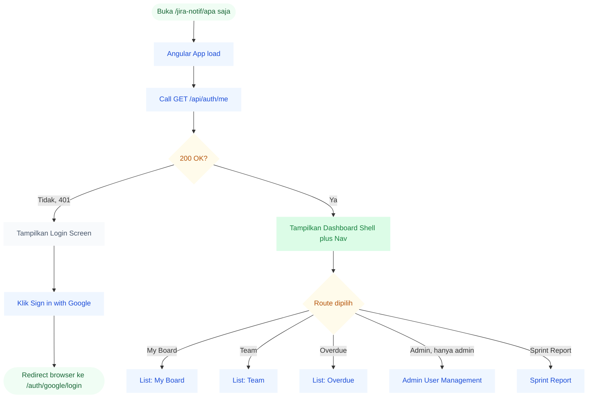

> **Preview:** [View diagram](https://mermaid.live/view#base64:Zmxvd2NoYXJ0IFRECiAgICBBKFtCdWthIC9qaXJhLW5vdGlmL2FwYSBzYWphXSk6Ojp0ZXJtaW5hbCAtLT4gQltBbmd1bGFyIEFwcCBsb2FkXTo6OmluZm8KICAgIEIgLS0+IENbQ2FsbCBHRVQgL2FwaS9hdXRoL21lXTo6OmluZm8KICAgIEMgLS0+IER7MjAwIE9LP306OjpkZWNpc2lvbgogICAgRCAtLT58VGlkYWssIDQwMXwgRVtUYW1waWxrYW4gTG9naW4gU2NyZWVuXTo6Om11dGVkCiAgICBFIC0tPiBGW0tsaWsgU2lnbiBpbiB3aXRoIEdvb2dsZV06OjppbmZvCiAgICBGIC0tPiBHKFtSZWRpcmVjdCBicm93c2VyIGtlIC9hdXRoL2dvb2dsZS9sb2dpbl0pOjo6dGVybWluYWwKICAgIEQgLS0+fFlhfCBIW1RhbXBpbGthbiBEYXNoYm9hcmQgU2hlbGwgcGx1cyBOYXZdOjo6c3VjY2VzcwogICAgSCAtLT4gSXtSb3V0ZSBkaXBpbGlofTo6OmRlY2lzaW9uCiAgICBJIC0tPnxNeSBCb2FyZHwgSltMaXN0OiBNeSBCb2FyZF06OjppbmZvCiAgICBJIC0tPnxUZWFtfCBLW0xpc3Q6IFRlYW1dOjo6aW5mbwogICAgSSAtLT58T3ZlcmR1ZXwgTFtMaXN0OiBPdmVyZHVlXTo6OmluZm8KICAgIEkgLS0+fEFkbWluLCBoYW55YSBhZG1pbnwgTVtBZG1pbiBVc2VyIE1hbmFnZW1lbnRdOjo6aW5mbwogICAgSSAtLT58U3ByaW50IFJlcG9ydHwgTltTcHJpbnQgUmVwb3J0XTo6OmluZm8KCiAgICBjbGFzc0RlZiBkZWNpc2lvbiAgZmlsbDojRkZGQkVCLHN0cm9rZTojRkZGQkVCLGNvbG9yOiNCNDUzMDksc3Ryb2tlLXdpZHRoOjBweAogICAgY2xhc3NEZWYgdGVybWluYWwgIGZpbGw6I0YwRkRGNCxzdHJva2U6I0YwRkRGNCxjb2xvcjojMTY2NTM0LHN0cm9rZS13aWR0aDowcHgKICAgIGNsYXNzRGVmIHN1Y2Nlc3MgICBmaWxsOiNEQ0ZDRTcsc3Ryb2tlOiNEQ0ZDRTcsY29sb3I6IzE1ODAzRCxzdHJva2Utd2lkdGg6MHB4CiAgICBjbGFzc0RlZiBkYW5nZXIgICAgZmlsbDojRkVGMkYyLHN0cm9rZTojRkVGMkYyLGNvbG9yOiNCOTFDMUMsc3Ryb2tlLXdpZHRoOjBweAogICAgY2xhc3NEZWYgaW5mbyAgICAgIGZpbGw6I0VGRjZGRixzdHJva2U6I0VGRjZGRixjb2xvcjojMUQ0RUQ4LHN0cm9rZS13aWR0aDowcHgKICAgIGNsYXNzRGVmIG11dGVkICAgICBmaWxsOiNGOEZBRkMsc3Ryb2tlOiNGOEZBRkMsY29sb3I6IzQ3NTU2OSxzdHJva2Utd2lkdGg6MHB4Cg==)

### Custom Flow: Login / Session Guard

#### 1. Interface

- Logo Jira U Bot + judul "Jira U Bot Dashboard" (reuse styling dari `login.html` lama: gradient background, card putih rounded, badge logo+🤖)
- Subtitle: "Login pakai akun Google kantor (@esb.co.id) untuk lihat tiket, atur reminder, dan lainnya."
- Alert box merah (kondisional) — tampil jika ada query param `error` di URL
- Tombol "Sign in with Google" — gradient biru-hijau, **elemen `<a>` biasa** (bukan `<button>` dengan click handler), `href="/jira-notif/auth/google/login"`
- Footer note: "Khusus email @esb.co.id"
- State loading singkat saat `AuthGuard` masih menunggu response `GET /api/auth/me` (spinner sederhana atau blank, karena ini cuma sepersekian detik)

#### 2. Component / Logic

**Conditional Render & Other Logic**
- Alert box merah tampil hanya jika `ActivatedRoute.snapshot.queryParamMap.get('error')` tidak kosong — pesan errornya ditampilkan apa adanya (sudah di-generate server-side dengan bahasa yang sama persis dengan `login.html` lama: "Login hanya untuk email @esb.co.id yang terverifikasi Google", "Sesi login tidak valid atau kedaluwarsa, coba lagi", dsb — lihat Chapter 1 backend untuk daftar lengkap pesan)
- Tombol Sign in with Google **tidak pernah** dipanggil lewat `HttpClient`/`fetch` — ini **harus** navigasi browser asli, karena OAuth butuh redirect sungguhan ke `accounts.google.com`, bukan panggilan AJAX dari origin aplikasi

#### Flow

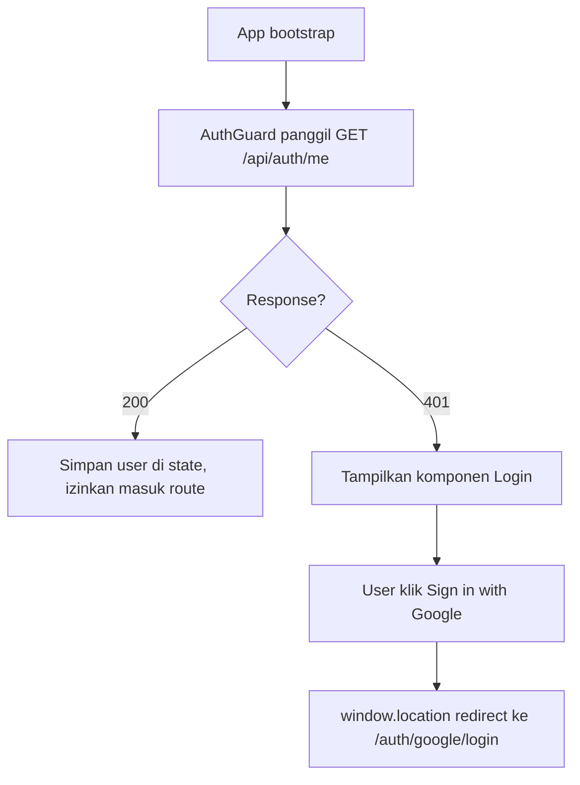

> **Preview:** [View diagram](https://mermaid.live/view#base64:Zmxvd2NoYXJ0IFRECiAgICBBW0FwcCBib290c3RyYXBdIC0tPiBCW0F1dGhHdWFyZCBwYW5nZ2lsIEdFVCAvYXBpL2F1dGgvbWVdCiAgICBCIC0tPiBDe1Jlc3BvbnNlP30KICAgIEMgLS0+fDIwMHwgRFtTaW1wYW4gdXNlciBkaSBzdGF0ZSwgaXppbmthbiBtYXN1ayByb3V0ZV0KICAgIEMgLS0+fDQwMXwgRVtUYW1waWxrYW4ga29tcG9uZW4gTG9naW5dCiAgICBFIC0tPiBGW1VzZXIga2xpayBTaWduIGluIHdpdGggR29vZ2xlXQogICAgRiAtLT4gR1t3aW5kb3cubG9jYXRpb24gcmVkaXJlY3Qga2UgL2F1dGgvZ29vZ2xlL2xvZ2luXQo=)

#### 3. State Management

- `AuthService.currentUser$: BehaviorSubject<{email: string, isAdmin: boolean} | null>` — (default: `null`)
- `AuthService.checked: boolean` — (default: `false`) — jadi `true` setelah `GET /api/auth/me` pertama kali selesai (dicek sekali saja per page load, bukan di-poll)
- `loginError: string | null` — di komponen Login, dari query param — (default: `null`)

#### 4. Integration

GET /api/auth/me

Purpose: Cek status login saat app pertama kali dimuat, dipanggil oleh `AuthGuard` sebelum route manapun diaktifkan.

Response Handling:
- Success 200: simpan `{email, isAdmin}` ke `AuthService.currentUser$`, `AuthGuard` mengizinkan navigasi ke route yang dituju
- Error 401: `AuthGuard` redirect ke route Login (tidak menampilkan apapun dari route tujuan)
- Error lain (500, network): tampilkan Login juga (fail-safe — tidak ada state "error" terpisah untuk gagal cek sesi, user tinggal coba Sign in lagi)

#### Task Breakdown

| No | Task | File | AC | SP |
|---|---|---|---|---:|
| 1.1 | Interface + Logic: Login component (alert box, tombol Sign in with Google, styling) | `frontend/src/app/features/login/login.component.html`, `login.component.ts` | AC1.3, AC1.4 | 1 |
| 1.2 | State + Integration: `AuthService` (`GET /api/auth/me`, `currentUser$`) + `AuthGuard` | `frontend/src/app/core/services/auth.service.ts`, `frontend/src/app/core/guards/auth.guard.ts` | AC1.2, AC1.5 | 1 |
| 1.3 | Routing: `app.routes.ts` — route Login di luar guard, semua route dashboard di bawah `AuthGuard` | `frontend/src/app/app.routes.ts` | AC1.1, AC1.5 | 0.5 |
| 1.u | **[UI Test]** Login component — tampil normal, tampil dengan error, tombol href benar | `frontend/src/app/features/login/login.component.spec.ts` | AC1.3, AC1.4 | 1 |
| 1.i | **[Integration Test]** `AuthService`/`AuthGuard` — 200 lanjut, 401 redirect ke Login | `frontend/src/app/core/guards/auth.guard.spec.ts` | AC1.2, AC1.5 | 0.5 |
| 1.x | **[Dev Test]** — self-test mandiri di browser: akses tanpa login harus ke Login, setelah login redirect balik ke dashboard | - | - | — |
| | **Subtotal** | | | **4 SP** |

### Update: Reminder Preference

#### 1. Interface

- 6 checkbox (T-2 jam, T-1 jam, T-30 menit, T-15 menit, T-5 menit, T-1 menit) — reuse label yang sama persis dengan `dashboard.html` lama
- Tombol "Simpan Preference"
- Pesan sukses/error di bawah tombol setelah submit

#### 2. Component / Logic

**Form Validation** — tidak ada validasi field (checkbox, semua kombinasi termasuk nol dicentang itu valid — AC5.1 sengaja mengizinkan "tidak pilih tier apapun")

**Submit Behavior**
- Button disabled: `submitting = true` saja (tidak ada state invalid untuk checkbox group)
- On success: tampilkan pesan "Preference tersimpan ✅", `submitting = false`
- On error: tampilkan pesan error, `submitting = false`, checkbox tidak direset

**Conditional Render & Other Logic**
- Checkbox pre-checked sesuai `tierPreference.tiers` dari response `GET /api/dashboard/board` (lihat Chapter 4 — My Board memuat data ini sekaligus, tidak ada panggilan terpisah)

#### 3. State Management

- `form: FormGroup` — 6 `FormControl<boolean>`, satu per tier
- `submitting: boolean` — (default: `false`)
- `message: {text: string, isError: boolean} | null` — (default: `null`)

#### 4. Integration

POST /api/dashboard/preference *(endpoint sudah ada, tidak berubah — lihat Background)*

Request Body: `{ "tiers": string[] }` — array kode tier yang dicentang (bisa kosong)

Response Handling:
- Success 200: tampilkan "Preference tersimpan ✅"
- Error: tampilkan `response.error` atau pesan generik "Gagal menyimpan"

#### Task Breakdown

| No | Task | File | AC | SP |
|---|---|---|---|---:|
| 2.1 | Interface + Logic: form 6 checkbox, pre-check dari data board | `frontend/src/app/features/dashboard/board/reminder-preference.component.html`, `reminder-preference.component.ts` | AC5.1, AC5.2 | 1 |
| 2.2 | State + Integration: submit ke `POST /api/dashboard/preference` | `frontend/src/app/features/dashboard/board/reminder-preference.component.ts` | AC5.1 | 0.5 |
| 2.u | **[UI Test]** Checkbox pre-checked sesuai data, submit menampilkan pesan sukses | `frontend/src/app/features/dashboard/board/reminder-preference.component.spec.ts` | AC5.1, AC5.2 | 0.5 |
| 2.i | **[Integration Test]** POST preference — sukses dan gagal | `frontend/src/app/features/dashboard/board/reminder-preference.component.spec.ts` | AC5.1 | 0.5 |
| 2.x | **[Dev Test]** — self-test mandiri | - | - | — |
| | **Subtotal** | | | **2.5 SP** |

### Create: Jira API Key Pribadi

#### 1. Interface

- Jika belum ada credential: form dengan input "Email Jira kamu" (email) + "API Token" (password), tombol "Simpan", link instruksi bikin token di Atlassian
- Jika sudah ada credential: teks "Aktif — token berakhiran **{masked}**" + tombol "Hapus Credential"

#### 2. Component / Logic

**Form Validation**

| Field | Validators | Error Message | Trigger |
|---|---|---|---|
| `jiraEmail` | `required`, `email` | "Email tidak valid" | onBlur |
| `apiToken` | `required` | "Token wajib diisi" | onBlur |

**Submit Behavior**
- Button disabled: `form.invalid` OR `submitting = true`
- On success: reload data credential dari parent (emit event), form hilang diganti tampilan "Aktif"
- On error 503 (`ErrEncryptionKeyNotConfigured`): tampilkan "fitur ini belum dikonfigurasi server, hubungi admin", `submitting = false`
- On error lain: tampilkan "failed to save credential", `submitting = false`

**Conditional Render & Other Logic**
- Toggle antara form dan tampilan "Aktif" berdasarkan `@Input() hasCredential: boolean` dari parent (data board)

#### 3. State Management

- `form: FormGroup` — `jiraEmail: FormControl<string>`, `apiToken: FormControl<string>`
- `submitting: boolean` — (default: `false`)
- `error: string | null` — (default: `null`)

#### 4. Integration

POST /api/dashboard/credential *(sudah ada, tidak berubah)*

Request Body: `{ "jiraEmail": string, "apiToken": string }`

Response Handling:
- Success 200: emit event ke parent untuk refresh status credential
- Error 400: tampilkan "jiraEmail and apiToken are required"
- Error 503: tampilkan "fitur ini belum dikonfigurasi server, hubungi admin"
- Error lain: tampilkan "failed to save credential"

DELETE /api/dashboard/credential *(sudah ada, tidak berubah)*

Response Handling:
- Success 200: emit event ke parent untuk refresh status credential (kembali ke tampilan form)
- Error: tampilkan "failed to delete credential"

#### Task Breakdown

| No | Task | File | AC | SP |
|---|---|---|---|---:|
| 3.1 | Interface + Logic: form + tampilan Aktif, toggle berdasarkan status | `frontend/src/app/features/dashboard/board/jira-credential.component.html`, `jira-credential.component.ts` | AC6.1, AC6.2 | 1.5 |
| 3.2 | State + Integration: `POST`/`DELETE /api/dashboard/credential` | `frontend/src/app/features/dashboard/board/jira-credential.component.ts` | AC6.1, AC6.2 | 1 |
| 3.u | **[UI Test]** Form tampil saat belum ada credential, tampilan Aktif saat sudah ada | `frontend/src/app/features/dashboard/board/jira-credential.component.spec.ts` | AC6.1, AC6.2 | 1 |
| 3.i | **[Integration Test]** POST sukses/503/error, DELETE sukses | `frontend/src/app/features/dashboard/board/jira-credential.component.spec.ts` | AC6.1, AC6.2 | 1 |
| 3.x | **[Dev Test]** — self-test mandiri | - | - | — |
| | **Subtotal** | | | **4.5 SP** |

### List: My Board

#### 1. Interface

- Tabel dengan kolom: Status (badge), Issue Key, Summary, SP, Elapsed, Sisa, Aksi — **struktur persis sama dengan redesign tabel yang baru saja dikerjakan di `dashboard.html`**, dipindahkan ke komponen Angular
- Kolom SP/Elapsed/Sisa menampilkan "—" untuk tiket yang `hasBudgetDetail = false`
- Dua tombol aksi per baris: "→ Todo" dan "→ Code Review"
- Pesan sukses/error di bawah tabel setelah aksi transition
- Komponen `ReminderPreferenceComponent` dan `JiraCredentialComponent` (Chapter 2 dan 3) dirender di atas tabel ini, di halaman yang sama (sesuai susunan `dashboard.html` lama)

#### 2. Component / Logic

**Conditional Render & Other Logic**
- Baris diurutkan sesuai urutan `columns[]` dari response (grouping status asli dipertahankan, tapi dirender flat sebagai tabel — sama seperti implementasi `dashboard.html` saat ini)
- Tombol aksi disabled sementara (`disabled` state per baris) saat request transition sedang berjalan, supaya tidak double-klik
- Setelah transition sukses, reload data board (panggil ulang `GET /api/dashboard/board`) alih-alih `location.reload()` penuh seperti versi HTML lama

#### 3. State Management

- `board: Board | null` — (default: `null`)
- `loading: boolean` — (default: `true`)
- `error: string | null` — (default: `null`)
- `transitioningIssueKey: string | null` — (default: `null`) — issue key yang tombolnya sedang disabled karena ada request in-flight
- `actionMessage: {text: string, isError: boolean} | null` — (default: `null`)

#### 4. Integration

GET /api/dashboard/board

Purpose: Ambil data board, preference, dan status credential sekaligus (lihat Backend Chapter 2)

Response Handling:
- Mapping `response.columns` ke `board`, `response.tierPreference` diteruskan ke `ReminderPreferenceComponent`, `response.credential` diteruskan ke `JiraCredentialComponent`
- Error 401: ditangani global oleh `AuthGuard`/interceptor (redirect ke Login) — tidak ditangani lokal di komponen ini
- Error lain: tampilkan pesan "Gagal memuat board, coba lagi"

POST /api/dashboard/tickets/:issueKey/transition *(sudah ada, tidak berubah)*

Request Body: `{ "target": "todo" | "code-review" }`

Response Handling:
- Success 200: tampilkan `response.message` sebagai pesan sukses, reload data board
- Error: tampilkan pesan error, tombol kembali aktif

#### Task Breakdown

| No | Task | File | AC | SP |
|---|---|---|---|---:|
| 4.1 | Interface + Logic: tabel board, badge status, dua tombol aksi per baris | `frontend/src/app/features/dashboard/board/board.component.html`, `board.component.ts` | AC2.1, AC2.2 | 1.5 |
| 4.2 | State + Integration: `GET /api/dashboard/board`, `POST .../transition`, reload setelah aksi | `frontend/src/app/features/dashboard/board/board.component.ts` | AC2.1, AC2.3 | 1 |
| 4.u | **[UI Test]** Tabel render data, badge per status, tombol aksi per baris | `frontend/src/app/features/dashboard/board/board.component.spec.ts` | AC2.1, AC2.2 | 1 |
| 4.i | **[Integration Test]** GET board sukses/gagal, POST transition sukses/gagal | `frontend/src/app/features/dashboard/board/board.component.spec.ts` | AC2.1, AC2.3 | 1 |
| 4.x | **[Dev Test]** — self-test mandiri di browser, bandingkan dengan tampilan `dashboard.html` lama | - | - | — |
| | **Subtotal** | | | **4.5 SP** |

### List: Team

#### 1. Interface

- Jika tidak ada data: pesan "Tidak ada aktivitas Code Process saat ini"
- Jika ada: grup per assignee (nama/email sebagai heading + jumlah tiket), daftar tiket di bawahnya dengan key, summary, dan budget detail (jika ada)

#### 2. Component / Logic

**Conditional Render & Other Logic**
- Empty state tampil jika `groups.length === 0`
- Budget detail (`{SP} SP · elapsed {elapsed} · sisa {remaining}`) hanya tampil jika `hasBudgetDetail = true` per tiket

#### 3. State Management

- `groups: TeamGroup[]` — (default: `[]`)
- `loading: boolean` — (default: `true`)
- `error: string | null` — (default: `null`)

#### 4. Integration

GET /api/dashboard/team

Response Handling:
- Mapping `response.groups` ke `groups`
- Error 401: ditangani global (lihat Chapter 4)
- Error lain: tampilkan "Gagal memuat data team, coba lagi"

#### Task Breakdown

| No | Task | File | AC | SP |
|---|---|---|---|---:|
| 5.1 | Interface + Logic: grup per assignee, empty state | `frontend/src/app/features/dashboard/team/team.component.html`, `team.component.ts` | AC3.1 | 1 |
| 5.2 | State + Integration: `GET /api/dashboard/team` | `frontend/src/app/features/dashboard/team/team.component.ts` | AC3.1 | 0.5 |
| 5.u | **[UI Test]** Render grup, empty state | `frontend/src/app/features/dashboard/team/team.component.spec.ts` | AC3.1 | 0.5 |
| 5.i | **[Integration Test]** GET team sukses/gagal | `frontend/src/app/features/dashboard/team/team.component.spec.ts` | AC3.1 | 0.5 |
| 5.x | **[Dev Test]** — self-test mandiri | - | - | — |
| | **Subtotal** | | | **2.5 SP** |

### List: Overdue

#### 1. Interface

- Jika tidak ada data: pesan "Semua tiket masih dalam budget 🎉"
- Jika ada: daftar kartu dengan border merah kiri, key, summary, assignee, dan info lewat budget

#### 2. Component / Logic

**Conditional Render & Other Logic**
- Empty state tampil jika `items.length === 0`
- Budget detail hanya tampil jika `hasBudgetDetail = true`

#### 3. State Management

- `items: OverdueItem[]` — (default: `[]`)
- `loading: boolean` — (default: `true`)
- `error: string | null` — (default: `null`)

#### 4. Integration

GET /api/dashboard/overdue

Response Handling:
- Mapping `response.items` ke `items`
- Error 401: ditangani global
- Error lain: tampilkan "Gagal memuat data overdue, coba lagi"

#### Task Breakdown

| No | Task | File | AC | SP |
|---|---|---|---|---:|
| 6.1 | Interface + Logic: daftar kartu overdue, empty state | `frontend/src/app/features/dashboard/overdue/overdue.component.html`, `overdue.component.ts` | AC4.1 | 1 |
| 6.2 | State + Integration: `GET /api/dashboard/overdue` | `frontend/src/app/features/dashboard/overdue/overdue.component.ts` | AC4.1 | 0.5 |
| 6.u | **[UI Test]** Render kartu, empty state | `frontend/src/app/features/dashboard/overdue/overdue.component.spec.ts` | AC4.1 | 0.5 |
| 6.i | **[Integration Test]** GET overdue sukses/gagal | `frontend/src/app/features/dashboard/overdue/overdue.component.spec.ts` | AC4.1 | 0.5 |
| 6.x | **[Dev Test]** — self-test mandiri | - | - | — |
| | **Subtotal** | | | **2.5 SP** |

### List: Admin User List (Chapter 7a)

> Route ini hanya boleh diakses jika `AuthService.currentUser$.isAdmin === true` — ditegakkan lewat `AdminGuard` di routing Angular **sebagai UX saja** (sembunyikan menu, redirect kalau nekat akses URL-nya langsung); keamanan sebenarnya tetap di `AdminMiddleware` server-side (lihat Backend Chapter 5).
>
> Chapter ini dipecah jadi 7a (list + guard) dan 7b (aksi per baris) karena gabungannya melebihi 7 SP — mengikuti aturan pemecahan chapter di `breakdown-task-fe`.

#### 1. Interface

- Tabel: Email, Status (badge Aktif/Nonaktif), Jira Account ID (input editable), Credential Pribadi, Aksi
- Textarea + tombol "Kirim ke semua user aktif" untuk Broadcast (lihat Chapter 8 — ditempatkan di halaman yang sama seperti `admin.html` lama)

#### 2. Component / Logic

**Conditional Render & Other Logic**
- Tombol "Hapus Credential" per baris hanya tampil jika `user.hasCredential = true` (tombolnya sendiri dikerjakan di Chapter 7b, tapi kondisi render-nya bagian dari struktur tabel Chapter 7a)

#### 3. State Management

- `users: UserRow[]` — (default: `[]`)
- `loading: boolean` — (default: `true`)
- `error: string | null` — (default: `null`)

#### 4. Integration

GET /api/dashboard/admin/users

Response Handling:
- Mapping `response.users` ke `users`
- Error 401: ditangani global
- Error 403: tampilkan pesan "Kamu tidak punya akses ke halaman ini" (seharusnya jarang terjadi karena `AdminGuard` sudah menyaring, tapi tetap ditangani untuk kasus race seperti admin di-nonaktifkan admin lain di tengah sesi)
- Error lain: tampilkan "Gagal memuat daftar user, coba lagi"

#### Task Breakdown

| No | Task | File | AC | SP |
|---|---|---|---|---:|
| 7a.1 | Interface + Logic: tabel user, badge status, struktur kolom (tanpa wiring tombol aksi, lihat 7b) | `frontend/src/app/features/dashboard/admin/admin.component.html`, `admin.component.ts` | AC7.1 | 1.5 |
| 7a.2 | State + Integration: `GET /api/dashboard/admin/users` | `frontend/src/app/features/dashboard/admin/admin.component.ts` | AC7.1 | 1 |
| 7a.3 | Routing: `AdminGuard` — cek `isAdmin`, redirect jika bukan admin | `frontend/src/app/core/guards/admin.guard.ts` | AC1.7 | 1 |
| 7a.u | **[UI Test]** Tabel render, badge, empty state | `frontend/src/app/features/dashboard/admin/admin.component.spec.ts` | AC7.1 | 1 |
| 7a.i | **[Integration Test]** GET admin users sukses/401/403/500 | `frontend/src/app/features/dashboard/admin/admin.component.spec.ts` | AC7.1 | 0.5 |
| 7a.x | **[Dev Test]** — self-test mandiri, termasuk cek non-admin tidak bisa akses route ini | - | - | — |
| | **Subtotal Chapter 7a** | | | **4.5 SP** |

### Action: Admin Row Actions (Chapter 7b)

#### 1. Interface

- Per baris tabel (dari Chapter 7a): tombol Aktifkan/Nonaktifkan, input + tombol Simpan ID, tombol Hapus Credential (kondisional), tombol Hapus (user)
- Dialog konfirmasi native (`confirm()`) sebelum Hapus Credential, Hapus User — sama seperti behavior `admin.html` saat ini

#### 2. Component / Logic

**Conditional Render & Other Logic**
- Setelah aksi Aktifkan/Nonaktifkan atau Hapus sukses, reload daftar user (panggil ulang `GET /api/dashboard/admin/users`)
- Simpan ID tidak reload seluruh daftar (cuma update baris terkait secara optimistic, sama seperti behavior lama yang tidak reload setelah simpan ID)

#### 3. State Management

- `rowActionInFlight: Record<number, boolean>` — (default: `{}`) — per `userID`, cegah double-klik

#### 4. Integration

POST /dashboard/admin/users/:userID/active *(sudah ada, tidak berubah — path tetap `/dashboard/admin/...`, BUKAN `/api/dashboard/admin/...`, lihat Notes & Recommendations)*

Request Body: `{ "active": boolean }`

Response Handling: Success → reload daftar user. Error 400 (self-lockout): tampilkan `response.error`.

POST /dashboard/admin/users/:userID/jira-account-id *(sudah ada, tidak berubah)*

Request Body: `{ "jiraAccountId": string }`

Response Handling: Success → tidak reload (optimistic). Error → tampilkan `response.error`.

DELETE /dashboard/admin/users/:userID/credential *(sudah ada, tidak berubah)*

Response Handling: Success → reload daftar user. Error → tampilkan pesan generik.

DELETE /dashboard/admin/users/:userID *(sudah ada, tidak berubah)*

Response Handling: Success → reload daftar user. Error 400 (self-lockout): tampilkan `response.error`.

#### Task Breakdown

| No | Task | File | AC | SP |
|---|---|---|---|---:|
| 7b.1 | Interface + Logic: 4 tombol aksi per baris + dialog konfirmasi | `frontend/src/app/features/dashboard/admin/admin.component.html`, `admin.component.ts` | AC7.2, AC7.3, AC7.4, AC7.5 | 1 |
| 7b.2 | State + Integration: wire ke 4 endpoint aksi existing | `frontend/src/app/features/dashboard/admin/admin.component.ts` | AC7.2, AC7.3, AC7.4, AC7.5 | 1 |
| 7b.u | **[UI Test]** Tombol kondisional (Hapus Credential), dialog konfirmasi, disabled saat in-flight | `frontend/src/app/features/dashboard/admin/admin.component.spec.ts` | AC7.2-AC7.5 | 1 |
| 7b.i | **[Integration Test]** 4 endpoint aksi sukses/gagal, termasuk self-lockout | `frontend/src/app/features/dashboard/admin/admin.component.spec.ts` | AC7.2-AC7.5 | 1 |
| 7b.x | **[Dev Test]** — self-test mandiri | - | - | — |
| | **Subtotal Chapter 7b** | | | **4 SP** |

### Action: Broadcast Message

#### 1. Interface

- Textarea placeholder "Tulis pengumuman fitur baru / update di sini..."
- Tombol "Kirim" di pojok kanan bawah textarea
- Area hasil di sebelah tombol: "Terkirim ke N user" (hijau/netral) atau "Terkirim ke N user, gagal ke: a@x.com, b@y.com" (merah) atau pesan error

#### 2. Component / Logic

**Submit Behavior**
- Button disabled: textarea kosong (setelah trim) OR `submitting = true`
- Konfirmasi native (`confirm("Kirim pengumuman ini ke semua user aktif?")`) sebelum kirim
- On success: tampilkan hasil (`sentCount` + `failedEmails` jika ada), kosongkan textarea
- On error 503 (DM belum dikonfigurasi): tampilkan pesan error dari response, textarea **tidak** dikosongkan
- On error lain: tampilkan pesan generik, textarea tidak dikosongkan

**Conditional Render & Other Logic**
- Area hasil berwarna merah jika `failedEmails.length > 0` atau request gagal, netral/hijau jika semua terkirim

#### 3. State Management

- `message: string` — (default: `''`) — isi textarea
- `submitting: boolean` — (default: `false`)
- `result: {text: string, isError: boolean} | null` — (default: `null`)

#### 4. Integration

POST /dashboard/admin/broadcast *(sudah ada, tidak berubah — path tetap `/dashboard/admin/...`, lihat Notes & Recommendations)*

Request Body: `{ "message": string }`

Response Handling:
- Success 200: tampilkan `"Terkirim ke " + sentCount + " user"` (+ daftar `failedEmails` jika ada), kosongkan textarea
- Error 400 (pesan kosong): tampilkan "pesan tidak boleh kosong" (seharusnya tidak pernah terjadi karena tombol sudah disabled, tapi tetap ditangani untuk defense-in-depth)
- Error 503: tampilkan "personal DM (OAuth) belum pernah di-setup di server ini, broadcast tidak tersedia"
- Error lain: tampilkan "gagal mengirim broadcast, coba lagi"

#### Task Breakdown

| No | Task | File | AC | SP |
|---|---|---|---|---:|
| 8.1 | Interface + Logic: textarea, tombol kirim, area hasil, dialog konfirmasi | `frontend/src/app/features/dashboard/admin/broadcast.component.html`, `broadcast.component.ts` | AC8.1, AC8.2 | 1 |
| 8.2 | State + Integration: `POST /dashboard/admin/broadcast` | `frontend/src/app/features/dashboard/admin/broadcast.component.ts` | AC8.1, AC8.2 | 0.5 |
| 8.u | **[UI Test]** Tombol disabled saat kosong, hasil tampil sesuai response | `frontend/src/app/features/dashboard/admin/broadcast.component.spec.ts` | AC8.1, AC8.2 | 0.5 |
| 8.i | **[Integration Test]** POST broadcast sukses, 503, gagal lain | `frontend/src/app/features/dashboard/admin/broadcast.component.spec.ts` | AC8.1, AC8.2 | 0.5 |
| 8.x | **[Dev Test]** — self-test mandiri | - | - | — |
| | **Subtotal** | | | **2.5 SP** |

### Custom Flow: Sprint Report

#### 1. Interface

- Checkbox list daftar sprint yang tersedia (dari `availableSprints`)
- Input angka opsional untuk cap deviation (default 12%)
- Tombol "Generate"
- Jika belum generate (`report = null`): hanya tampil picker
- Jika sudah generate: tabel per-tiket (Sprint, Jira Key, Task, Est. jam, Actual jam, Deviation %, Result) + ringkasan (Aggregate Deviation %, Achievement %, X dari Y tiket dalam cap)

#### 2. Component / Logic

**Conditional Render & Other Logic**
- Tabel dan ringkasan hanya tampil jika `report !== null`
- Baris dengan `within = false` ditandai visual berbeda (misal teks/badge merah) dari yang `within = true`
- Generate ulang (ganti pilihan sprint, klik Generate lagi) memanggil ulang endpoint dengan query baru — tidak ada state lama yang nyangkut

#### Flow

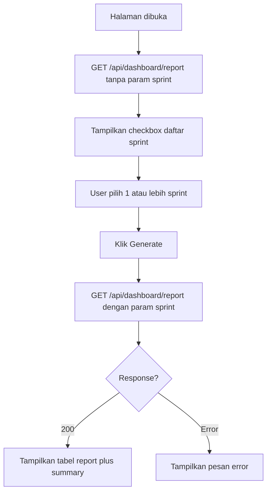

> **Preview:** [View diagram](https://mermaid.live/view#base64:Zmxvd2NoYXJ0IFRECiAgICBBW0hhbGFtYW4gZGlidWthXSAtLT4gQltHRVQgL2FwaS9kYXNoYm9hcmQvcmVwb3J0IHRhbnBhIHBhcmFtIHNwcmludF0KICAgIEIgLS0+IENbVGFtcGlsa2FuIGNoZWNrYm94IGRhZnRhciBzcHJpbnRdCiAgICBDIC0tPiBEW1VzZXIgcGlsaWggMSBhdGF1IGxlYmloIHNwcmludF0KICAgIEQgLS0+IEVbS2xpayBHZW5lcmF0ZV0KICAgIEUgLS0+IEZbR0VUIC9hcGkvZGFzaGJvYXJkL3JlcG9ydCBkZW5nYW4gcGFyYW0gc3ByaW50XQogICAgRiAtLT4gR3tSZXNwb25zZT99CiAgICBHIC0tPnwyMDB8IEhbVGFtcGlsa2FuIHRhYmVsIHJlcG9ydCBwbHVzIHN1bW1hcnldCiAgICBHIC0tPnxFcnJvcnwgSVtUYW1waWxrYW4gcGVzYW4gZXJyb3JdCg==)

#### 3. State Management

- `availableSprints: string[]` — (default: `[]`)
- `selectedSprints: Set<string>` — (default: `new Set()`)
- `capPercent: number` — (default: `12`)
- `report: Report | null` — (default: `null`)
- `loading: boolean` — (default: `true`) — untuk load awal daftar sprint
- `generating: boolean` — (default: `false`) — khusus saat klik Generate
- `error: string | null` — (default: `null`)

#### 4. Integration

GET /api/dashboard/report (tanpa query `sprint`, saat halaman pertama dibuka)

Response Handling:
- Mapping `response.availableSprints` ke `availableSprints`, `response.capPercent` ke `capPercent`
- `response.report` akan `null` di panggilan ini — tidak ada yang di-mapping ke `report`
- Error 401: ditangani global
- Error lain: tampilkan "Gagal memuat daftar sprint, coba lagi"

GET /api/dashboard/report?sprint=...&cap=... (saat klik Generate)

Query: `sprint` (repeatable, dari `selectedSprints`), `cap` (dari `capPercent`)

Response Handling:
- Mapping `response.report` ke `report`, `generating = false`
- Error: tampilkan "Gagal membuat report, coba lagi", `generating = false`, `report` tidak diubah (tetap tampilkan hasil generate sebelumnya jika ada)

#### Task Breakdown

| No | Task | File | AC | SP |
|---|---|---|---|---:|
| 9.1 | Interface + Logic: checkbox sprint, input cap, tombol Generate, tabel + summary report | `frontend/src/app/features/dashboard/report/report.component.html`, `report.component.ts` | AC9.1, AC9.2 | 2 |
| 9.2 | State + Integration: load awal (`GET` tanpa sprint) + generate (`GET` dengan sprint) | `frontend/src/app/features/dashboard/report/report.component.ts` | AC9.1, AC9.2 | 1.5 |
| 9.u | **[UI Test]** Picker tampil, tabel+summary tampil setelah generate, baris within=false ditandai beda | `frontend/src/app/features/dashboard/report/report.component.spec.ts` | AC9.1, AC9.2 | 1.5 |
| 9.i | **[Integration Test]** Load awal sukses/gagal, generate sukses/gagal | `frontend/src/app/features/dashboard/report/report.component.spec.ts` | AC9.1, AC9.2 | 1 |
| 9.x | **[Dev Test]** — self-test mandiri, bandingkan hasil dengan `report.html` lama untuk 1 sprint yang sama | - | - | — |
| | **Subtotal** | | | **6 SP** |

| | **Total Repository 2** | | | **37.5 SP** |

### Affected Functions

**Core services, guards, routing**

| Status | Function | File | Line | Notes |
|---|---|---|---|---|
| New | `AuthService.checkSession()` | `frontend/src/app/core/services/auth.service.ts` | — | Panggil `GET /api/auth/me`, update `currentUser$` |
| New | `AuthGuard.canActivate()` | `frontend/src/app/core/guards/auth.guard.ts`, `auth.guard.spec.ts` | — | Blokir route dashboard jika belum login |
| New | `AdminGuard.canActivate()` | `frontend/src/app/core/guards/admin.guard.ts`, `admin.guard.spec.ts` | — | Blokir route admin jika bukan admin |
| New | `BoardService.getBoard()` | `frontend/src/app/core/services/board.service.ts` | — | `GET /api/dashboard/board` |
| New | `BoardService.getTeam()` | `frontend/src/app/core/services/board.service.ts` | — | `GET /api/dashboard/team` |
| New | `BoardService.getOverdue()` | `frontend/src/app/core/services/board.service.ts` | — | `GET /api/dashboard/overdue` |
| New | `BoardService.transitionTicket()` | `frontend/src/app/core/services/board.service.ts` | — | `POST /api/dashboard/tickets/:issueKey/transition`, endpoint existing |
| New | `BoardService.updatePreference()` | `frontend/src/app/core/services/board.service.ts` | — | `POST /api/dashboard/preference`, endpoint existing |
| New | `BoardService.saveCredential()` / `deleteCredential()` | `frontend/src/app/core/services/board.service.ts` | — | `POST`/`DELETE /api/dashboard/credential`, endpoint existing |
| New | `AdminService.listUsers()` | `frontend/src/app/core/services/admin.service.ts` | — | `GET /api/dashboard/admin/users` |
| New | `AdminService.toggleActive()` / `editJiraAccountId()` / `deleteCredential()` / `deleteUser()` | `frontend/src/app/core/services/admin.service.ts` | — | 4 endpoint existing di bawah `/dashboard/admin/...` |
| New | `AdminService.broadcast()` | `frontend/src/app/core/services/admin.service.ts` | — | `POST /dashboard/admin/broadcast`, endpoint existing |
| New | `ReportService.getReport()` | `frontend/src/app/core/services/report.service.ts` | — | `GET /api/dashboard/report` |
| New | `routes` (const) | `frontend/src/app/app.routes.ts` | — | Definisi semua route — Login di luar guard, sisanya di bawah `AuthGuard`/`AdminGuard` |

**Komponen per chapter** (`.component.ts` + `.component.html` + `.component.spec.ts` satu baris karena dikerjakan sebagai satu kesatuan per Task Breakdown masing-masing chapter)

| Status | Function | File | Line | Notes |
|---|---|---|---|---|
| New | `LoginComponent` | `frontend/src/app/features/login/login.component.ts`, `login.component.html`, `login.component.spec.ts` | — | Chapter "Custom Flow: Login / Session Guard" |
| New | `ReminderPreferenceComponent.onSubmit()` | `frontend/src/app/features/dashboard/board/reminder-preference.component.ts`, `reminder-preference.component.html`, `reminder-preference.component.spec.ts` | — | Chapter "Update: Reminder Preference" |
| New | `JiraCredentialComponent.onSubmit()` / `onDelete()` | `frontend/src/app/features/dashboard/board/jira-credential.component.ts`, `jira-credential.component.html`, `jira-credential.component.spec.ts` | — | Chapter "Create: Jira API Key Pribadi" |
| New | `BoardComponent.loadBoard()` / `onTransition()` | `frontend/src/app/features/dashboard/board/board.component.ts`, `board.component.html`, `board.component.spec.ts` | — | Chapter "List: My Board" |
| New | `TeamComponent.loadTeam()` | `frontend/src/app/features/dashboard/team/team.component.ts`, `team.component.html`, `team.component.spec.ts` | — | Chapter "List: Team" |
| New | `OverdueComponent.loadOverdue()` | `frontend/src/app/features/dashboard/overdue/overdue.component.ts`, `overdue.component.html`, `overdue.component.spec.ts` | — | Chapter "List: Overdue" |
| New | `AdminComponent.loadUsers()` / row action handlers | `frontend/src/app/features/dashboard/admin/admin.component.ts`, `admin.component.html`, `admin.component.spec.ts` | — | Chapter "List: Admin User Management" |
| New | `BroadcastComponent.onSend()` | `frontend/src/app/features/dashboard/admin/broadcast.component.ts`, `broadcast.component.html`, `broadcast.component.spec.ts` | — | Chapter "Action: Broadcast Message" |
| New | `ReportComponent.loadSprints()` / `onGenerate()` | `frontend/src/app/features/dashboard/report/report.component.ts`, `report.component.html`, `report.component.spec.ts` | — | Chapter "Custom Flow: Sprint Report" |

### Test Scope

| No | Type | Scenario | Expected |
|---:|---|---|---|
| 1 | E2E | Buka app tanpa login → Login Screen → klik Sign in with Google → (setelah OAuth, di luar scope test Angular) → kembali dengan sesi valid → Dashboard Shell tampil | Transisi mulus, tidak ada flash of wrong content |
| 2 | E2E | Login → My Board → ubah preference → simpan → refresh halaman → preference tetap tersimpan | Data persisten lewat reload |
| 3 | E2E | Login sebagai non-admin → menu Admin tidak tampil di nav, akses manual ke URL admin → redirect | `AdminGuard` berfungsi |
| 4 | Integration | Sesi expired saat sedang di halaman manapun → aksi apapun (GET atau POST) → 401 | Redirect otomatis ke Login, tidak ada dead state/blank screen |
| 5 | Regression | Semua endpoint existing yang dipanggil Angular (preference, transition, credential, admin actions, broadcast) menghasilkan perilaku identik dengan saat dipanggil dari vanilla JS sebelumnya | Tidak ada regresi fungsional, hanya cara panggilnya yang beda |

## Out of Scope

- **Tidak ada perubahan business logic apapun** — perhitungan budget, reminder tier, overage, sprint report, business hours, semua tetap persis sama. Fitur ini murni mengganti lapisan presentasi.
- **Tidak ada migrasi ke pola esb-lms** (Docker Compose, `api/`+`frontend/` sebagai service terpisah) — sudah diputuskan di Background, bukan arah yang diambil.
- **Tidak ada perubahan command Google Chat** (`/u-mytickets`, `/u-geser`, dll) — itu jalur terpisah dari dashboard web, tidak tersentuh fitur ini.
- **Tidak ada perubahan skema database** — lihat Database Changes.
- **Tidak ada konsolidasi endpoint admin** yang sekarang tersebar di dua prefix berbeda (`/api/dashboard/admin/users` baru vs `/dashboard/admin/*` lama) — lihat Open Question #2 dan Notes & Recommendations C1.
- **Tidak ada dark mode, i18n, atau PWA/offline support** — tidak diminta, di luar scope revamp ini.
- **Tidak ada perubahan di `oms-cron`/poller/reminder_engine** — service-service background itu sama sekali tidak tersentuh, hanya dashboard web yang berubah.

## Notes & Recommendations

- **C1.** Endpoint admin write (`POST`/`DELETE /dashboard/admin/...`) dan endpoint admin read baru (`GET /api/dashboard/admin/users`) sekarang hidup di dua prefix path berbeda (`/dashboard/admin/*` vs `/api/dashboard/admin/*`). Ini inkonsistensi minor yang sudah ada sebelumnya (endpoint write memang sudah di `/dashboard/admin/*` sejak awal dibuat) — direkomendasikan dirapikan jadi satu prefix (`/api/dashboard/admin/*` semua) di iterasi berikutnya, di luar scope revamp ini supaya tidak menambah risiko ke pekerjaan yang sudah besar.
- **C2.** Setelah Angular live, `html/template` sebagai dependency masih dipakai di tempat lain? **Tidak** — setelah Chapter 7a-7b (Build & Deploy) selesai, tidak ada satupun `html/template.Execute` lagi di seluruh codebase. Sempat dicek: `go.mod` tidak perlu diubah karena `html/template` adalah standard library, bukan dependency eksternal — tidak masalah kalaupun tidak dipakai lagi (tidak ada "unused dependency" warning untuk stdlib).
- **C3.** Error message yang sekarang ditampilkan Go (bahasa Indonesia, misal "Sesi login tidak valid atau kedaluwarsa, coba lagi") **tidak diterjemahkan ulang** — Angular menampilkan apa adanya dari response API, menjaga konsistensi pesan yang sudah dikenal user.
- **C4.** Rekomendasi untuk fase berikutnya (di luar scope sekarang): tambah `HttpInterceptor` global di Angular yang otomatis redirect ke Login saat menerima 401 dari endpoint manapun, supaya tiap komponen tidak perlu menangani 401 masing-masing secara manual — disebutkan di beberapa Integration section di atas sebagai "ditangani global", implementasinya didetailkan di Chapter 1 (`AuthGuard`) tapi interceptor-nya sendiri cukup sederhana untuk dikerjakan sebagai bagian Chapter 1 saat eksekusi plan, tidak perlu chapter terpisah.

## Impact on Existing Features

| Existing Feature / Endpoint | Dampak | Scope Regresi |
|---|---|---|
| `POST /api/dashboard/preference` | Tidak berubah — dipanggil Angular alih-alih vanilla JS | Test existing (`user_dashboard_handler_test.go`) harus tetap PASS tanpa modifikasi |
| `POST /api/dashboard/tickets/:issueKey/transition` | Tidak berubah | Sama seperti di atas |
| `POST`/`DELETE /api/dashboard/credential` | Tidak berubah | Sama seperti di atas |
| `POST /dashboard/admin/users/:userID/active` | Tidak berubah | `admin_dashboard_handler_test.go` tetap PASS |
| `POST /dashboard/admin/users/:userID/jira-account-id` | Tidak berubah | Sama seperti di atas |
| `DELETE /dashboard/admin/users/:userID/credential` | Tidak berubah | Sama seperti di atas |
| `DELETE /dashboard/admin/users/:userID` | Tidak berubah | Sama seperti di atas |
| `POST /dashboard/admin/broadcast` | Tidak berubah | Sama seperti di atas |
| `GET /jira-notif/ping` health check | Tidak berubah — tetap endpoint JSON sederhana, dipakai GitHub Actions deploy health check | Tidak ada dampak |
| Command Google Chat (`/u-mytickets`, `/u-geser`, dll) | Tidak tersentuh — jalur terpisah (`chat_command_poller`, `chat_interactive_service`) | Tidak ada dampak |
| Poller & reminder engine (business-hours gate, dll) | Tidak tersentuh | Tidak ada dampak |
| Bookmark lama pengguna ke `/jira-notif/dashboard`, `/jira-notif/dashboard/admin`, dll | URL tetap sama persis, kontennya yang berubah (sekarang Angular, bukan server-rendered HTML) — **tidak ada broken link** | Perlu di-cek manual saat UAT: semua bookmark lama user masih mengarah ke halaman yang benar |

## Affected Services

| Service | File-file utama yang terdampak |
|---|---|
| jira-u-bot (Go backend) | `router.go`, `main.go`, `modules/auth/*`, `modules/user_dashboard/user_dashboard_handler/*`, `modules/admin_dashboard/admin_dashboard_handler/*`, `modules/sprint_report/sprint_report_handler/*`, `modules/*/router.go`, `webapp/embed.go` (baru), semua `modules/*/templates/*` (dihapus) |
| jira-u-bot (Angular frontend, baru) | Seluruh isi `frontend/` — project baru |
| `.github/workflows/deploy.yml` | Tambah step build Angular sebelum `go build` |

## Effort Summary & Deploy Order

| Repository | Total SP | Estimasi Hari (7.5 SP/hari) |
|---|---:|---:|
| Repository 1 — jira-u-bot API (Go) | 17 SP | ~2.3 hari |
| Repository 2 — jira-u-bot Frontend (Angular) | 37.5 SP | ~5 hari |
| **Total** | **54.5 SP** | **~7.3 hari** |

**Deploy order yang direkomendasikan** (semua dalam 1 repo, 1 deploy — tidak ada urutan rilis lintas service seperti biasanya di multi-repo):

1. Chapter 7a-7b (Build & Deploy Integration) dikerjakan **terakhir** dalam urutan coding meski didaftar sebagai chapter terakhir di Repository 1 — alasannya: chapter ini butuh SEMUA endpoint baru (Chapter 1-6) dan SEMUA komponen Angular (Repository 2) sudah ada dulu, baru routing lama bisa dibongkar dengan aman tanpa app dalam keadaan rusak di tengah pengerjaan.
2. Urutan pengerjaan yang disarankan: Chapter 1 (session-check) → Chapter 2-6 (backend, paralel dengan Angular Chapter 1-9 yang mengonsumsinya) → Chapter 7a-7b (bongkar routing lama, baru sekali di akhir).
3. **Tidak ada rilis bertahap/feature-flag** — karena ini revamp tampilan penuh (bukan fitur baru yang bisa hidup berdampingan dengan versi lama), deploy dilakukan sekaligus setelah semua chapter selesai dan lolos UAT manual.

## Deployment Checklist

> **Non-Technical Summary:** Daftar langkah pengecekan sebelum dan sesudah rilis, supaya tidak ada yang kelewat saat pindah dari tampilan lama ke Angular.

- [ ] `npm ci` dan `npm run build` di `frontend/` berhasil tanpa error, hasil build ada di path yang dirujuk `webapp/embed.go`
- [ ] `go build ./...` dari root repo berhasil (membuktikan `go:embed` menemukan hasil build Angular)
- [ ] `go vet ./...` dan `go test ./...` semua PASS
- [ ] `.github/workflows/deploy.yml` sudah update dengan step build Angular sebelum `go build`
- [ ] Manual smoke test di `http://localhost:8080/jira-notif/` (atau path apapun) tanpa login → Login Screen tampil
- [ ] Manual smoke test login via Google → Dashboard Shell tampil, semua 4 nav (My Board/Team/Overdue/Sprint Report, +Admin jika admin) bisa diakses
- [ ] Manual test semua aksi (ubah preference, geser tiket, simpan/hapus credential, kelola user admin, broadcast, generate sprint report) menghasilkan perilaku yang sama dengan versi HTML lama
- [ ] Cek bookmark lama (`/jira-notif/dashboard`, `/jira-notif/dashboard/admin`, `/jira-notif/dashboard/report`, dll) masih mengarah ke halaman yang benar
- [ ] Deploy ke `labcup.tech`, jalankan health check `GET /jira-notif/ping`
- [ ] Informasikan ke user aktif (Benni, dkk) bahwa tampilan dashboard berubah, supaya tidak kaget

## Rollback Plan

> **Non-Technical Summary:** Kalau ada masalah serius setelah rilis, cara kembali ke tampilan lama cukup sederhana karena tidak ada perubahan data, hanya kode.

Karena ini 1 binary (bukan multi-service), rollback semudah revert deploy biasa:

1. `git revert` commit-commit fitur ini (atau `git reset --hard` ke commit sebelum merge, sesuai kebijakan repo) di branch `main`
2. Re-deploy lewat `deploy.yml` seperti biasa — `go build` dari kode lama otomatis kembali ke handler HTML + template lama (karena template belum dihapus di commit-commit sebelum Chapter 7a-7b selesai — **rollback paling aman dilakukan sebelum Chapter 7a-7b di-merge**, karena Chapter 7a-7b menghapus semua template HTML lama yang jadi fallback alami)
3. Tidak ada data yang perlu di-rollback — tidak ada migrasi skema, tidak ada data baru yang ditulis dengan format berbeda
4. Setelah rollback, user otomatis kembali melihat tampilan HTML lama di request berikutnya — tidak perlu clear cache browser (tidak ada service worker/PWA yang di-cache agresif)

## Observability / Logging

Tidak ada logging/tracing tambahan di luar yang sudah ada (`gin.Logger()` mencatat tiap request, `log.Printf` di titik-titik yang sudah ada). Tidak ada Sentry atau APM terintegrasi di jira-u-bot — di luar scope untuk ditambahkan di sini (project internal skala kecil, bukan service production ESB yang besar).

## Production Risks, Calculation Impact & Mitigation

> **Non-Technical Summary:** Karena ini revamp tampilan penuh (bukan tambahan kecil), ada risiko user bingung dengan perubahan besar, atau ada endpoint/alur yang kelewat belum dipindahkan — bagian ini daftar risiko itu dan cara menguranginya.

### Calculation Impact & Known Issues

Tidak ada — tidak ada perhitungan harga/budget/waktu yang berubah, semua logic kalkulasi (budget tiket, deviation sprint report, dll) tetap persis sama, hanya cara penyajiannya yang beda.

### P1 — Endpoint lama terhapus sebelum Angular siap menggantikannya

Kalau Chapter 7a-7b (hapus routing lama) dikerjakan sebelum semua chapter Angular selesai, user akan melihat halaman kosong/404 di tengah proses development kalau tidak sengaja ter-deploy prematur.
**Mitigasi:** Chapter 7a-7b secara eksplisit dikerjakan **terakhir** (lihat Effort Summary & Deploy Order) — tidak di-deploy ke production sampai semua chapter lain lolos Dev Test.

### P2 — Lupa pindahkan 1-2 endpoint lama, Angular memanggil path yang sudah tidak ada

Karena ada banyak endpoint lama yang **tidak berubah** (preference, transition, credential, 4 endpoint admin write, broadcast) tercampur dengan endpoint yang **diganti total** (board, team, overdue, admin list, report) — risiko salah pindah path di satu-dua tempat.
**Mitigasi:** tabel [Impact on Existing Features](#impact-on-existing-features) sudah mendaftar SEMUA endpoint existing yang tidak berubah secara eksplisit — dipakai sebagai checklist silang saat implementasi `BoardService`/`AdminService` di Angular.

### P3 — User lama punya tab/bookmark yang ter-cache halaman HTML lama di browser

Service worker/PWA tidak dipakai, tapi browser tetap bisa cache HTML statis dengan agresif tergantung header cache yang dikirim server untuk static assets Angular.
**Mitigasi:** pastikan `webapp/embed.go`/handler static file tidak set header cache panjang untuk `index.html` (boleh cache panjang untuk file JS/CSS yang sudah ada content-hash di nama filenya, pola standar Angular CLI build) — dicek di Dev Test Chapter 7a.

### P4 — Admin lupa redirect URI GCP berubah

**Tidak relevan** — OAuth redirect URI (`/auth/google/callback`) tidak berubah sama sekali di revamp ini, hanya target redirect SETELAH login (`/dashboard`) yang sekarang di-serve Angular alih-alih HTML — URL-nya sendiri persis sama.

### P5 — Regresi di endpoint yang "tidak berubah" karena developer AI tergoda merapikan kode saat menyentuh file yang sama

Beberapa handler existing (misal `user_dashboard_handler_impl.go`) akan disentuh di chapter yang sama dengan penambahan handler JSON baru — risiko perubahan tidak sengaja di method yang seharusnya "Unchanged".
**Mitigasi:** `go test ./...` harus tetap PASS **tanpa modifikasi file test existing** untuk endpoint yang tidak berubah (ditegaskan di Task Breakdown tiap chapter backend dan di Integration & E2E Tests baris Regression) — review manual saat code review memeriksa diff tidak menyentuh baris di luar yang didaftarkan Affected Functions.

### Risk Summary

| Risiko | Severity | Mitigasi |
|---|---|---|
| P1 — Endpoint lama terhapus prematur | High | Chapter 7a-7b dikerjakan & dideploy terakhir |
| P2 — Salah pindah endpoint | Medium | Checklist silang di Impact on Existing Features |
| P3 — Browser cache HTML lama | Low | Cache header benar untuk `index.html` vs asset ber-hash |
| P4 — OAuth redirect URI | — | Tidak relevan, URI tidak berubah |
| P5 — Regresi tidak sengaja di endpoint unchanged | Medium | `go test ./...` PASS tanpa modifikasi test existing, review manual |
