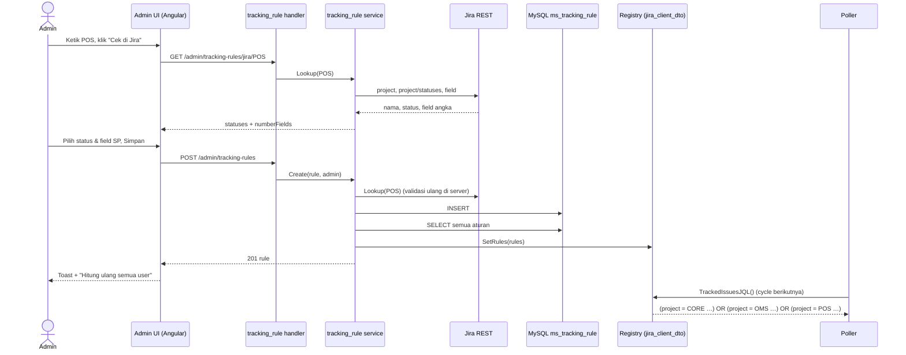

# Tech Spec — Aturan Board (Admin CRUD Tracking Rules)

> **Date:** 2026-11-16
> **PRD Link:** — (permintaan langsung user, sesi brainstorming 2026-11-16)
> **STP Link:** —
> **Epic / Task:** Nudge — Aturan Board dikelola dari Admin, tanpa ubah kode
> **Document Status:** `In Review`
> **Document Owner:** Yusuf Wijaya
> **Need Review:** Yusuf Wijaya

---

## 📋 Background, Problem & Solution

| | |
|---|---|
| **Why** | Menambah board/project Jira baru ke Nudge saat ini wajib mengubah kode + deploy. Aturan "status mana yang dihitung budget", "status selesai", "status review" dan "field Story Point" tersebar sebagai konstanta. Admin ingin mengelolanya sendiri, dan OMS & CORE yang sudah ada ikut dikelola dari tempat yang sama. |
| **Current condition** | Aturan di-hardcode di `modules/jira_client/jira_client_dto/tracking_rules.go` (`trackingRules` map: OMS, CORE). Field SP di `constants.go` + struct tag `IssueFields` (`customfield_10016`, `customfield_10125`, `customfield_11053`) dengan urutan coalesce tetap di `EffectiveStoryPoints()`. Tiga JQL lain menulis `project in (CORE, OMS)` (`jira_agile_client.go:62`, `:199`, `jira_client_service_impl.go:143`). Daftar status notif perubahan status di frontend di-hardcode (`settings.component.ts:432-443`). |
| **Solution** | Tabel `ms_tracking_rule` (seed OMS & CORE identik dengan kode sekarang) + registry in-memory yang dimuat saat start, di-refresh setiap simpan dan tiap 5 menit. Fungsi publik `RuleFor`/`RuleForIssue`/`TrackedIssuesJQL`/`IsTrackedProjectKey` tetap, sumber datanya pindah ke registry. Halaman Admin "Aturan Board" untuk tambah/edit/nonaktifkan, dengan status & field SP dipilih dari Jira. |

---

## 📖 User Stories & Acceptance Criteria

> Tidak ada PRD; US/AC diturunkan dari keputusan brainstorming: (1) status & field SP **dipilih dari Jira**, (2) hapus = **nonaktifkan**, (3) OMS & CORE **di-seed**, (4) registry in-memory refresh **on save + tiap 5 menit**.

### US-1 — Seed & paritas perilaku
- **AC1.1** Setelah deploy, `ms_tracking_rule` berisi OMS dan CORE dengan nilai persis seperti `trackingRules` sekarang (lihat DB Schema). 
- **AC1.2** Tanpa admin mengubah apa pun, poller JQL, perhitungan waktu (`TrackedRunTimes`/`TrackedSeconds`), status_watch, reminder, backfill, dashboard dan Buat Card menghasilkan output yang sama dengan sebelum perubahan (dibuktikan test paritas).
- **AC1.3** (negatif) Seed tidak menimpa aturan yang sudah diedit admin pada restart/deploy berikutnya (`INSERT IGNORE`).
- **AC1.4** (edge) Bila tidak ada aturan aktif (hanya mungkin lewat ubah DB manual — Admin mencegahnya, lihat AC4.3), service tetap start dan log `WARN`; poller tidak mencari apa pun (JQL kosong → skip cycle, bukan error Jira).

### US-2 — Admin melihat daftar aturan
- **AC2.1** Menu **Aturan Board** di sidebar Admin (hanya `ADMIN_EMAIL`), route `/admin/tracking-rules`.
- **AC2.2** Tabel: project key + nama project, status dihitung (chip), status selesai, status review, field SP (nama + ID, urut prioritas), badge Aktif/Nonaktif, diubah oleh + kapan.
- **AC2.3** (negatif) Non-admin memanggil API → `403` (AdminMiddleware), menu tidak tampil.
- **AC2.4** (edge) Belum ada aturan aktif selain yang dinonaktifkan → baris nonaktif tetap tampil (redup) dengan tombol Aktifkan.

### US-3 — Admin menambah aturan board baru (pilih dari Jira)
- **AC3.1** Admin mengetik project key → tombol **Cek di Jira** memanggil lookup; menampilkan nama + avatar project, daftar status workflow (unik, gabungan semua issue type), dan daftar field angka (`schema.type = number`) dengan field bernama "story point" diurutkan paling atas.
- **AC3.2** Status dihitung = chip multi-pilih dari daftar status; Status selesai = dropdown dari status yang **tidak** dipilih sebagai dihitung; Status review (opsional) = dropdown dari status dihitung; Field SP baca = multi-pilih berurutan (bisa geser naik/turun), minimal 1; **Field SP tulis (card biasa)** dan **Field SP tulis (subtask)** = dropdown dari field SP baca, wajib keduanya (boleh sama).
- **AC3.3** Preview kalimat realtime: *"Budget berjalan selama {dihitung…}; selesai saat {selesai}. Review {ikut/tidak} dihitung. SP dibaca dari {field1} → {field2}; ditulis ke {fieldTulis} (card biasa) / {fieldTulisSubtask} (subtask)."*
- **AC3.4** Simpan → `201`, registry langsung di-refresh, toast sukses dengan aksi **Hitung ulang semua user** (memanggil backfill `RunAll` di background).
- **AC3.5** (negatif) Project key tidak ada di Jira → `404 project_not_found`, pesan "Project XYZ tidak ditemukan di Jira".
- **AC3.6** (negatif) Project key sudah punya aturan (aktif atau nonaktif) → `409 rule_exists`, pesan arahkan ke Edit.
- **AC3.7** (negatif) Validasi server: status dihitung kosong; status selesai ∈ status dihitung; status review ∉ status dihitung; field SP kosong; status/field tidak ada di data Jira project itu → `400` dengan `fields` per input.
- **AC3.8** (edge) Project key diketik huruf kecil/spasi → dinormalisasi `TRIM` + `UPPER`; format wajib `^[A-Z][A-Z0-9_]{1,19}$`.

### US-4 — Admin mengedit & menonaktifkan aturan
- **AC4.1** Edit memuat ulang data Jira project (status/field terbaru) dan mencentang nilai tersimpan; project key tidak bisa diubah.
- **AC4.2** Nonaktifkan dengan konfirmasi *"Tiket {KEY} berhenti dipantau. Riwayat tetap tersimpan."* → aturan `isActive = 0`; project hilang dari semua JQL & relasi (subtask/linked) pada cycle berikutnya.
- **AC4.3** (negatif) Menonaktifkan aturan aktif terakhir → `422 last_active_rule`.
- **AC4.4** (negatif) Edit menyisakan status tersimpan yang sudah tidak ada di workflow Jira → status itu ditampilkan bertanda ⚠ "tidak ada lagi di Jira" dan wajib dibuang sebelum bisa simpan.
- **AC4.5** (edge) Sesi aktif tiket project yang dinonaktifkan ditutup **tanpa menambah waktu dan tanpa notifikasi** (perlakuan sama seperti tiket keluar sprint aktif, `CloseSession(key, 0)`).
- **AC4.6** (edge) Mengaktifkan kembali → tiket yang masih di status dihitung dibuka lagi oleh poller dari waktu masuk aslinya (perilaku `OpenOrResumeSessionAt` yang sudah ada).

### US-5 — Semua modul memakai aturan dari registry
- **AC5.1** `TrackedIssuesJQL`, JQL dashboard/my-tickets/team (`project in (...)`) dan `IsTrackedProjectKey` memakai project **aktif** dari registry.
- **AC5.2** Story Point dibaca per project dari `storyPointFields` (urutan = prioritas); `fields=` di request Jira berisi gabungan field SP semua aturan aktif + field sprint.
- **AC5.3** Buat Card: field SP untuk create = `storyPointWriteFieldSubtask` bila issue type subtask (termasuk bulk subtask), selain itu `storyPointWriteField` — dipakai hanya bila field itu ada di createmeta tipe tersebut (kalau tidak, input SP disembunyikan). Semua field SP project dianggap "handled" (tidak dirender sebagai field dinamis). CORE: card biasa → *Story Point Estimate* (`customfield_10125`), subtask → *Story Points* (`customfield_11053`) — **dikonfirmasi user 2026-11-17**.
- **AC5.3b** (negatif) Field tulis yang dipilih tidak ada di createmeta tipe card → SP tidak dikirim dan input SP disembunyikan (bukan error 400 dari Jira).
- **AC5.4** Perubahan aturan berlaku paling lambat cycle poller berikutnya di proses yang sama (refresh on save) dan ≤ 5 menit bila diubah dari luar (refresh periodik).
- **AC5.5** Pengaturan › Notif perubahan status: daftar status diambil dari workflow Jira project board terpilih (`GET /api/dashboard/boards/:boardID/statuses`, cache 1 jam); fallback ke daftar statis lama bila Jira gagal.
- **AC5.6** (negatif) Registry gagal refresh (DB error) → aturan terakhir yang valid tetap dipakai, log `ERROR`, tidak pernah jatuh ke kosong.

---

## 🗺️ Domain Mapping

> Nudge bukan bagian ESB Core (fnb-backend/go-core-api/phantom-lancer); domain dipetakan ke modul Nudge.

| User Story | Domain (Nudge) | Sub-module |
|------------|----------------|------------|
| US-1 | Data / migrations | `migrations/0021_tracking_rule.sql` |
| US-2, US-3, US-4 | Admin | `modules/tracking_rule` (baru), `frontend/.../admin/tracking-rules` |
| US-5 | Jira tracking core | `jira_client_dto` (registry), `jira_client_service`, `poller`, `issue_create`, `user_dashboard` |

---

## 🔀 Cross-repo Impact

| Repo | Impact | Detail | Priority |
|------|--------|--------|----------|
| `nudge` | `YES` | Backend Go + frontend Angular + migrasi | `HIGH` |
| `fnb-backend` | `NO` | — | — |
| `go-core-api` | `NO` | — | — |
| `phantom-lancer` | `NO` | — | — |

---

## 🗄️ DB Schema Changes

```sql
-- Table   : ms_tracking_rule
-- Action  : NEW TABLE  (migrations/0021_tracking_rule.sql, CREATE TABLE IF NOT EXISTS — idempotent)
CREATE TABLE IF NOT EXISTS ms_tracking_rule (
  projectKey        VARCHAR(20)  NOT NULL                    COMMENT 'Jira project key, UPPER',
  projectName       VARCHAR(255) NOT NULL DEFAULT ''         COMMENT 'Cache nama project dari Jira',
  trackedStatuses   JSON         NOT NULL                    COMMENT 'Array status: budget berjalan',
  doneStatus        VARCHAR(100) NOT NULL                    COMMENT 'Status selesai (early-completion)',
  reviewStatus      VARCHAR(100) NULL                        COMMENT 'Status review yang ikut dihitung; harus ∈ trackedStatuses',
  storyPointFields  JSON         NOT NULL                    COMMENT 'Array customfield_xxx, urutan = prioritas baca',
  storyPointWriteField        VARCHAR(50) NOT NULL         COMMENT 'Field SP yang ditulis Buat Card untuk card biasa; ∈ storyPointFields',
  storyPointWriteFieldSubtask VARCHAR(50) NOT NULL         COMMENT 'Field SP yang ditulis Buat Card untuk subtask; ∈ storyPointFields',
  isActive          TINYINT(1)   NOT NULL DEFAULT 1,
  editedBy          VARCHAR(255) NOT NULL DEFAULT 'seed'     COMMENT 'Email admin terakhir',
  editedDate        DATETIME     NOT NULL DEFAULT CURRENT_TIMESTAMP ON UPDATE CURRENT_TIMESTAMP,
  PRIMARY KEY (projectKey)
);

-- Seed (migrations/0021b_tracking_rule_seed.sql) — INSERT IGNORE: tidak menimpa editan admin (AC1.3)
INSERT IGNORE INTO ms_tracking_rule (projectKey, projectName, trackedStatuses, doneStatus, reviewStatus, storyPointFields, storyPointWriteField, storyPointWriteFieldSubtask) VALUES
  ('OMS',  'ESB OMS',  JSON_ARRAY('Code Process'),                'Code Review',    NULL,          JSON_ARRAY('customfield_10016'),                      'customfield_10016', 'customfield_10016'),
  ('CORE', 'ESB Core', JSON_ARRAY('Code Process', 'CODE REVIEW'), 'Code Completed', 'CODE REVIEW', JSON_ARRAY('customfield_10125', 'customfield_11053'), 'customfield_10125', 'customfield_11053');
```

> Didaftarkan di `migrations/migrate.go` (`//go:embed` + `db.Exec`, pola yang sama dengan 0018). Rollback: tabel boleh dibiarkan (kode lama tidak membacanya) atau `DROP TABLE ms_tracking_rule`.

---

## 📡 API Contract

Semua di `router.go` grup `base.Group("/api/dashboard/admin")` + `AdminMiddleware` (admin) atau `AuthMiddlewareAPI` (user). Response error mengikuti pola `{error, message?, fields?}` modul lain.

### `GET /api/dashboard/admin/tracking-rules`
**Response 200:**
```json
{
  "rules": [
    {
      "projectKey": "CORE", "projectName": "ESB Core",
      "trackedStatuses": ["Code Process", "CODE REVIEW"], "doneStatus": "Code Completed", "reviewStatus": "CODE REVIEW",
      "storyPointFields": [{"id": "customfield_10125", "name": "Story Point Estimate"}, {"id": "customfield_11053", "name": "Story Points"}],
      "storyPointWriteField": "customfield_10125", "storyPointWriteFieldSubtask": "customfield_11053",
      "isActive": true, "editedBy": "seed", "editedDate": "2026-11-16T09:00:00+07:00"
    }
  ]
}
```

### `GET /api/dashboard/admin/tracking-rules/jira/:projectKey`
Lookup Jira untuk mengisi form (kredensial server `JIRA_EMAIL`/`JIRA_API_TOKEN`). Cache 10 menit per project.

**Response 200:**
```json
{
  "projectKey": "POS", "projectName": "ESB POS", "avatarUrl": "https://…",
  "statuses": ["To Do", "In Progress", "Code Review", "Done"],
  "numberFields": [{"id": "customfield_10016", "name": "Story point estimate", "storyPointLike": true}]
}
```

| Code | Condition |
|------|-----------|
| `400` | `invalid_project_key` — format salah |
| `404` | `project_not_found` — Jira 404 |
| `502` | `jira_unavailable` — Jira error/timeout |

Sumber Jira: `GET /rest/api/3/project/{key}`, `GET /rest/api/3/project/{key}/statuses` (gabung unik semua issue type), `GET /rest/api/3/field` (filter `schema.type == "number"`; `storyPointLike` = nama mengandung "story point", case-insensitive).

### `POST /api/dashboard/admin/tracking-rules`
**Request:**
```json
{
  "projectKey": "string — wajib, ^[A-Z][A-Z0-9_]{1,19}$ setelah TRIM+UPPER",
  "trackedStatuses": ["string — min 1, harus ada di statuses Jira"],
  "doneStatus": "string — wajib, ∉ trackedStatuses, ada di statuses Jira",
  "reviewStatus": "string|null — opsional, ∈ trackedStatuses",
  "storyPointFields": ["string — min 1, ada di numberFields Jira, tanpa duplikat"],
  "storyPointWriteField": "string — wajib, ∈ storyPointFields (card biasa)",
  "storyPointWriteFieldSubtask": "string — wajib, ∈ storyPointFields (subtask)"
}
```
**Response 201:** satu objek rule (bentuk sama dengan item list).

| Code | Condition |
|------|-----------|
| `400` | `validation_failed` + `fields: {trackedStatuses|doneStatus|reviewStatus|storyPointFields|storyPointWriteField|storyPointWriteFieldSubtask|projectKey: "pesan"}` |
| `404` | `project_not_found` |
| `409` | `rule_exists` |
| `502` | `jira_unavailable` |

### `PUT /api/dashboard/admin/tracking-rules/:projectKey`
Request sama tanpa `projectKey`. Validasi sama dengan POST. **200** rule; **404** `rule_not_found`; **400/502** seperti POST.

### `PUT /api/dashboard/admin/tracking-rules/:projectKey/active`
**Request:** `{"active": true|false}` → **200** rule; **404** `rule_not_found`; **422** `last_active_rule` (menonaktifkan aturan aktif terakhir).

### `POST /api/dashboard/admin/tracking-rules/recalculate`
Memicu `SprintBackfillService.RunAll` di goroutine (tidak menunggu). **202** `{"started": true}`; **409** `already_running` bila masih berjalan.

### `GET /api/dashboard/boards/:boardID/statuses` *(user, AuthMiddlewareAPI)*
Status workflow project board (via `ms_board.projectKey`), cache 1 jam. **200** `{"statuses": ["To Do", …]}`; **404** board tidak dikenal; **502** Jira gagal (frontend fallback ke daftar statis).

---

## 🔐 Access Control Matrix

| Action | Guard | Behavior if Denied |
|--------|-------|--------------------|
| Lihat / tambah / edit / nonaktifkan aturan | `AdminMiddleware` (`ADMIN_EMAIL`) + `AdminGuard` di route Angular | `403`; menu tidak tampil |
| Hitung ulang semua user | `AdminMiddleware` | `403` |
| Status workflow board (Pengaturan) | `AuthMiddlewareAPI` (user login) | `401` |

> Tidak ada UAC `lk_accesscontrol` (Nudge memakai satu admin email).

---

## 🔄 Sequence Diagram



---

## 🧠 State Management & UI Logic

```
Registry (jira_client_dto, package-level)
  Default state : builtinRules (OMS, CORE — identik seed) sampai Load pertama; hanya untuk unit test & jaga-jaga
  Startup       → tracking_rule.Service.Reload() sinkron sebelum poller/backfill start; gagal → log.Fatalf (sama dengan migrasi)
  On save       → Reload() di request yang sama, sebelum response
  Periodik      → ticker 5 menit Reload(); gagal → simpan ruleset lama (AC5.6)
  Swap          : atomic.Pointer[ruleSet]; RuleFor/JQL membaca snapshot, tanpa lock
  Unknown/inactive project → RuleFor() mengembalikan defaultRule (Code Process / Code Review) seperti sekarang;
                             IsTrackedProjectKey()=false; tidak masuk JQL
```

```
Form Aturan Board (Angular, signals)
  Project key   : enabled saat tambah, disabled saat edit; "Cek di Jira" aktif bila format valid
  Setelah lookup → chips status, dropdown selesai/review, picker field SP terisi; sebelum lookup semuanya disabled
  Status dihitung on change : buang doneStatus bila jadi ∈ dihitung; buang reviewStatus bila ∉ dihitung
  Field SP      : list berurutan, tombol ↑/↓ dan hapus; "Tambah field" dari numberFields (storyPointLike di atas)
  Field SP tulis: 2 dropdown (card biasa / subtask) dari field SP baca; default = field pertama; field dihapus dari list → dropdown yang memakainya direset
  Nilai tersimpan yang tak ada lagi di Jira → chip ⚠, tombol Simpan disabled sampai dibuang (AC4.4)
  Preview kalimat : computed dari pilihan (AC3.3)
  Simpan        : spinner; 400 → error per field; 409 → link ke Edit; sukses → kembali ke daftar + toast aksi
  Nonaktifkan   : ConfirmService (tone danger); 422 → toast "Minimal satu board harus aktif"
  Motion        : fade-up list & form, pop-in chip, transisi tombol (konsisten dengan Buat Card)
```

---

## 🏗️ Angular Module Architecture

Mengikuti admin page yang ada (standalone component + lazy route di `app.routes.ts` bawah `admin`, shell `AdminShellComponent`).

```
frontend/src/app/
  core/services/tracking-rule.service.ts            # HTTP client admin tracking rules + board statuses
  features/admin/tracking-rules/
    tracking-rules.component.{ts,html,scss,spec.ts} # daftar + aksi aktif/nonaktif + hitung ulang
    tracking-rule-form.component.{ts,html,scss,spec.ts} # tambah/edit, lookup Jira, validasi, preview
  layouts/admin-shell/…                             # + item menu "Aturan Board"
  features/dashboard/settings/settings.component.ts # statusOptionsFor → pakai status dari API, fallback statis
```

---

## ✅ Breakdown Task & Effort

> **🤖 AI** = waktu generate Claude. **👨‍💻 Dev Verify** = verifikasi, jalankan, perbaiki.

| # | Task | Repo | AC Coverage | 🤖 AI | 👨‍💻 Dev Verify | Blocked By |
|---|------|------|-------------|-------|----------------|------------|
| 1 | Migration `0021_tracking_rule.sql` + seed `0021b` + daftar di `migrate.go` + test | `nudge` | AC1.1, AC1.3 | `~1m` | `~20m` | — |
| 2 | Registry di `jira_client_dto`: `TrackingRule` + `ProjectKey/StoryPointFields`, `atomic.Pointer` ruleset, `SetRules`, `ActiveProjectKeys`, `StoryPointFieldIDs`, `ProjectsJQLIn`; `RuleFor/JQL/IsTrackedProjectKey` baca snapshot; JQL kosong → skip | `nudge` | AC1.2, AC1.4, AC5.1 | `~2m` | `~45m` | — |
| 3 | Story Point dinamis: `IssueFields.UnmarshalJSON` simpan field angka di `Numbers map[string]*float64`; `Issue.StoryPoints()` per rule; ganti 4 pemanggil `EffectiveStoryPoints`; `fields=` dari registry; test paritas OMS/CORE | `nudge` | AC1.2, AC5.2 | `~2m` | `~1h` | #2 |
| 4 | Ganti 3 JQL `project in (CORE, OMS)` dengan project aktif registry; poller: sesi project nonaktif → `CloseSession(key, 0)` | `nudge` | AC4.5, AC5.1 | `~1m` | `~40m` | #2 |
| 5 | Buat Card `meta.go`: field SP tulis per jenis card (biasa/subtask) & `handled` dari rule project | `nudge` | AC5.3, AC5.3b | `~1m` | `~20m` | #2 |
| 6 | Modul `tracking_rule`: repository MySQL, service (CRUD, validasi, Jira lookup + cache, Reload, ticker 5 menit, recalc RunAll + guard), handler, routes; jira client `GetProject/GetProjectStatuses/GetFields`; wiring `main.go` (Reload sinkron sebelum poller) | `nudge` | AC2.3, AC3.1–AC3.8, AC4.1–AC4.3, AC4.6, AC5.4, AC5.6 | `~4m` | `~2h` | #1, #2 |
| 7 | Endpoint `GET /api/dashboard/boards/:boardID/statuses` (cache 1 jam) | `nudge` | AC5.5 | `~1m` | `~20m` | #6 |
| 8 | Frontend: `tracking-rule.service.ts`, halaman daftar, form tambah/edit, menu Admin, route, motion & style custom | `nudge` | AC2.1, AC2.2, AC2.4, AC3.1–AC3.4, AC4.1, AC4.2, AC4.4 | `~4m` | `~1.5h` | #6 |
| 9 | Frontend Pengaturan: daftar status dari API + fallback statis | `nudge` | AC5.5 | `~1m` | `~20m` | #7 |
| 10 | README + `.env.example` (tidak ada env baru, dokumentasi menu) + deploy & verifikasi produksi (seed OMS/CORE, JQL sama, tambah aturan uji lalu nonaktifkan) | `nudge` | AC1.1, AC1.2 | `~1m` | `~30m` | #1–#9 |

> **🤖 AI generates code: ~0.3h**
>
> **👨‍💻 Dev verify & fix: ~7.9h** — paritas perhitungan waktu & SP OMS/CORE, race registry vs poller, validasi Jira, wiring Angular
>
> **Combined: ~8.2h** (~1 hari kerja)
>
> ⚠️ Uncovered ACs: tidak ada.

### Dependency Chain
```
#1 ──┐
#2 ──┼─► #6 ─► #7 ─► #9
     ├─► #3
     ├─► #4
     └─► #5          #6 ─► #8          (#1..#9) ─► #10
```

---

## 🔗 Dependencies

**Internal:**
- `sprint_backfill_service.RunAll` (hitung ulang semua user)
- `ms_board.projectKey` (endpoint status board)
- `ConfirmService`, `ToastService` (aksi toast), `SelectComponent` (dropdown custom)

**Cross-repo:** tidak ada.

**External:**
- Jira Cloud REST v3: `project/{key}`, `project/{key}/statuses`, `field` — kredensial server yang sudah ada.

---

## 🚀 Milestone / Deployment Strategy

1. Deploy normal (GitHub Actions). Migrasi jalan otomatis saat start; seed OMS & CORE masuk.
2. Verifikasi produksi: `SELECT * FROM ms_tracking_rule` (2 baris), log poller JQL identik dengan sebelumnya, Papan Tiket & SP OMS/CORE sama.
3. Uji di Admin: tambah aturan project uji → muncul di JQL log → nonaktifkan → hilang, tanpa notifikasi palsu.
4. Tidak perlu feature flag: tanpa perubahan admin, perilaku identik (AC1.2).
5. **Rollback plan:** deploy release sebelumnya (`/var/www/nudge/releases`); tabel `ms_tracking_rule` boleh tetap ada (tidak dibaca kode lama).

---

## ⚠️ Drawbacks / Risks

| Category | Risk |
|----------|------|
| **Paritas SP** | Coalesce lama berlaku global (10016 → 10125 → 11053) untuk semua project; baru per project. Karena OMS selalu null di field CORE dan sebaliknya (terverifikasi live di `constants.go`), hasil sama — dijaga test paritas di #3. |
| **Konsistensi data** | Admin salah pilih status dihitung → waktu tercatat salah sejak cycle berikutnya. Mitigasi: preview kalimat, validasi ke data Jira, dan tombol hitung ulang (backfill dari changelog Jira bisa memperbaiki sprint aktif). |
| **Performance** | Registry dibaca tiap cycle tanpa lock (atomic); lookup Jira hanya saat admin membuka form (cache 10 menit). `GET /rest/api/3/field` bisa ratusan field — difilter di server. |
| **Concurrency** | Swap ruleset di tengah cycle poller: poller mengambil snapshot sekali per cycle (JQL + rule diambil dari snapshot yang sama) agar satu cycle konsisten. |
| **Multi-tenant** | Nudge single-tenant (satu Jira site); aturan berlaku untuk semua user. |

---

## ❓ Unresolved / Pending Clarification

| # | Location | Contradiction / Ambiguity | Assumption Made |
|---|----------|---------------------------|-----------------|
| 1 | AC5.3 | Field SP yang ditulis Buat Card untuk CORE. | ✅ Dikonfirmasi user 2026-11-17: card biasa → Story Point Estimate (`customfield_10125`), subtask → Story Points (`customfield_11053`); disimpan per board di `storyPointWriteField` / `storyPointWriteFieldSubtask`. |
| 2 | AC4.2 | Menonaktifkan project: perlu juga menyembunyikan board-nya dari pemilih board user? | Tidak — pemilih board mengikuti sprint aktif berisi tiket user; tiket project nonaktif tidak lagi masuk JQL dashboard sehingga board otomatis hilang. |
| 3 | AC3.4 | "Hitung ulang" hanya untuk semua user (bukan per project). | `RunAll` yang sudah ada; cukup untuk skala tim saat ini. |
| 4 | Chat | Shortcut status di `/n-tiket` (`parse.go statusShortcuts`) tetap generik. | Di luar scope; status baru tetap bisa diketik dengan nama lengkap. |

> **Future possibilities:** riwayat perubahan aturan (audit log), aturan per issue type, batas jam per SP per project.

---

## 📁 Files to Modify

| File | Change |
|------|--------|
| `migrations/0021_tracking_rule.sql` | Baru — tabel `ms_tracking_rule` |
| `migrations/0021b_tracking_rule_seed.sql` | Baru — seed OMS & CORE (`INSERT IGNORE`) |
| `migrations/migrate.go` | Embed + apply 0021/0021b |
| `modules/jira_client/jira_client_dto/tracking_rules.go` | Registry atomic, `SetRules`, `ActiveProjectKeys`, `StoryPointFieldIDs`, `ProjectsJQLIn`; `TrackingRule` + `ProjectKey`, `StoryPointFields` |
| `modules/jira_client/jira_client_dto/issue_relations.go` | `IsTrackedProjectKey` dari registry |
| `modules/jira_client/jira_client_dto/jira_client_dto.go` | `IssueFields.Numbers` + `UnmarshalJSON`; `Issue.StoryPoints()`; `EffectiveStoryPoints` dihapus/diganti |
| `modules/jira_client/jira_client_dto/constants.go` | Konstanta SP dipertahankan hanya untuk seed/test |
| `modules/jira_client/jira_client_dto/project_meta.go` | Baru — DTO project, statuses, field Jira |
| `modules/jira_client/jira_client_service/jira_client_service_impl.go` | `fields=` dari registry; JQL `project in` dari registry |
| `modules/jira_client/jira_client_service/jira_agile_client.go` | `dashboardIssueFields` dinamis; 2 JQL `project in` dari registry |
| `modules/jira_client/jira_client_service/jira_project_meta.go` | Baru — `GetProject`, `GetProjectStatuses`, `GetNumberFields` |
| `modules/poller/poller_service/poller_service_impl.go` | `Issue.StoryPoints()`; sesi project nonaktif → `CloseSession(key, 0)` |
| `modules/sprint_backfill/sprint_backfill_service/sprint_backfill_service_impl.go` | `Issue.StoryPoints()` |
| `modules/user_dashboard/user_dashboard_service/user_dashboard_service_impl.go` | `Issue.StoryPoints()`; endpoint status board |
| `modules/issue_create/issue_create_service/meta.go` | Field SP tulis per jenis card (subtask/biasa) & `handled` dari rule project |
| `modules/tracking_rule/…` | Baru — dto, repository, service (CRUD, validasi, lookup, Reload, ticker, recalc), handler, routes + test |
| `router.go`, `main.go` | Mount routes admin + board statuses; Reload sinkron sebelum poller; ticker refresh |
| `frontend/src/app/core/services/tracking-rule.service.ts` | Baru |
| `frontend/src/app/features/admin/tracking-rules/*` | Baru — daftar + form |
| `frontend/src/app/app.routes.ts`, `layouts/admin-shell/*` | Route + menu "Aturan Board" |
| `frontend/src/app/features/dashboard/settings/settings.component.ts` | Status dari API, fallback statis |
| `README.md` | Dokumentasi Aturan Board |
