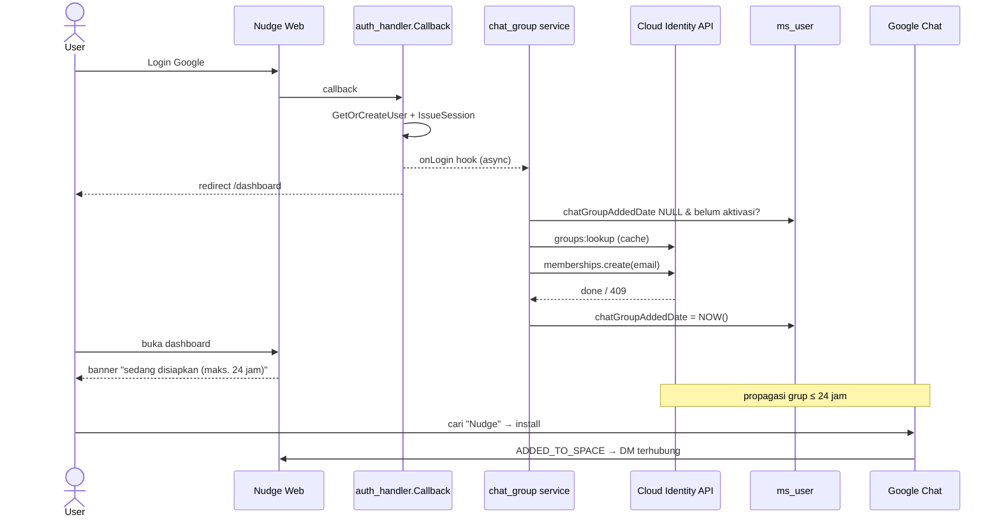

# Tech Spec — Auto Join Google Group untuk Visibility App Nudge

> **Date:** 2026-11-16
> **PRD Link:** — (permintaan langsung user, 2026-11-16)
> **STP Link:** —
> **Epic / Task:** Nudge — user web otomatis bisa menemukan app Nudge di Google Chat
> **Document Status:** `In Review` — **gated oleh Spike (Task #0)**
> **Document Owner:** Yusuf Wijaya
> **Need Review:** Yusuf Wijaya

---

## 📋 Background, Problem & Solution

| | |
|---|---|
| **Why** | App Nudge (Chat app klasik, project `jira-u-bot` milik akun Gmail) hanya bisa ditemukan oleh email/grup di daftar **Visibility** Chat API. Daftar itu tidak bisa diubah lewat API untuk Chat app non-add-on ([configure-chat-api](https://developers.google.com/workspace/chat/configure-chat-api): "`chatAppConfig` methods only support Chat apps built as Google Workspace add-ons"). Menambah orang satu per satu manual tidak skala. |
| **Current condition** | Visibility berisi email perorangan. Pendaftaran Nudge hanya lewat web (`auth_handler.Callback` → `GetOrCreateUser`, `modules/auth/auth_handler/auth_handler_impl.go:127`); install app oleh user belum terdaftar dijawab "daftar lewat web" (`modules/chat_app/chat_app_service/chat_app_service.go`). Token OAuth operator (`modules/chat_oauth`) hanya punya scope Chat. |
| **Solution** | Satu Google Group `nudge-users@esb.co.id` dipasang **sekali** di Visibility. Saat user login web (pertama kali dan login berikutnya bila belum tercatat), Nudge menambahkan emailnya ke grup itu via **Cloud Identity Groups API** (`groups:lookup` + `memberships.create`) memakai token OAuth **terpisah** milik operator (pemilik grup). Dashboard menampilkan "App Nudge sedang disiapkan untuk akunmu (maks. 24 jam)" selama propagasi grup. |

---

## 🧪 Spike Gate (Task #0) — wajib lolos sebelum implementasi

Dokumentasi tidak memastikan bahwa **pemilik grup non-admin** boleh menambah anggota lewat API, dan bahwa kebijakan Workspace ESB tidak memblokir scope `cloud-identity.groups`. Uji manual via [OAuth Playground](https://developers.google.com/oauthplayground) dengan akun `yusuf.wijaya@esb.co.id`:

1. Buat grup `nudge-users@esb.co.id` (groups.google.com, Groups for Business, **bukan** grup dinamis, **tidak** locked).
2. Authorize scope `https://www.googleapis.com/auth/cloud-identity.groups`.
3. `GET https://cloudidentity.googleapis.com/v1/groups:lookup?groupKey.id=nudge-users@esb.co.id` → catat `groups/{id}`.
4. `POST https://cloudidentity.googleapis.com/v1/groups/{id}/memberships` body `{"preferredMemberKey":{"id":"<email>"},"roles":[{"name":"MEMBER"}]}`.

| Hasil spike | Keputusan |
|---|---|
| Langkah 2–4 sukses, anggota muncul di grup | **GO** — lanjut Task #1–#7 |
| "Access blocked" / admin restricted di langkah 2 | **NO-GO** — tetap manual; spec ditutup |
| 403 di langkah 4 (bukan admin) | **NO-GO** — tetap manual; opsi lain: minta admin ESB jadikan operator *Groups Admin* |
| "API not enabled" (project Playground) | Ulang langkah 2–4 memakai OAuth client project `jira-u-bot` setelah Cloud Identity API di-enable |

---

## 📖 User Stories & Acceptance Criteria

### US-1 — User web otomatis masuk grup
- **AC1.1** Setelah login web sukses (callback Google), bila fitur aktif dan user belum tercatat masuk grup, Nudge menambahkan email user ke grup secara **asinkron** (login tidak menunggu; gagal tidak menggagalkan login).
- **AC1.2** Sukses atau "sudah anggota" (`409 ALREADY_EXISTS`) → catat `ms_user.chatGroupAddedDate = NOW()`, kosongkan `chatGroupError`.
- **AC1.3** (negatif) Error API (403/5xx/timeout) → catat `chatGroupError` (≤255 char), `chatGroupAddedDate` tetap NULL, log `WARN`; dicoba ulang oleh sweep (US-3).
- **AC1.4** (negatif) Fitur tidak dikonfigurasi (`NUDGE_GROUP_EMAIL` kosong atau token Groups tidak ada) → tidak ada panggilan API, tidak ada perubahan DB, banner seperti sekarang.
- **AC1.5** (edge) User yang sudah mengaktifkan app (`chatAppSpaceID` terisi) tidak perlu ditambahkan; dilewati.
- **AC1.6** (edge) Operator (`JIRA_EMAIL`) tetap ditambahkan seperti user lain (tidak ada pengecualian khusus) — idempotent via 409.

### US-2 — Dashboard menjelaskan status
- **AC2.1** `GET /api/dashboard/chat-app/status` menambah `groupState`: `"none"` (fitur mati/tidak relevan), `"pending"` (`chatGroupAddedDate` < 24 jam & belum aktivasi), `"ready"` (≥ 24 jam atau sudah aktivasi), `"failed"` (`chatGroupError` terisi).
- **AC2.2** Banner aktivasi saat `pending`: *"App Nudge sedang disiapkan untuk akunmu (maks. 24 jam). Sementara itu notifikasi tetap dikirim lewat DM."* + tombol aktivasi tetap ada (boleh dicoba lebih cepat).
- **AC2.3** Saat `failed`: *"Akunmu belum bisa ditambahkan ke app Nudge. Hubungi admin Nudge."* — tidak menampilkan detail error teknis (detail ada di log server & `ms_user.chatGroupError`).
- **AC2.4** (negatif) `ready`/`none` → banner sama seperti sekarang.

### US-3 — Sweep untuk user lama & retry
- **AC3.1** Job tiap 1 jam menambahkan semua user aktif dengan `chatGroupAddedDate IS NULL` dan `chatAppSpaceID` kosong (maks. 50 per run, jeda 200 ms antar panggilan).
- **AC3.2** Saat deploy pertama, 7 user yang sudah terdaftar ikut tertambah lewat sweep tanpa perlu login ulang.
- **AC3.3** (negatif) Token Groups invalid/revoked → sweep berhenti di panggilan pertama yang gagal 401, log `ERROR` sekali per run.
- **AC3.4** (edge) User dinonaktifkan admin tidak ditambahkan (anggota yang sudah ada tidak dihapus — out of scope).

### US-4 — Setup operator
- **AC4.1** CLI `./nudge --setup-groups-oauth` menjalankan consent sekali (scope `cloud-identity.groups`, offline) dan menyimpan token di `GOOGLE_GROUPS_TOKEN_PATH` (default `./data/groups_oauth_token.json`, chmod 600) — **terpisah** dari token Chat operator.
- **AC4.2** `groups:lookup` hasilnya di-cache di memori (resource name grup) sampai restart.

---

## 🗺️ Domain Mapping

| User Story | Domain (Nudge) | Sub-module |
|------------|----------------|------------|
| US-1, US-3, US-4 | Chat App onboarding | `modules/chat_group` (baru), `main.go` login hook |
| US-2 | Chat App activation | `modules/chat_app_activation`, `frontend/.../chat-app-banner` |

---

## 🔀 Cross-repo Impact

| Repo | Impact | Detail | Priority |
|------|--------|--------|----------|
| `nudge` | `YES` | Backend Go, frontend banner, migrasi | `MEDIUM` |
| `fnb-backend` / `go-core-api` / `phantom-lancer` | `NO` | — | — |

---

## 🗄️ DB Schema Changes

```sql
-- Table   : ms_user
-- Action  : ADD COLUMN (migrations/0020_chat_group.sql, via addColumnIfNotExists)
ALTER TABLE ms_user
  ADD COLUMN chatGroupAddedDate DATETIME NULL COMMENT 'Kapan email masuk grup Visibility app Nudge',
  ADD COLUMN chatGroupError VARCHAR(255) NULL COMMENT 'Error terakhir saat menambah ke grup';
```

> Nomor migrasi menyesuaikan urutan saat implementasi (spec "Aturan Board" juga merencanakan `0020`; yang di-merge belakangan memakai nomor berikutnya).

---

## 📡 API Contract

### `GET /api/dashboard/chat-app/status` *(modified)*

**Response 200** — field baru:
```json
{
  "groupState": "none | pending | ready | failed"
}
```
Tidak ada endpoint baru. Panggilan keluar (Cloud Identity):

| Call | Request | Sukses | Ditangani |
|------|---------|--------|-----------|
| `GET /v1/groups:lookup?groupKey.id={NUDGE_GROUP_EMAIL}` | — | `{"name":"groups/…"}` | 403/404 → fitur dianggap gagal konfigurasi, log `ERROR` |
| `POST /v1/{group}/memberships` | `{"preferredMemberKey":{"id":email},"roles":[{"name":"MEMBER"}]}` | `Operation` (`done:true`) | `409` = sudah anggota (sukses); 401 = token invalid; lainnya = gagal |

---

## 🔐 Access Control Matrix

| Action | Guard | Behavior if Denied |
|--------|-------|--------------------|
| Tambah ke grup | Hanya server, token operator; dipicu login user sendiri / sweep | — |
| Lihat `groupState` | `AuthMiddlewareAPI` (user sendiri) / `AdminMiddleware` (admin target) | `401`/`403` |

> Tidak ada endpoint publik untuk menambah anggota; email yang ditambahkan selalu email sesi login yang sudah diverifikasi Google (domain @esb.co.id).

---

## 🔄 Sequence Diagram



---

## 🧠 State Management & UI Logic

```
groupState (server-side, dihitung di chat_app_activation.status)
  fitur mati                                → none
  sudah aktivasi app                        → ready
  chatGroupError != NULL                    → failed
  chatGroupAddedDate != NULL && < 24 jam    → pending
  chatGroupAddedDate != NULL && ≥ 24 jam    → ready
  chatGroupAddedDate NULL (belum diproses)  → pending (sweep/hook segera memproses)

Banner aktivasi (chat-app-banner.component)
  pending → teks "sedang disiapkan…" + tombol aktivasi tetap tampil
  failed  → teks "belum bisa ditambahkan… admin sudah diberi tahu"
  ready/none → perilaku sekarang
```

---

## ✅ Breakdown Task & Effort

| # | Task | Repo | AC Coverage | 🤖 AI | 👨‍💻 Dev Verify | Blocked By |
|---|------|------|-------------|-------|----------------|------------|
| 0 | **Spike** OAuth Playground (manual oleh user) + enable Cloud Identity API di `jira-u-bot` | — | Gate | `—` | `~15m` | — |
| 1 | Migrasi `chatGroupAddedDate`/`chatGroupError` + repository (mark added/error, list pending) | `nudge` | AC1.2, AC1.3, AC3.1 | `~1m` | `~20m` | #0 |
| 2 | Config `NUDGE_GROUP_EMAIL`, `GOOGLE_GROUPS_TOKEN_PATH`; CLI `--setup-groups-oauth`; token source terpisah | `nudge` | AC1.4, AC4.1 | `~1m` | `~30m` | #0 |
| 3 | Client Cloud Identity: `Lookup` (cache) + `AddMember` (409 = ok) + test httptest | `nudge` | AC1.2, AC4.2 | `~1m` | `~30m` | #2 |
| 4 | Service `chat_group`: `EnsureMember(email)` (skip aktivasi/nonaktif), sweep job 1 jam, wiring login hook async di `main.go` | `nudge` | AC1.1, AC1.5, AC1.6, AC3.1–AC3.4 | `~2m` | `~45m` | #1, #3 |
| 5 | `groupState` di status chat-app (user + admin) | `nudge` | AC2.1 | `~1m` | `~20m` | #1 |
| 6 | Frontend banner pending/failed + test | `nudge` | AC2.2–AC2.4 | `~1m` | `~30m` | #5 |
| 7 | README + `.env.example`, deploy, jalankan `--setup-groups-oauth` di server, pasang grup di Visibility, verifikasi sweep 7 user | `nudge` | AC3.2, AC4.1 | `~1m` | `~30m` | #1–#6 |

> **🤖 AI generates code: ~0.15h**
>
> **👨‍💻 Dev verify & fix: ~3.7h** — consent OAuth di server (headless), perilaku 409/403 nyata, propagasi grup
>
> **Combined: ~3.9h** (~0.5 hari kerja) — di luar waktu tunggu propagasi grup (≤ 24 jam)
>
> ⚠️ Uncovered ACs: tidak ada.

---

## 🔗 Dependencies

**Internal:** `auth_handler.WithLoginHook` (sudah ada), `chat_app_activation.status`, `registration_repository` (ms_user).

**External:**
- Cloud Identity Groups API (enable di project `jira-u-bot`), scope `cloud-identity.groups`.
- Google Group `nudge-users@esb.co.id` (Groups for Business, non-dinamis, tidak locked) dimiliki operator.
- Kebijakan Workspace ESB mengizinkan akses scope tersebut dari aplikasi pihak ketiga (dibuktikan Spike).

---

## 🚀 Milestone / Deployment Strategy

1. Spike (Task #0) → GO.
2. Deploy kode (fitur mati selama `NUDGE_GROUP_EMAIL` kosong).
3. Di server: `./nudge --setup-groups-oauth` (consent sekali, token ke `shared/data/`), isi `NUDGE_GROUP_EMAIL` & `GOOGLE_GROUPS_TOKEN_PATH` di `shared/.env`, restart.
4. Cloud Console → Chat API → Visibility: `yusuf.wijaya@esb.co.id, nudge-users@esb.co.id` → Save.
5. Verifikasi: sweep menambah 7 user (`SELECT email, chatGroupAddedDate, chatGroupError FROM ms_user`), anggota terlihat di groups.google.com.
6. **Rollback plan:** kosongkan `NUDGE_GROUP_EMAIL` + restart (fitur mati); kolom DB boleh tetap.

---

## ⚠️ Drawbacks / Risks

| Category | Risk |
|----------|------|
| **Propagasi** | Grup bisa butuh ≤ 24 jam; aktivasi 1-klik bisa gagal di jam-jam pertama — diredam teks banner. |
| **Kebijakan ESB** | Admin bisa memblokir scope atau mengunci grup kapan saja → state `failed`; notifikasi tetap via DM operator. |
| **Token operator** | Token Groups milik akun pribadi operator; bila operator keluar/revoke, fitur berhenti (log `ERROR`), tidak memengaruhi DM Chat karena token terpisah. |
| **Privasi** | Grup berisi email pengguna Nudge; atur "Who can view members" = hanya pemilik/manager. |
| **Rate limit** | Sweep dibatasi 50/run + jeda 200 ms; skala tim kecil. |

---

## ❓ Unresolved / Pending Clarification

| # | Location | Contradiction / Ambiguity | Assumption Made |
|---|----------|---------------------------|-----------------|
| 1 | Spike | Hak pemilik grup non-admin & kebijakan ESB belum terbukti. | Implementasi menunggu hasil spike. ⚠️ |
| 2 | AC3.4 | Hapus anggota grup saat user dinonaktifkan/dihapus? | Tidak (out of scope); admin hapus manual di Google Groups. |
| 3 | AC1.6 | Nama grup final. | `nudge-users@esb.co.id`, bisa diganti via env. |
| 4 | AC2.3 | Perlu tampilan error di Admin › Detail User? | Tidak di versi ini — admin melihat log server / `ms_user.chatGroupError`. |

> **Future possibilities:** hapus anggota otomatis saat user dihapus; listing Marketplace private bila project dipindah ke organisasi ESB.

---

## 📁 Files to Modify

| File | Change |
|------|--------|
| `migrations/0020_chat_group.sql`, `migrations/migrate.go` | Kolom `chatGroupAddedDate`, `chatGroupError` |
| `config/config.go`, `.env.example` | `NUDGE_GROUP_EMAIL`, `GOOGLE_GROUPS_TOKEN_PATH` |
| `modules/chat_group/` (baru) | `client.go` (Cloud Identity), `service.go` (EnsureMember, sweep), `repository.go`, token setup, test |
| `main.go` | Flag `--setup-groups-oauth`; login hook memanggil `EnsureMember` async; worker sweep |
| `modules/chat_app_activation/chat_app_activation.go` | `groupState` di `StatusResponse` |
| `frontend/src/app/core/services/chat-app.service.ts` | Tipe `groupState` |
| `frontend/src/app/shared/ui/chat-app-banner.component.ts` (+spec) | Teks pending/failed |
| `README.md` | Dokumentasi setup grup |
