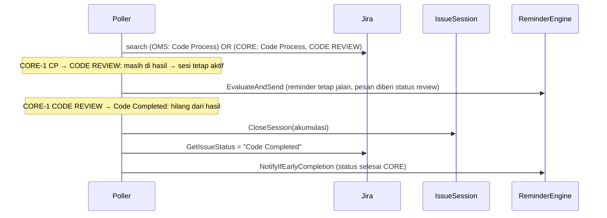

# Tech Spec — CORE: Waktu Code Review Ikut Dihitung

> **Date:** 2026-11-14
> **PRD Link:** — (hasil brainstorming di sesi Claude Code, disetujui user)
> **STP Link:** —
> **Epic / Task:** Nudge — perubahan aturan perhitungan untuk project CORE
> **Document Status:** `Implemented`
> **Document Owner:** Yusuf Wijaya
> **Need Review:** —

---

## 📋 Background, Problem & Solution

| | |
|---|---|
| **Why** | Di CORE, waktu Code Review adalah bagian dari pengerjaan tiket. Budget harus terus berjalan selama review dan baru berhenti saat tiket **Code Completed**. |
| **Current condition** | Poller (`modules/poller/poller_service/poller_service_impl.go`) hanya melacak status `"Code Process"` (JQL `project in (CORE, OMS) AND status = "Code Process"` di `jira_client_service_impl.go`). Keluar dari Code Process → sesi ditutup; notif selesai-lebih-awal dicek dengan `status == "Code Review"` (case-sensitive) sehingga **tidak pernah terkirim untuk CORE** yang memakai `"CODE REVIEW"`. Waktu mulai sesi dari changelog transisi terakhir ke `"Code Process"` (`GetLatestCodeProcessEntryTime`). |
| **Solution** | Peta aturan status per project (status yang dihitung + status "selesai"). CORE menghitung `Code Process` + `CODE REVIEW` tanpa putus dan berhenti saat keluar (Code Completed → notif selesai lebih awal). Reminder tetap jalan saat review. Dashboard: card **Sedang di-review** untuk CORE. |

Status workflow (terverifikasi live 2026-11-14): CORE — To Do, Code Process, **CODE REVIEW**, **Code Completed**, TEST RUN, SIT, UAT, Feedback, TEST COMPLETE, Release Candidate, Done, RELEASED. OMS — New, To Do, Code Process, **Code Review**, Code Complete, TESTING & Review, Test Complete, UAT, Feedback, RELEASE CANDIDATE, Done.

---

## 🗺️ Domain Mapping

| User Story | Domain | Sub-module |
|------------|--------|------------|
| US-1 Waktu CORE dihitung di Code Process + CODE REVIEW | Tracking | `jira_client`, `poller`, `issue_session` |
| US-2 Notif & reminder sesuai aturan per project | Notification | `reminder_engine`, `google_chat_notifier` |
| US-3 Card "Sedang di-review" di Dashboard | Dashboard | `user_dashboard`, frontend home |

**Acceptance Criteria**

- **AC1.1** Aturan per project: OMS dihitung `[Code Process]`, selesai `Code Review`; CORE dihitung `[Code Process, CODE REVIEW]`, selesai `Code Completed`. Project lain: perilaku OMS (default).
- **AC1.2** Pencocokan nama status tidak peka huruf besar/kecil.
- **AC1.3** CORE Code Process ↔ CODE REVIEW tidak menutup sesi (waktu jalan terus).
- **AC1.4** Keluar dari status yang dihitung → sesi ditutup (akumulasi). Ke status "selesai" → notif selesai lebih awal (bila di bawah budget); ke To Do → notif balik ke To Do; status lain → berhenti tanpa notif.
- **AC1.5** Sesi baru (tiket belum pernah dilacak) mulai dari awal rangkaian status terhitung saat ini (masuk dari status tidak terhitung). Sesi lama yang dibuka lagi mulai dari transisi terakhir ke status terhitung (tidak menghitung dobel waktu yang sudah diakumulasi).
- **AC1.6** Kembali ke Code Process setelah keluar → waktu lanjut dari akumulasi.
- **AC2.1** Reminder (tier & overage) tetap dikirim selama CODE REVIEW.
- **AC2.2** Pesan untuk tiket yang sedang di review menampilkan baris `*Status:* CODE REVIEW (waktu review tetap dihitung)`.
- **AC2.3** Bug: notif selesai lebih awal CORE terkirim saat tiket masuk Code Completed.
- **AC3.1** Tiket CORE di CODE REVIEW mendapat detail budget (progress bar) di Dashboard.
- **AC3.2** `GET /boards` mengembalikan `reviewTracked` per board (true untuk project yang menghitung review).
- **AC3.3** Card "Sedang di-review" di bawah "Sedang dikerjakan": selalu tampil untuk board `reviewTracked`; di "Semua board" tampil bila ada tiket review terlacak; tidak tampil untuk board OMS.
- **AC3.4** Card review: urutan lewat budget dulu, warna bar sama, hanya aksi **To Do**.
- **AC3.5** Statistik "Lewat budget" menghitung tiket Code Process + review; "Sedang dikerjakan" tetap Code Process saja.

---

## 🔀 Cross-repo Impact

| Repo | Impact | Detail | Priority |
|------|--------|--------|----------|
| `jira-u-bot` (Go) | `YES` | `jira_client` (aturan status, JQL, changelog), `poller`, `reminder_engine`, `google_chat_notifier`, `user_dashboard` | `HIGH` |
| `jira-u-bot/frontend` | `YES` | Dashboard home | `MEDIUM` |
| `fnb-backend` / `go-core-api` / `phantom-lancer` | `NO` | — | — |

---

## 🗄️ DB Schema Changes

**No schema changes required.** *(Aturan status ada di kode; sesi memakai kolom yang sudah ada.)*

---

## 📡 API Contract

### `GET /api/dashboard/boards` *(diubah)*
Tambahan field per board:
```json
{ "reviewTracked": true }
```

### `GET /api/dashboard/board?board=X` *(perilaku diubah)*
Kartu tiket CORE di `CODE REVIEW` yang punya sesi aktif kini juga berisi `hasBudgetDetail`, `elapsedSeconds`, `budgetSeconds`, label sisa & deadline (sebelumnya hanya Code Process). Bentuk respons tetap.

---

## 🔐 Access Control Matrix

Tidak berubah — semua data tetap scoped ke sesi login.

---

## 🔄 Sequence Diagram



---

## 🧠 State Management & UI Logic

```
Card "Sedang di-review" (home)
  Data           : kartu dari GET /board dengan status = status review terlacak (case-insensitive) — bukan "Code Process"
  Tampil         : board terpilih reviewTracked → selalu (empty state bila kosong)
                   Semua board → hanya bila ada tiket review berdetail budget / berstatus review di board reviewTracked
                   board tidak reviewTracked → tidak tampil
  Aksi           : To Do (konfirmasi), sama dengan card Sedang dikerjakan
Stat "Lewat budget" : Code Process + review yang lewat budget
```

---

## ✅ Breakdown Task & Effort

| # | Task | Repo | AC Coverage | 🤖 AI | 👨‍💻 Dev Verify | Blocked By |
|---|------|------|-------------|-------|----------------|------------|
| 1 | `jira_client_dto` aturan status per project + helper + test | `jira-u-bot` | AC1.1, AC1.2 | `~1m` | `~20m` | — |
| 2 | JQL poller per project + changelog `GetTrackedRunStart` + test | `jira-u-bot` | AC1.1, AC1.5 | `~2m` | `~45m` | #1 |
| 3 | Poller: exit per project, start sesi baru vs dibuka lagi + test | `jira-u-bot` | AC1.3–AC1.6, AC2.3 | `~2m` | `~1h` | #2 |
| 4 | Reminder/notifier: baris status review + test | `jira-u-bot` | AC2.1, AC2.2 | `~1m` | `~20m` | #1 |
| 5 | Dashboard: detail budget review, `reviewTracked` + test | `jira-u-bot` | AC3.1, AC3.2 | `~1m` | `~30m` | #1 |
| 6 | Frontend: card Sedang di-review + stat + spec | `frontend` | AC3.3–AC3.5 | `~2m` | `~45m` | #5 |
| 7 | README + verifikasi visual | — | semua | `~1m` | `~20m` | #3, #6 |

> **🤖 AI generates code: ~0.2h** · **👨‍💻 Dev verify & fix: ~4h** · **Combined: ~4.2h** (~0.5 hari)

---

## 🔗 Dependencies

**Internal:** `issue_session` (akumulasi), `business_hours`, `board` (projectKey board untuk `reviewTracked`).
**External:** Jira REST — search JQL, issue changelog, issue status.

---

## 🚀 Milestone / Deployment Strategy

1. Tidak ada migration. Deploy → siklus poll berikutnya mulai melacak tiket CORE di CODE REVIEW.
2. Tiket CORE yang sedang di review saat deploy: sesinya dibuka lagi mulai dari transisi terakhirnya ke status terhitung (masuk CODE REVIEW), sehingga waktu Code Process yang sudah diakumulasi tidak dihitung dua kali. Waktu review antara masuk review dan deploy ikut terhitung.
3. **Rollback plan:** deploy build sebelumnya; sesi review yang terbuka akan ditutup di siklus poll pertama build lama (dianggap keluar dari Code Process).

---

## ⚠️ Drawbacks / Risks

| Category | Risk |
|----------|------|
| **Behavior change** | Tiket CORE di review kini mendapat reminder & notif lewat budget (disengaja, AC2.1). |
| **Data** | Angka "aktual" sprint report CORE akan lebih besar dari sebelumnya untuk tiket yang melewati review setelah deploy. |
| **Performance** | Satu JQL (lebih lebar); changelog hanya dibaca saat sesi dibuka (tidak berubah). |
| **Notif "selesai lebih awal" OMS** | Tetap terpicu saat masuk Code Review — kini case-insensitive. |

---

## ❓ Unresolved / Pending Clarification

| # | Location | Contradiction / Ambiguity | Assumption Made |
|---|----------|---------------------------|-----------------|
| 1 | AC3.4 | Aksi geser ke Code Completed dari dashboard | Tidak ada — `/u-geser` belum mendukung target itu |
| 2 | AC1.1 | Project selain OMS/CORE di masa depan | Default = aturan OMS |

> **Future possibilities:** aturan status per project bisa dipindah ke setting admin (fase setting global).

---

## 📁 Files to Modify

| File | Change |
|------|--------|
| `modules/jira_client/jira_client_dto/constants.go`, `tracking_rules.go` (baru) | Aturan status per project + helper |
| `modules/jira_client/jira_client_service/*` | JQL per project, `GetLatestTrackedEntryTimes` (changelog) |
| `modules/poller/poller_service/*` | Exit per project, waktu mulai sesi baru vs dibuka lagi |
| `modules/google_chat_notifier/*`, `modules/reminder_engine/*` | Baris status review di pesan |
| `modules/user_dashboard/*` | Detail budget review, `reviewTracked` |
| `frontend/src/app/core/services/board-context.service.ts`, `features/dashboard/home/*` | Card Sedang di-review, stat |
| `README.md` | Dokumentasi |
