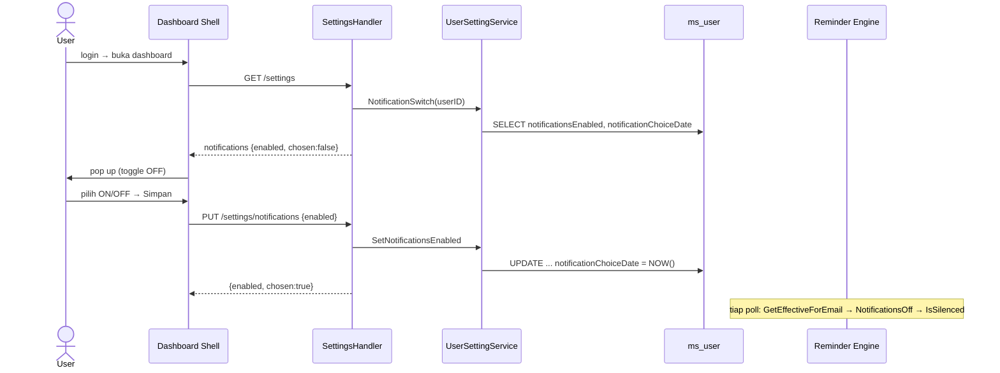

# Tech Spec — Pilihan On/Off Notifikasi Setelah Login

> **Date:** 2026-11-15
> **PRD Link:** — (request langsung dari user, sesi brainstorming 2026-11-15)
> **STP Link:** —
> **Epic / Task:** Nudge — Notification consent
> **Document Status:** `Implemented`
> **Document Owner:** Yusuf Wijaya
> **Need Review:** —

---

## 📋 Background, Problem & Solution

| | |
|---|---|
| **Why** | Begitu user login pertama kali (auto-register), Nudge langsung mengirim reminder. User perlu memilih sendiri apakah mau menerima notifikasi; default-nya OFF. |
| **Current condition** | Registrasi terjadi di login Google pertama (`modules/auth/auth_service/auth_service_impl.go:111` → `registration_repository.UpsertUser`). Reminder engine hanya menahan notif saat mute / jam tenang (`user_setting_dto.UserSetting.IsSilenced`). Tidak ada penanda "sudah memilih". |
| **Solution** | Saklar utama per user di `ms_user` (`notificationsEnabled`, `notificationChoiceDate`). User baru = OFF; user lama tetap ON. Selama belum memilih, pop up wajib muncul setelah login (toggle awal OFF). Saklar yang sama ada di Pengaturan. Reminder engine menganggap OFF seperti mute. |

### Keputusan dari brainstorming

| # | Pertanyaan | Keputusan |
|---|---|---|
| 1 | User lama saat rilis | Notifikasi **tetap jalan** sampai mereka memilih; toggle di pop up awalnya OFF. User baru langsung OFF. |
| 2 | Cakupan saklar | Semua notif otomatis: reminder sebelum/sesudah budget, selesai lebih awal, balik ke To Do. Broadcast admin & balasan command `/u-` tetap jalan. |
| 3 | Perilaku pop up | Wajib pilih sekali (tidak bisa ditutup tanpa Simpan); tidak muncul lagi setelah memilih. |

---

## 🗺️ Domain Mapping

| User Story | Domain | Sub-module |
|------------|--------|------------|
| US-1 Pilih on/off setelah login | Nudge Dashboard | `user_dashboard` handler, frontend shell |
| US-2 Notifikasi patuh saklar | Nudge Bot | `reminder_engine`, `user_setting` |
| US-3 Ubah saklar kapan saja | Nudge Frontend | Pengaturan |

### Acceptance Criteria

- **AC1.1** User baru (registrasi lewat login pertama) tersimpan `notificationsEnabled = 0`, `notificationChoiceDate = NULL`.
- **AC1.2** User lama setelah migrasi: `notificationsEnabled = 1`, `notificationChoiceDate = NULL`.
- **AC1.3** Selama `notificationChoiceDate IS NULL`, pop up muncul di dashboard setelah login, dengan toggle awal **OFF** (untuk user lama pun).
- **AC1.4** Pop up tidak bisa ditutup tanpa Simpan (tanpa tombol ×, klik backdrop / Esc tidak menutup).
- **AC1.5** Simpan → nilai tersimpan, `notificationChoiceDate = NOW()`, pop up tertutup dan tidak muncul lagi (juga setelah reload/login ulang).
- **AC1.6** Gagal simpan → pesan error di pop up, pop up tetap terbuka.
- **AC2.1** OFF → tidak ada reminder T-, notif budget habis / T+ / repeat, selesai lebih awal, balik ke To Do; tier yang jatuh tempo dicatat `skipped` (sama seperti mute).
- **AC2.2** OFF → session tiket & waktu tetap dihitung (poller tidak berubah).
- **AC2.3** Broadcast admin dan balasan command `/u-` tidak terpengaruh.
- **AC2.4** Assignee yang tidak terdaftar / lookup gagal → perilaku lama (default, ON).
- **AC3.1** Pengaturan menampilkan card "Notifikasi Nudge" dengan saklar; mengubahnya langsung tersimpan.
- **AC3.2** OFF → banner Dashboard menampilkan "Notifikasi mati".

---

## 🔀 Cross-repo Impact

| Repo | Impact | Detail | Priority |
|------|--------|--------|----------|
| `jira-u-bot` (Nudge) | `YES` | migration, registration, user_setting, reminder engine (via `IsSilenced`), user_dashboard handler, frontend | `HIGH` |
| `fnb-backend` / `go-core-api` / `phantom-lancer` | `NO` | — | — |

---

## 🗄️ DB Schema Changes

```sql
-- Table   : ms_user
-- Action  : ADD COLUMN
ALTER TABLE ms_user
  ADD COLUMN notificationsEnabled TINYINT(1) NOT NULL DEFAULT 1 COMMENT 'saklar utama notif otomatis; user lama = 1, user baru di-insert 0',
  ADD COLUMN notificationChoiceDate DATETIME NULL COMMENT 'kapan user memilih lewat pop up/pengaturan; NULL = belum memilih';

-- Migration file: migrations/0014_user_notification_switch.sql (addColumnIfNotExists)
-- (0013 dipakai migrasi foto profil user yang dikerjakan paralel)
```

Insert user baru (`UpsertUser`) menulis `notificationsEnabled = 0`; `ON DUPLICATE KEY UPDATE` tidak menyentuh kedua kolom.

---

## 📡 API Contract

### `GET /nudge/api/dashboard/settings` (diubah, additive)

```json
{
  "notifications": { "enabled": false, "chosen": false },
  "...": "field lama tidak berubah"
}
```

### `PUT /nudge/api/dashboard/settings/notifications`

**Auth:** session cookie

**Request:**
```json
{ "enabled": true }
```

**Response 200:**
```json
{ "enabled": true, "chosen": true }
```

**Error Responses:**
| Code | Condition |
|------|-----------|
| `400` | body tidak valid / `enabled` tidak ada |
| `500` | gagal menyimpan |

> Endpoint ada di `SettingsHandler`, tapi **belum** di-mount di route admin (`admin_dashboard/router.go`) — cukup satu baris bila admin perlu mengubah saklar user lain.

---

## 🔐 Access Control Matrix

| Action | Rule | Behavior if Denied |
|--------|------|--------------------|
| Baca/ubah saklar sendiri | login `@esb.co.id`, target = user sesi | `401` |
| Baca/ubah saklar user lain | admin (mount admin yang sudah ada) | `403` |

> Tidak ada entry UAC baru.

---

## 🔄 Sequence Diagram



---

## 🧠 State Management & UI Logic

```
NotificationSwitchService (frontend, root)
  state       : { enabled, chosen } | null (belum dimuat)
  load()      : GET /settings (sekali di shell)
  save(on)    : PUT /settings/notifications → set state

Pop up (shell)
  Tampil      : state != null && !state.chosen
  Toggle awal : OFF
  Simpan      : disable tombol + spinner; sukses → toast + tutup; gagal → error inline
  Tutup       : hanya lewat Simpan

Pengaturan (scope default & board)
  Card "Notifikasi Nudge" paling atas, saklar = state.enabled; ubah → save()

Dashboard banner
  state.enabled === false → "Notifikasi mati" (prioritas sama dengan mute selamanya)
```

---

## ✅ Breakdown Task & Effort

| # | Task | Repo | AC Coverage | 🤖 AI | 👨‍💻 Dev Verify | Blocked By |
|---|------|------|-------------|-------|----------------|------------|
| 1 | Migration 0013 + `UpsertUser` insert OFF + scan kolom baru | `jira-u-bot` | AC1.1, AC1.2 | `~1m` | `~20m` | — |
| 2 | Repo + service `NotificationSwitch` / `SetNotificationsEnabled`; `NotificationsOff` di `GetEffectiveForEmail` + `IsSilenced` | `jira-u-bot` | AC2.1–AC2.4 | `~2m` | `~30m` | #1 |
| 3 | Handler: field `notifications` di GET, PUT `/settings/notifications` | `jira-u-bot` | AC1.5, AC1.6 | `~1m` | `~15m` | #2 |
| 4 | Frontend: service state, pop up di shell, card Pengaturan, banner | `jira-u-bot` | AC1.3–AC1.6, AC3.1, AC3.2 | `~3m` | `~45m` | #3 |
| 5 | Test Go + Angular, visual QA, README | `jira-u-bot` | semua | `~2m` | `~30m` | #4 |

> **🤖 AI generates code: ~0.2h**
>
> **👨‍💻 Dev verify & fix: ~2.3h**
>
> **Combined: ~2.5h** (~0.5 working day)

---

## 🔗 Dependencies

**Internal:** `registration` (insert user), `user_setting` (effective setting + saklar), `reminder_engine` (memakai `IsSilenced`, tanpa perubahan kode), `user_dashboard` (`SettingsHandler`).

**External:** None.

---

## 🚀 Milestone / Deployment Strategy

1. Migrasi jalan otomatis saat start (`migrations.Apply`); kolom baru default 1 → user lama tidak berubah perilakunya.
2. Deploy backend + frontend bersamaan.
3. **Rollback plan:** deploy build sebelumnya; kolom baru boleh dibiarkan (diabaikan build lama). Bila perlu: `ALTER TABLE ms_user DROP COLUMN notificationChoiceDate, DROP COLUMN notificationsEnabled;`

---

## ⚠️ Drawbacks / Risks

| Category | Risk |
|----------|------|
| **Adopsi** | User baru yang tidak pernah membuka dashboard lagi tidak akan menerima reminder (memang default OFF). |
| **Perilaku** | Saat dinyalakan kembali, notif "budget habis" (T+0) yang tertahan langsung terkirim — sama seperti saat mute berakhir. |
| **Performance** | Tidak ada query tambahan di reminder engine: kolom ikut terbaca di `FindUserByEmail` yang sudah ada. |

---

## ❓ Unresolved / Pending Clarification

| # | Location | Contradiction / Ambiguity | Assumption Made |
|---|----------|---------------------------|-----------------|
| 1 | AC1.3 | Admin login sebagai user biasa juga dapat pop up | Ya, admin sama seperti user lain. |
| 2 | AC2.1 | Hubungan dengan "Mute selamanya" | Terpisah; keduanya menahan notif. Saklar tidak mengubah mute. |

> **Future possibilities:** pengingat DM sekali untuk user baru yang belum memilih.

---

## 📁 Files to Modify

| File | Change |
|------|--------|
| `migrations/0014_user_notification_switch.sql` (baru), `migrations/migrate.go` | kolom baru |
| `modules/registration/registration_dto/registration_dto.go` | field `NotificationsEnabled`, `NotificationChoiceDate` |
| `modules/registration/registration_repository/registration_repository_impl.go` | insert OFF, kolom di select/scan |
| `modules/user_setting/user_setting_dto/user_setting_dto.go` | `NotificationsOff`, `IsSilenced`, `NotificationSwitch` |
| `modules/user_setting/user_setting_repository/*` | `FindNotificationSwitch`, `SaveNotificationSwitch` |
| `modules/user_setting/user_setting_service/*` | `NotificationSwitch`, `SetNotificationsEnabled`, `GetEffectiveForEmail` |
| `modules/user_dashboard/user_dashboard_handler/settings_handler.go`, `user_dashboard_handler.go`, `user_dashboard_handler_impl.go`, `router.go` | GET field + PUT endpoint |
| `frontend/src/app/core/services/notification-switch.service.ts` (baru), `board.service.ts` | API + state |
| `frontend/src/app/shared/ui/notification-consent.component.ts` (baru) + spec | pop up |
| `frontend/src/app/layouts/dashboard-shell/*` | pop up |
| `frontend/src/app/features/dashboard/settings/*`, `home/*` | card saklar, banner |
| `README.md` | dokumentasi |
