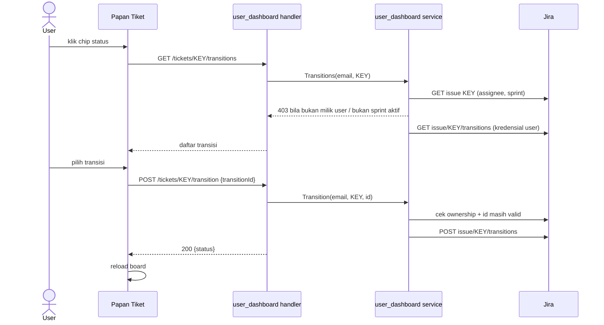
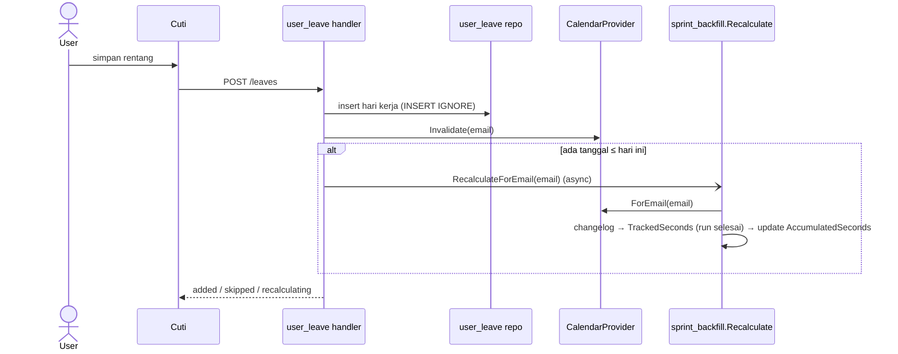

# Tech Spec — Papan Tiket & Cuti

> **Date:** 2026-11-15
> **PRD Link:** — (request langsung dari user, 2026-11-15)
> **STP Link:** —
> **Epic / Task:** Nudge — Dashboard self-service
> **Document Status:** `Implemented`
> **Document Owner:** Yusuf Wijaya
> **Need Review:** —

---

## 📋 Background, Problem & Solution

| | |
|---|---|
| **Why** | (1) User harus buka Jira hanya untuk memindahkan status tiketnya; workflow CORE dan OMS berbeda (OMS di To Do hanya bisa ke Code Process), jadi bot harus ikut aturan masing-masing. (2) Saat user cuti, jam kerja tetap terhitung ke budget tiket dan DM pengingat tetap terkirim — deviasi sprint jadi tidak adil. |
| **Current condition** | Pindah status hanya lewat `/n-geser<KEY>:todo\|code-review` atau tombol di card Beranda — target terbatas dua status, dicocokkan dengan nama (`modules/user_dashboard/user_dashboard_handler/user_dashboard_handler_impl.go` `TransitionTicket` → `RouteCommand`). Kalender non-kerja hanya libur nasional global (`business_hours_dto.HolidayCalendar`, dimuat sekali di `main.go`) dan disuntikkan ke 6 service: poller, reminder_engine, chat_interactive, user_dashboard, sprint_report, sprint_backfill. `CalculateElapsedSeconds` = `AccumulatedSeconds` (beku) + elapsed periode aktif yang dihitung ulang dari `CurrentSessionStartedDate`. |
| **Solution** | (A) Menu **Papan Tiket**: tiket saya di sprint aktif per kolom status; chip status di card membuka dropdown transisi yang diizinkan Jira untuk tiket itu. (B) Menu **Cuti**: user mengisi hari cuti penuh; kalender per user = libur nasional ∪ cuti user, dipakai di semua perhitungan waktu & gate DM. Cuti di tanggal yang sudah lewat memicu hitung ulang session sprint aktif user dari changelog Jira. |

### Keputusan

| # | Pertanyaan | Keputusan |
|---|---|---|
| 1 | Tiket yang boleh dipindah | **Tiket saya di sprint aktif** (CORE/OMS, termasuk subtask). |
| 2 | Pilihan status tujuan | **Ikut workflow Jira** — daftar transisi dari `GET /issue/{key}/transitions` dengan kredensial user; batasan OMS/CORE berlaku otomatis. |
| 3 | Satuan cuti | **Hari penuh** (tanggal / rentang tanggal). |
| 4 | Efek cuti | **Waktu & notif berhenti** — hari cuti bukan jam kerja: tidak dihitung, deadline mundur, DM pengingat tidak dikirim. |
| 5 | Struktur menu | Dua menu baru: **Papan Tiket** dan **Cuti**. |
| 6 | Interaksi pindah status | **Dropdown di card** (bukan drag & drop). |
| 7 | Cuti di tengah tiket berjalan (tambahan user) | Harus menyesuaikan — periode aktif otomatis, periode lampau via hitung ulang dari changelog. |

---

## 🗺️ Domain Mapping

| User Story | Domain | Sub-module |
|------------|--------|------------|
| US-1 Pindah status tiket dari dashboard | Nudge Bot + Frontend | `user_dashboard`, `jira_client`, fitur baru `board-page` |
| US-2 Isi & hapus cuti | Nudge Bot + Frontend | modul baru `user_leave`, fitur baru `leave` |
| US-3 Cuti tidak dihitung & tidak ada DM | Nudge Bot | `business_hours` (calendar provider), 6 service pemakai kalender |
| US-4 Cuti di tengah tiket berjalan | Nudge Bot | `user_leave` → `sprint_backfill` (recalc) |

### Acceptance Criteria

**US-1 — Papan Tiket**
- **AC1.1** Menu "Papan Tiket" menampilkan tiket saya di sprint aktif (data `GET /api/dashboard/board`, ikut pemilih board di navbar) dalam kolom per status, urutan kolom mengikuti urutan status yang dikembalikan board.
- **AC1.2** Card menampilkan nomor tiket (link ke Jira), summary, SP, dan chip status. Subtask menampilkan parent-nya (pola cabang yang sudah ada).
- **AC1.3** Klik chip status → dropdown berisi transisi dari `GET /api/dashboard/tickets/:key/transitions` (nama transisi + status tujuan, seperti menu Jira). Dimuat saat dropdown dibuka, ada loading state.
- **AC1.4** Pilih transisi → `POST /api/dashboard/tickets/:key/transition` dengan `transitionId` → sukses: toast, card pindah ke kolom status baru (reload board); gagal: toast error, card tetap.
- **AC1.5** OMS di To Do hanya menampilkan "Start Development → Code Process" (sesuai workflow Jira). CORE di Code Completed menampilkan semua transisi yang diizinkan (To Do, Code Process, CODE REVIEW, Feedback, …).
- **AC1.6** Negatif: tiket bukan milik user, atau tidak di sprint aktif → `403` di kedua endpoint; `transitionId` yang tidak ada di daftar transisi saat ini → `422` "Transisi tidak tersedia untuk status sekarang".
- **AC1.7** Negatif: Jira error / kredensial tidak valid → `502` dengan pesan ramah; dropdown menampilkan "Gagal memuat transisi".
- **AC1.8** Edge: tiket tanpa transisi tersedia → dropdown menampilkan "Tidak ada transisi".
- **AC1.9** Tracking tidak diubah oleh fitur ini: poller mendeteksi status baru di polling berikutnya (mulai/stop session seperti biasa).
- **AC1.10** Kompatibilitas: body lama `{ "target": "todo" | "code-review" }` (tombol Beranda) tetap berfungsi lewat `RouteCommand`.

**US-2 — Cuti**
- **AC2.1** Menu "Cuti" berisi form rentang tanggal (dari–sampai, sampai opsional = 1 hari) + catatan opsional (maks 200 karakter), dan daftar cuti saya (tanggal, catatan, tombol hapus), urut tanggal terbaru di atas.
- **AC2.2** Simpan rentang → satu baris per **hari kerja**; Sabtu/Minggu & libur nasional di dalam rentang dilewati. Respons memberi jumlah hari yang tersimpan dan yang dilewati.
- **AC2.3** Tanggal yang sudah ada diabaikan (idempotent, tidak error).
- **AC2.4** Negatif: `to < from` → `400`; rentang > 31 hari → `400`; tanggal lebih dari 60 hari ke belakang → `400`; rentang yang seluruhnya akhir pekan/libur → `422` "Tidak ada hari kerja di rentang ini".
- **AC2.5** Hapus satu tanggal → `DELETE /api/dashboard/leaves/:date`; tanggal yang bukan milik user / tidak ada → `404`.
- **AC2.6** User hanya melihat & mengubah cutinya sendiri.

**US-3 — Efek cuti**
- **AC3.1** Kalender per user = libur nasional ∪ tanggal cuti user. `IsHoliday` true untuk keduanya.
- **AC3.2** Elapsed, sisa waktu, deadline (Beranda, `/n-` command, DM), laporan sprint, dan backfill memakai kalender milik **assignee** session.
- **AC3.3** Reminder engine: pada hari cuti assignee, `IsWithinBusinessHours` = false → tidak ada DM pengingat/overage untuk user itu. DM untuk user lain tidak terpengaruh.
- **AC3.4** Cuti di tanggal mendatang langsung menggeser deadline yang ditampilkan (deadline dihitung ulang setiap dibaca).

**US-4 — Cuti di tengah tiket berjalan**
- **AC4.1** Periode aktif: otomatis menyesuaikan karena elapsed dihitung dari `CurrentSessionStartedDate` dengan kalender user (AC3.2) — tanpa recalc.
- **AC4.2** Bila cuti yang ditambah/dihapus mencakup tanggal **≤ hari ini**, bot menghitung ulang `AccumulatedSeconds` setiap session user di sprint aktif (aktif maupun tertutup) dari changelog Jira dengan kalender user terbaru: jumlah run status tracked yang **sudah selesai** (`TrackedSeconds`, run terbuka dilewati). `CurrentSessionStartedDate` & `flagActive` tidak diubah.
- **AC4.3** Session yang tiketnya sudah tidak di sprint aktif tidak disentuh (termasuk yang ditutup 0 detik karena stale).
- **AC4.4** Recalc berjalan async setelah simpan/hapus berhasil; gagal untuk satu tiket hanya di-log, tidak menggagalkan request. Respons memberi `recalculating: true`.
- **AC4.5** Contoh acuan: tiket masuk Code Process Senin 08:30, user mengisi cuti Rabu pada hari Jumat → elapsed Jumat 17:30 = 4 hari kerja (Sen, Sel, Kam, Jum), bukan 5; deadline mundur 1 hari kerja.
- **AC4.6** Contoh acuan periode lampau: tiket Code Process Sen–Rab, balik To Do Kamis, user mengisi cuti Selasa → `AccumulatedSeconds` turun 8 jam kerja setelah recalc.

---

## 🔀 Cross-repo Impact

| Repo | Impact | Detail | Priority |
|------|--------|--------|----------|
| `jira-u-bot` (Nudge) | `YES` | jira_client (transitions by ID), user_dashboard handler/service, modul baru `user_leave`, calendar provider di `business_hours`, 6 service pemakai kalender, sprint_backfill (recalc), frontend 2 menu baru | `HIGH` |
| `fnb-backend` / `go-core-api` / `phantom-lancer` | `NO` | — | — |

---

## 🗄️ DB Schema Changes

```sql
-- Table   : tr_user_leave
-- Action  : NEW TABLE
-- Migration: migrations/0015_add_user_leave.sql
CREATE TABLE IF NOT EXISTS tr_user_leave (
  userLeaveID BIGINT AUTO_INCREMENT PRIMARY KEY,
  email       VARCHAR(255) NOT NULL COMMENT 'pemilik cuti (ms_user.email)',
  leaveDate   DATE         NOT NULL COMMENT 'hari cuti penuh (WIB)',
  note        VARCHAR(200) NULL,
  createdDate DATETIME     NOT NULL DEFAULT CURRENT_TIMESTAMP,
  UNIQUE KEY uq_user_leave_email_date (email, leaveDate),
  KEY idx_user_leave_date (leaveDate)
);
```

> Nomor migrasi dicek ulang sebelum dibuat — agent lain aktif di repo ini (0013 dipakai mereka). Rantai di `migrate.go` setelah 0014.

---

## 📡 API Contract

Semua di bawah `/nudge/api/dashboard`, auth session cookie, scope user sesi.

### `GET /tickets/:issueKey/transitions`

**Response 200:**
```json
{
  "issueKey": "OMS-12626",
  "currentStatus": "To Do",
  "transitions": [
    { "id": "11", "name": "Start Development", "toStatus": "Code Process" }
  ]
}
```

### `POST /tickets/:issueKey/transition` *(diperluas)*

**Request (baru):**
```json
{ "transitionId": "11" }
```
**Request (lama, tetap didukung):** `{ "target": "todo" | "code-review" }` → `RouteCommand`.

**Response 200:**
```json
{ "message": "OMS-12626 dipindah ke Code Process.", "status": "Code Process" }
```

**Error Responses:**
| Code | Condition |
|------|-----------|
| `400` | Body kosong / tidak ada `transitionId` maupun `target` |
| `403` | Tiket bukan milik user atau tidak di sprint aktif |
| `422` | `transitionId` tidak ada di daftar transisi saat ini |
| `502` | Jira gagal / kredensial tidak valid |

### `GET /leaves`

**Response 200:**
```json
{ "leaves": [ { "date": "2026-11-18", "note": "Cuti keluarga" } ] }
```

### `POST /leaves`

**Request:**
```json
{ "from": "2026-11-18", "to": "2026-11-20", "note": "Cuti keluarga" }
```

**Response 200:**
```json
{ "added": ["2026-11-18", "2026-11-19", "2026-11-20"], "skipped": [], "recalculating": true }
```

### `DELETE /leaves/:date`

**Response 200:** `{ "deleted": "2026-11-18", "recalculating": true }`

**Error Responses (leaves):**
| Code | Condition |
|------|-----------|
| `400` | Format tanggal salah, `to < from`, rentang > 31 hari, tanggal > 60 hari lalu, note > 200 karakter |
| `404` | DELETE: tanggal tidak ada untuk user ini |
| `422` | Rentang tanpa hari kerja |

---

## 🔐 Access Control Matrix

| Action | Aturan | Behavior if Denied |
|--------|--------|--------------------|
| Lihat Papan Tiket | user login (route dashboard) | redirect login |
| Pindah status | tiket di-assign ke user **dan** di sprint aktif; transisi dieksekusi dengan kredensial Jira user (`TransitionIssueAs`) | `403` + toast |
| Lihat/ubah cuti | hanya baris `email = user sesi` | `404` |

> Tidak ada route admin baru. Admin panel tidak menampilkan cuti (di luar scope).

---

## 🔄 Sequence Diagram





---

## 🧠 State Management & UI Logic

### Kalender per user (backend)

```
CalendarProvider.ForEmail(ctx, email) HolidayCalendar
  = libur nasional ∪ tr_user_leave(email)
  Cache       : map email → calendar, TTL 5 menit; Invalidate(email) saat simpan/hapus cuti
  Email kosong: kalender global (perilaku lama)
  DB error    : log + kalender global (jangan blokir DM/perhitungan)
```

Penerapan — setiap service mengganti field `holidayCalendar` dengan `CalendarProvider` dan memanggil `ForEmail(session.AssigneeEmail)`:

| Service | Titik pakai |
|---|---|
| `reminder_engine` | gate `IsWithinBusinessHours` + elapsed/overage per session |
| `poller` | elapsed saat `CloseSession` |
| `chat_interactive` | elapsed/deadline di balasan command |
| `user_dashboard` | elapsed/remaining/deadline card |
| `sprint_report` | aktual per baris |
| `sprint_backfill` | `TrackedSeconds` + recalc |

### Recalc (`sprint_backfill.RecalculateForEmail`)

```
Untuk tiap session user dengan tiket di sprint aktif:
  histories  = GetChangelog(key)
  closedRuns = TrackedSeconds(histories, rule, elapsed(kalender user))  // run terbuka dilewati
  UPDATE tr_issuesession SET accumulatedSeconds = closedRuns WHERE issueKey = ?
  (CurrentSessionStartedDate, flagActive tidak diubah)
Mutex per email: recalc yang sama tidak jalan paralel.
```

### Papan Tiket (frontend)

```
Kolom          : dari BoardResponse.columns (status kosong tetap tampil bila dikembalikan backend)
Chip status    : tombol → dropdown; transisi dimuat saat dibuka (cache per tiket sampai pindah)
Saat transisi  : card disabled + spinner; sukses → reload board; gagal → toast, card kembali normal
Pemilih board  : ikut BoardContextService (sama seperti Beranda)
```

### Cuti (frontend)

```
Field from     : wajib, default hari ini
Field to       : opsional (kosong = 1 hari), min = from, maks from + 31 hari
Field note     : opsional, maks 200
Submit         : disabled saat loading / form invalid
Setelah simpan : toast "N hari cuti disimpan (M dilewati: akhir pekan/libur)", reload daftar
Hapus          : konfirmasi inline → DELETE → reload
```

### Navigasi

Sidebar dashboard: Beranda · **Papan Tiket** (`/dashboard/board`, ikon kanban) · **Cuti** (`/dashboard/leave`, ikon kalender) · Pengaturan.

---

## ✅ Breakdown Task & Effort

| # | Task | Repo | AC Coverage | 🤖 AI | 👨‍💻 Dev Verify | Blocked By |
|---|------|------|-------------|-------|----------------|------------|
| 1 | Migration `0015_add_user_leave.sql` + `migrate.go` | `jira-u-bot` | AC2.x | `~30s` | `~10m` | — |
| 2 | Modul `user_leave`: repo (list/insert ignore/delete/dates by email) + service (validasi rentang, lewati weekend/libur) + test | `jira-u-bot` | AC2.2–AC2.6 | `~2m` | `~45m` | #1 |
| 3 | `CalendarProvider` (merge + cache + invalidate) + test | `jira-u-bot` | AC3.1 | `~1m` | `~30m` | #2 |
| 4 | Ganti kalender global → provider di 6 service + `main.go` wiring + update test fakes | `jira-u-bot` | AC3.2–AC3.4, AC4.1 | `~3m` | `~1.5h` | #3 |
| 5 | `sprint_backfill.RecalculateForEmail` + repo `UpdateAccumulatedSeconds` + test | `jira-u-bot` | AC4.2–AC4.6 | `~2m` | `~1h` | #4 |
| 6 | Handler & route `/leaves` (GET/POST/DELETE) + trigger recalc async + test | `jira-u-bot` | AC2.1–AC2.5, AC4.4 | `~1m` | `~30m` | #2, #5 |
| 7 | Jira client: transitions dengan status tujuan; service `Transitions`/`TransitionByID` (ownership + sprint aktif + id valid); handler GET transitions & POST diperluas + test | `jira-u-bot` | AC1.3–AC1.10 | `~2m` | `~1h` | — |
| 8 | Frontend Papan Tiket: route, sidebar, kolom, card, dropdown transisi + spec | `jira-u-bot` | AC1.1–AC1.8 | `~3m` | `~1.5h` | #7 |
| 9 | Frontend Cuti: route, sidebar, form, daftar, hapus + spec | `jira-u-bot` | AC2.1–AC2.5 | `~2m` | `~1h` | #6 |
| 10 | README + update status spec | `jira-u-bot` | — | `~30s` | `~10m` | #8, #9 |

> **🤖 AI generates code: ~17m**
>
> **👨‍💻 Dev verify & fix: ~8h**
>   — uji transisi nyata di tiket OMS & CORE (sandbox / tiket sendiri), cek ulang angka elapsed sebelum/sesudah cuti, wiring 6 service
>
> **Combined: ~8.5h** (~1 hari kerja)
>
> ⚠️ Uncovered ACs: —

### Dependency Chain
```
#1 → #2 → #3 → #4 → #5 → #6 → #9 ─┐
#7 → #8 ──────────────────────────┴→ #10
```

---

## 🔗 Dependencies

**Internal:**
- `jira_client` `GetTransitionsAs` / `TransitionIssueAs`, `GetChangelog`, issue fetch dengan sprint (`ActiveSprint()`).
- `jira_client_dto.TrackedSeconds`, `RuleForIssue`.
- `GET /api/dashboard/board` (data kolom), `BoardContextService` (frontend).

**External:**
- Jira Cloud REST: `GET/POST /rest/api/3/issue/{key}/transitions`, `GET /rest/api/3/issue/{key}/changelog`.

---

## 🚀 Milestone / Deployment Strategy

1. Jalankan migrasi 0015 (otomatis saat bot start).
2. Deploy backend lalu frontend; restart `air`.
3. Tanpa feature flag — user tanpa cuti mendapat kalender sama dengan sekarang.
4. **Rollback plan:** revert commit; tabel `tr_user_leave` boleh dibiarkan (tidak dibaca kode lama).

---

## ⚠️ Drawbacks / Risks

| Category | Risk |
|----------|------|
| **Performance** | Reminder engine memanggil `ForEmail` per session tiap tick → wajib cache (TTL 5 menit + invalidate). Recalc memanggil changelog per tiket sprint user (±10–20 request) — async & per user saja. |
| **Akurasi** | Recalc mengganti `AccumulatedSeconds` dengan angka changelog; bisa beda beberapa menit dari angka poller (poller tercatat pada interval polling). Changelog dianggap sumber yang lebih tepat. |
| **Konsistensi** | Cuti dihapus untuk tanggal lampau → waktu bertambah kembali (recalc yang sama). |
| **Jira workflow** | Transisi dengan screen/field wajib (mis. butuh resolution) bisa ditolak Jira → tampil sebagai `502` dengan pesan Jira. |
| **Paralel agent** | Agent lain aktif (admin panel). Nomor migrasi & file sidebar/routes bisa bentrok — cek sebelum commit. |

---

## ❓ Unresolved / Pending Clarification

| # | Location | Contradiction / Ambiguity | Assumption Made |
|---|----------|---------------------------|-----------------|
| 1 | AC2.4 | Batas tanggal lampau untuk mengisi cuti | Maks 60 hari ke belakang. |
| 2 | AC1.6 | Subtask milik user tapi parent milik orang lain | Boleh, karena subtask itu di-assign ke user dan mewarisi sprint aktif. |
| 3 | AC3.3 | Admin/rekan perlu tahu user sedang cuti? | Tidak di scope ini. |
| 4 | AC1.9 | Transisi lewat Papan Tiket langsung memicu DM "mulai dilacak"? | Mengikuti poller seperti perubahan dari Jira langsung. |

> **Future possibilities:** cuti setengah hari; drag & drop di Papan Tiket; admin melihat jadwal cuti tim; impor cuti dari kalender Google.

---

## 📁 Files to Modify

| File | Change |
|------|--------|
| `migrations/0015_add_user_leave.sql` | Tabel baru `tr_user_leave` |
| `migrations/migrate.go` | Tambah step 0015 |
| `modules/user_leave/...` (baru) | dto, repository, service, handler, router + test |
| `modules/business_hours/business_hours_service/calendar_provider.go` (baru) | `CalendarProvider` merge + cache |
| `modules/reminder_engine/reminder_engine_service/reminder_engine_service_impl.go` | Pakai provider per assignee |
| `modules/poller/poller_service/poller_service_impl.go` | Pakai provider |
| `modules/chat_interactive/chat_interactive_service/chat_interactive_service_impl.go` | Pakai provider |
| `modules/user_dashboard/user_dashboard_service/user_dashboard_service_impl.go` | Pakai provider; `Transitions`, `TransitionByID` |
| `modules/user_dashboard/user_dashboard_handler/user_dashboard_handler_impl.go` | `GetTransitions`, `TransitionTicket` terima `transitionId` |
| `modules/user_dashboard/router.go` | `GET /tickets/:issueKey/transitions` |
| `modules/sprint_report/sprint_report_service/sprint_report_service_impl.go` | Pakai provider |
| `modules/sprint_backfill/sprint_backfill_service/sprint_backfill_service_impl.go` | Pakai provider; `RecalculateForEmail` |
| `modules/issue_session/issue_session_repository/session_backfill_repository.go` | `UpdateAccumulatedSeconds` |
| `modules/jira_client/...` | Transition DTO berisi status tujuan (`to.name`) |
| `main.go` | Wiring provider, user_leave, recalc |
| `frontend/src/app/app.routes.ts` | Route `board`, `leave` |
| `frontend/src/app/features/dashboard/board-page/*` (baru) | Papan Tiket |
| `frontend/src/app/features/dashboard/leave/*` (baru) | Cuti |
| `frontend/src/app/core/services/dashboard.service.ts`, `leave.service.ts` (baru) | API client |
| Sidebar/shell dashboard | Item menu baru |
| `README.md` | Dokumentasi menu & endpoint |
