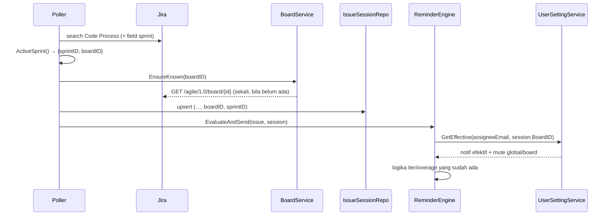

# Tech Spec — Per-Board Settings & Active Sprint Dashboard

> **Date:** 2026-11-14
> **PRD Link:** — (hasil brainstorming di sesi Claude Code, disetujui user)
> **STP Link:** —
> **Epic / Task:** Nudge — pengaturan & dashboard per board Jira (berbasis sprint aktif)
> **Document Status:** `Implemented`
> **Document Owner:** Yusuf Wijaya
> **Need Review:** —

---

## 📋 Background, Problem & Solution

| | |
|---|---|
| **Why** | User bekerja di beberapa board Jira (mis. ESB OMS Board & ESB Core Board) yang ritme dan sprint-nya berbeda. Satu set pengaturan notifikasi untuk semua board dan dashboard yang mencampur semua tiket sepanjang masa tidak cukup: user ingin pengaturan & ringkasan **per board**, berbasis **sprint yang sedang berjalan**. |
| **Current condition** | Pengaturan notifikasi satu per user (`ms_user_setting`, PK `userID` — migration `0008`); mute hanya satu (`mutedUntil`). Dashboard (`frontend/src/app/features/dashboard/home/`) memakai `GET /api/dashboard/board` = semua tiket user di project CORE/OMS (`jira_client_service.SearchAllIssuesByAssignee`, JQL `project in (CORE, OMS) AND assignee = X`) dan menebak sprint terbaru dari nama sprint. Poller sudah membaca field sprint (`customfield_10020`) — terverifikasi live: tiap entri berisi `id`, `name`, `state`, `boardId`. |
| **Solution** | Board = board Jira Agile, dipetakan dari **sprint aktif** tiket. Pengaturan dikunci `(userID, boardID)` dengan `boardID = 0` = default semua board; board mewarisi default sampai user mengatur khusus. Mute dua level (global + per board). Navbar mendapat pemilih board (dengan avatar project dari Jira); Dashboard & Pengaturan mengikuti board terpilih dan sprint aktifnya. |

---

## 🗺️ Domain Mapping

| User Story | Domain | Sub-module |
|------------|--------|------------|
| US-1 Pemilih board di navbar (board dengan tiket saya di sprint aktif, ikon dari Jira) | Dashboard | `board` (baru), `jira_client`, frontend shell |
| US-2 Dashboard per board berbasis sprint aktif | Dashboard | `user_dashboard`, `sprint_report`, frontend home |
| US-3 Pengaturan notifikasi per board, mewarisi default | Notification | `user_setting`, frontend settings |
| US-4 Mute dua level (global & per board) | Notification | `user_setting`, `reminder_engine` |
| US-5 Reminder memakai pengaturan board tiket | Notification | `poller`, `issue_session`, `reminder_engine` |

**Acceptance Criteria**

- **AC1.1** Pemilih board menampilkan "Semua board" + setiap board yang **sprint aktifnya** berisi tiket yang di-assign ke user login (project yang dipantau: CORE, OMS).
- **AC1.2** Tiap opsi menampilkan avatar project board dari Jira, nama board, nama sprint aktif, jumlah tiket, dan penanda bila board punya pengaturan khusus.
- **AC1.3** Avatar dilayani lewat proxy backend (bekerja juga untuk avatar custom yang butuh autentikasi); gagal muat → kotak inisial project.
- **AC1.4** Board terpilih tersimpan di URL (`?board=`) dan `localStorage`; board yang tidak lagi tersedia → kembali ke "Semua board" + toast info.
- **AC1.5** Proxy avatar hanya melayani board yang ada di `ms_board`; selain itu `404`.
- **AC2.1** Dashboard board X menampilkan hanya tiket saya di sprint aktif board X; "Semua board" = gabungan semua sprint aktif.
- **AC2.2** Ringkasan sprint memakai sprint aktif board terpilih (bukan tebakan dari nama); "Semua board" menampilkan ringkasan per board dengan tab.
- **AC2.3** Status notif di banner memperhitungkan mute global & mute board terpilih.
- **AC3.1** `boardID = 0` = Pengaturan default semua board (= pengaturan per user yang sudah ada; tidak ada data hilang saat upgrade).
- **AC3.2** Board tanpa pengaturan khusus memakai pengaturan notifikasi default (tier, overage, toggle, jam tenang).
- **AC3.3** "Atur khusus board ini" menyalin default ke baris board (`useDefault = 0`); setelah itu perubahan default tidak memengaruhi board itu.
- **AC3.4** "Kembalikan ke default" → `useDefault = 1` (mute board tetap).
- **AC3.5** Menyimpan scope default tidak mengubah board yang punya pengaturan khusus.
- **AC4.1** Mute global (baris `boardID = 0`) membungkam semua board; mute board X hanya board X.
- **AC4.2** Pilihan mute sama di kedua level: 1 jam, 2 jam, sampai besok, selamanya.
- **AC4.3** Perilaku saat dibungkam sama seperti sekarang (tier dilewati → `skipped`; T+0/ulangan overage tertunda).
- **AC5.1** Poller menyimpan `boardID` & `sprintID` sprint aktif tiap tiket yang dilacak; `NULL` bila tiket tidak di sprint aktif.
- **AC5.2** Reminder engine memakai pengaturan efektif `(assignee, boardID tiket)`; `boardID NULL` → default + mute global.
- **AC5.3** Nama/avatar board yang belum dikenal diambil sekali dari Jira Agile API dan di-cache di `ms_board`; kegagalan tidak menghambat reminder.
- **AC6.1** Semua endpoint tetap scoped ke sesi; `board` hanya memfilter data milik sendiri; `board` bukan angka → `400`.

---

## 🔀 Cross-repo Impact

| Repo | Impact | Detail | Priority |
|------|--------|--------|----------|
| `jira-u-bot` (Go) | `YES` | migration `0010`, modul baru `board`, `jira_client`, `issue_session`, `poller`, `user_setting`, `reminder_engine`, `user_dashboard` | `HIGH` |
| `jira-u-bot/frontend` (Angular) | `YES` | `BoardContextService`, navbar picker, Dashboard & Pengaturan per scope | `HIGH` |
| `fnb-backend` / `go-core-api` / `phantom-lancer` | `NO` | tidak terkait | — |

---

## 🗄️ DB Schema Changes

```sql
-- Table   : ms_board
-- Action  : NEW TABLE (cache board Jira Agile)
CREATE TABLE IF NOT EXISTS ms_board (
  boardID     BIGINT       NOT NULL COMMENT 'id board Jira Agile',
  boardName   VARCHAR(255) NOT NULL,
  projectKey  VARCHAR(20)  NOT NULL DEFAULT '',
  avatarURL   VARCHAR(500) NOT NULL DEFAULT '' COMMENT 'location.avatarURI dari Agile API',
  updatedDate DATETIME     NOT NULL DEFAULT CURRENT_TIMESTAMP ON UPDATE CURRENT_TIMESTAMP,
  PRIMARY KEY (boardID)
);

-- Table   : tr_issuesession
-- Action  : ADD COLUMN (board & sprint AKTIF tiket; NULL = tidak di sprint aktif)
ALTER TABLE tr_issuesession ADD COLUMN boardID BIGINT NULL AFTER sprintName;
ALTER TABLE tr_issuesession ADD COLUMN sprintID BIGINT NULL AFTER boardID;

-- Table   : ms_user_setting
-- Action  : ADD COLUMN + ganti PK (userID) → (userID, boardID)
ALTER TABLE ms_user_setting ADD COLUMN boardID BIGINT NOT NULL DEFAULT 0 AFTER userID;
ALTER TABLE ms_user_setting ADD COLUMN useDefault TINYINT(1) NOT NULL DEFAULT 0 AFTER boardID;
ALTER TABLE ms_user_setting DROP PRIMARY KEY, ADD PRIMARY KEY (userID, boardID);

-- Migration files: 0010_add_board.sql, 0011_issuesession_board.sql, 0011b_issuesession_sprint.sql,
--                  0012_user_setting_board.sql, 0012b_user_setting_use_default.sql, 0012c_user_setting_board_pk.sql
-- migrations.Apply retries MySQL deadlock / lock-wait errors (parallel test packages share one schema)
-- ADD COLUMN via addColumnIfNotExists; penggantian PK dijaga cek information_schema
-- (hanya bila PK belum memuat boardID) supaya idempotent.
```

- Baris `ms_user_setting` yang sudah ada otomatis menjadi `boardID = 0` (default) → AC3.1.
- FK `fk_ms_user_setting_user (userID)` tetap valid: PK komposit diawali `userID`.
- `useDefault` hanya bermakna untuk `boardID <> 0`.

---

## 📡 API Contract

Semua di grup `dashboardAPI` (`{BASE_PATH}/api/dashboard`, `AuthMiddlewareAPI`). Parameter `board`: angka > 0 = board; kosong/`0` = Semua board / default. Non-angka → `400`.

### `GET /api/dashboard/boards` *(baru)*

**Response 200:**
```json
{
  "boards": [
    {
      "boardId": 28,
      "name": "ESB OMS Board",
      "projectKey": "OMS",
      "activeSprint": { "id": 8294, "name": "OMS Sprint 23 - 2026", "startDate": "2026-11-09", "endDate": "2026-11-22" },
      "ticketCount": 17,
      "hasCustomSettings": false,
      "muted": { "active": false, "until": null, "forever": false }
    }
  ]
}
```
Sumber: JQL `project in (CORE, OMS) AND assignee = "<accountId>" AND sprint in openSprints()` (+ field sprint), dikelompokkan per `boardId` sprint ber-`state = active`. Tanggal sprint dari Agile API (`/board/{id}/sprint?state=active`), di-cache bersama `ms_board` selama sprint aktif.

### `GET /api/dashboard/boards/:boardId/avatar` *(baru)*

Proxy gambar `ms_board.avatarURL` memakai kredensial bot; cache memori 24 jam; `Cache-Control: private, max-age=86400`; `Content-Type` diteruskan dari Jira.

| Code | Condition |
|------|-----------|
| `400` | `boardId` bukan angka |
| `404` | board tidak ada di `ms_board` atau tanpa avatar |
| `502` | Jira gagal |

### `GET /api/dashboard/board?board=X` *(diubah)*

Tanpa `board`: tiket saya di **semua sprint aktif**. Dengan `board`: tiket saya di sprint aktif board X. Bentuk respons tetap (`columns`), tiap `card` + `boardId`.

### `GET /api/dashboard/report?sprint=...` *(tetap)*
Frontend mengirim nama sprint aktif board terpilih (dari `GET /boards`).

### `GET /api/dashboard/settings?board=X` *(diubah)*

**Response 200:**
```json
{
  "scope": "board",
  "boardId": 28,
  "useDefault": true,
  "notification": { "reminderTiers": ["2h", "1h"], "overageTiers": [], "overageRepeatMinutes": 5, "notifyEarlyFinish": true, "notifyReturnedToTodo": true, "quietHours": null },
  "mute": {
    "global": { "active": false, "until": null, "forever": false },
    "board": { "active": true, "until": "2026-11-14T15:30:00+07:00", "forever": false }
  },
  "credential": { "hasCredential": false, "maskedPreview": "" }
}
```
`scope = "default"` (tanpa `board`): `useDefault` = `false`, `mute.board` = `null`. `notification` selalu nilai **efektif**.

### `PUT /api/dashboard/settings/notification?board=X` *(diubah)*
Body sama seperti sekarang. Untuk board: simpan + `useDefault = 0` (AC3.3). Untuk default: simpan baris `0` saja (AC3.5). Error `400` per field tetap.

### `DELETE /api/dashboard/settings/notification?board=X` *(baru)*
Kembalikan ke default (`useDefault = 1`). `400` bila tanpa `board`.

### `POST / DELETE /api/dashboard/settings/mute?board=X` *(diubah)*
Tanpa `board` = mute global; dengan `board` = mute board X. Body & respons sama seperti sekarang.

---

## 🔐 Access Control Matrix

| Action | Rule | Behavior if Denied |
|--------|------|--------------------|
| Lihat board / dashboard / setting sendiri | Login (`AuthMiddlewareAPI`) | `401` → login |
| Data user lain | Tidak mungkin: identitas dari sesi; `board` hanya filter | — |
| Proxy avatar | Login + board harus ada di `ms_board` | `404` |

---

## 🔄 Sequence Diagram



---

## 🧠 State Management & UI Logic

```
BoardContextService (signal)
  Sumber         : GET /boards saat shell dimuat (dan saat refresh dashboard)
  selected       : number | null (null = Semua board)
  Init           : ?board= di URL → localStorage → null
  On change      : tulis URL (queryParams, merge) + localStorage
  Board hilang   : selected → null + toast info

Navbar picker
  Tombol         : [avatar] nama board · sprint aktif ▾  (mobile: avatar + ▾)
  Opsi           : Semua board, lalu tiap board (avatar, nama, sprint, ticketCount, titik bila custom)
  Mute board     : titik oranye di avatar tombol

Pengaturan
  scope default  → judul "Pengaturan default semua board"; kartu mute = mute global
  scope board, useDefault=1 → banner "mengikuti default" + [Atur khusus board ini]; kartu notif read-only
  scope board, useDefault=0 → badge "Pengaturan khusus" + [Kembalikan ke default] (konfirmasi)
  Kartu mute (board) → baris "Mute board ini" + status mute global (read-only, link ke Semua board)
  Jira API Key   : selalu tampil (per user)

Dashboard
  Data           : GET /board?board=X, GET /report?sprint=<sprint aktif board>
  Semua board    : gabungan; ikon board kecil di tiap tiket; ringkasan sprint per board via tab
```

---

## ✅ Breakdown Task & Effort

| # | Task | Repo | AC Coverage | 🤖 AI | 👨‍💻 Dev Verify | Blocked By |
|---|------|------|-------------|-------|----------------|------------|
| 1 | Migration `0010`–`0012` + apply idempotent + test | `jira-u-bot` | AC3.1, AC5.1 | `~2m` | `~30m` | — |
| 2 | `jira_client`: `ActiveSprint()`, `SearchActiveSprintIssuesByAssignee`, `GetBoard`, `GetActiveSprint`, `FetchAvatar` + test | `jira-u-bot` | AC1.1, AC5.1, AC5.3 | `~2m` | `~45m` | — |
| 3 | Modul `board` (repo `ms_board`, `EnsureKnown`, avatar cache) + test | `jira-u-bot` | AC1.3, AC1.5, AC5.3 | `~2m` | `~45m` | #1, #2 |
| 4 | `issue_session` + `poller`: simpan boardID/sprintID, `EnsureKnown` + test | `jira-u-bot` | AC5.1 | `~2m` | `~45m` | #1, #3 |
| 5 | `user_setting`: kunci (user, board), `GetEffective`, useDefault, mute dua level + test | `jira-u-bot` | AC3.x, AC4.x | `~3m` | `~1.5h` | #1 |
| 6 | `reminder_engine`: pakai `GetEffective(email, boardID)` + test | `jira-u-bot` | AC4.3, AC5.2 | `~1m` | `~45m` | #4, #5 |
| 7 | `user_dashboard` API: `/boards`, avatar, `?board=` pada board/settings/mute, DELETE notification + test | `jira-u-bot` | AC1.x, AC2.1, AC3.x, AC6.1 | `~3m` | `~1.5h` | #2, #3, #5 |
| 8 | Frontend: `BoardContextService` + navbar picker + spec | `frontend` | AC1.1–AC1.4 | `~3m` | `~1h` | #7 |
| 9 | Frontend: Dashboard per board + spec | `frontend` | AC2.x | `~3m` | `~1h` | #8 |
| 10 | Frontend: Pengaturan per scope + mute dua baris + spec | `frontend` | AC3.x, AC4.1–AC4.2 | `~3m` | `~1.5h` | #8 |
| 11 | README + verifikasi visual (mock) | — | semua | `~1m` | `~30m` | #9, #10 |

> **🤖 AI generates code: ~0.4h**
>
> **👨‍💻 Dev verify & fix: ~10h**
>
> **Combined: ~10.5h** (~1.5 working days)

### Dependency Chain
```
#1 ─┬─> #3 ─> #4 ─┐
    │             ├─> #6
    └─> #5 ───────┤
#2 ─> #3          └─> #7 ─> #8 ─┬─> #9 ─┐
                                └─> #10 ┴─> #11
```

---

## 🔗 Dependencies

**Internal:** field sprint `customfield_10020` (`jira_client_dto.SprintFieldID`), `registration_repository.FindUserByEmail` (accountId & userID), `sprint_report` (report per nama sprint), credential resolution (`jira_credential_service.ResolveCredential`).

**External:** Jira Agile REST API — `GET /rest/agile/1.0/board/{id}` (nama, `location.projectKey`, `location.avatarURI`), `GET /rest/agile/1.0/board/{id}/sprint?state=active` (tanggal sprint), URL avatar project.

---

## 🚀 Milestone / Deployment Strategy

1. Migration jalan otomatis saat start (`migrations.Apply`), idempotent.
2. Tanpa parameter `board`, semua endpoint berperilaku seperti sebelumnya → frontend lama tetap jalan selama deploy.
3. `boardID` sesi terisi bertahap di siklus poll berikutnya; sebelum terisi → setting default (= perilaku sekarang).
4. Piloting flag: tidak diperlukan.
5. **Rollback plan:** deploy build sebelumnya; kolom/tabel baru dibiarkan. Catatan: setelah PK komposit, build lama yang meng-upsert `ms_user_setting` tetap aman karena ia hanya menulis baris `boardID = 0` (default kolom).

---

## ⚠️ Drawbacks / Risks

| Category | Risk |
|----------|------|
| **Performance** | `GET /boards` = 1 JQL + ≤ N panggilan sprint aktif (di-cache); proxy avatar di-cache 24 jam. Poller: `EnsureKnown` hanya memanggil Jira untuk board baru. |
| **Data correctness** | Tiket di backlog / tanpa sprint aktif tidak punya board → memakai default (disengaja, "based on sprint saat ini"). |
| **Board kanban** | Board tanpa sprint tidak muncul di pemilih (di luar cakupan). |
| **Avatar** | Avatar adalah avatar **project** lokasi board (Jira tidak punya avatar per board). |
| **Migration** | Penggantian PK pada tabel berisi data — dijaga transaksi DDL MySQL & cek information_schema. |

---

## ❓ Unresolved / Pending Clarification

| # | Location | Contradiction / Ambiguity | Assumption Made |
|---|----------|---------------------------|-----------------|
| 1 | AC1.1 | Tiket di sprint aktif yang ada di dua board sekaligus (sprint dibagi) | Board dari entri sprint `active` pertama di field sprint |
| 2 | AC2.2 | "Semua board" punya beberapa sprint aktif | Ringkasan per board dengan tab |
| 3 | AC1.1 | Project selain CORE/OMS | Tetap dibatasi CORE/OMS (yang dipantau poller) |

> **Future possibilities:** setting global admin (fase 2 sebelumnya), command `/u-mute` per board, dukungan board kanban.

---

## 📁 Files to Modify

| File | Change |
|------|--------|
| `migrations/0010_add_board.sql`, `0011_issuesession_board.sql`, `0012_user_setting_board.sql`, `migrations/migrate.go` | Skema baru + apply idempotent |
| `modules/jira_client/jira_client_dto/jira_client_dto.go` | `ActiveSprint()` (id, name, state, boardId) |
| `modules/jira_client/jira_client_service/*` | `SearchActiveSprintIssuesByAssignee`, `GetBoard`, `GetActiveSprint`, `FetchAvatar` |
| `modules/board/**` | Baru — dto, repository `ms_board`, service `EnsureKnown` / `ListForUser` / avatar cache |
| `modules/issue_session/**` | Kolom & parameter `boardID`, `sprintID` |
| `modules/poller/poller_service/*` | Simpan board/sprint aktif, `EnsureKnown` |
| `modules/user_setting/**` | Kunci (user, board), `GetEffective`, `useDefault`, mute dua level |
| `modules/reminder_engine/reminder_engine_service/*` | `GetEffective(email, boardID)` |
| `modules/user_dashboard/**`, `router.go` | `/boards`, avatar, `?board=` |
| `main.go` | Wiring modul `board` |
| `frontend/src/app/core/services/board-context.service.ts` | Baru — board terpilih (URL + localStorage) |
| `frontend/src/app/layouts/dashboard-shell/*` | Pemilih board di navbar |
| `frontend/src/app/features/dashboard/home/*` | Dashboard per board |
| `frontend/src/app/features/dashboard/settings/*` | Pengaturan per scope, mute dua baris |
| `frontend/src/styles.scss` | Style picker & banner scope |
| `README.md` | Dokumentasi |
