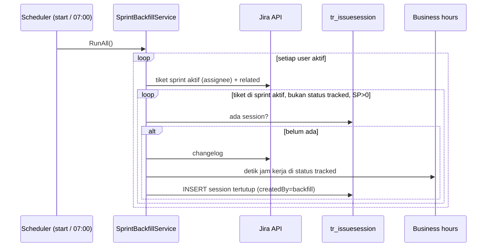

# Tech Spec — Pelacakan Khusus Sprint Aktif & Backfill dari Changelog Jira

> **Date:** 2026-11-15
> **PRD Link:** — (request langsung dari user, investigasi "Achievement 100% padahal semua lewat budget", 2026-11-15)
> **STP Link:** —
> **Epic / Task:** Nudge — Sprint report accuracy
> **Document Status:** `Implemented`
> **Document Owner:** Yusuf Wijaya
> **Need Review:** —

---

## 📋 Background, Problem & Solution

| | |
|---|---|
| **Why** | Card "Sprint aktif" Core Sprint 23 2026 menampilkan 0/0 tiket & achievement 100%, padahal CORE-10923 + 7 subtask-nya (9–13 Nov) hampir semuanya lewat budget. Selain itu, sejak CODE REVIEW CORE ikut dihitung, 7 tiket lama (CORE-8033 dkk, sprint 2025 yang sudah ditutup, masih berstatus CODE REVIEW) mulai dilacak dengan waktu mulai Juni 2025 → Senin 08:30 akan memicu DM "SUDAH LEWAT BUDGET". |
| **Current condition** | (1) Poller hanya mencatat tiket yang **sedang** berada di status tracked saat ia berjalan (`modules/poller/poller_service/poller_service_impl.go` `pollOnce` / `backfillActiveSessions`); periode yang terlewat (bot mati) tidak pernah diisi. (2) Poller tidak memeriksa sprint — tiket apa pun di status tracked dilacak. (3) `achievementPercent` mengembalikan 100 untuk deviasi 0, termasuk saat tidak ada tiket (`modules/sprint_report/sprint_report_service/sprint_report_service_impl.go`). |
| **Solution** | (A) Tiket hanya dilacak **selama ada di sprint aktif**; session aktif tiket di luar sprint aktif ditutup tanpa menambah waktu & tanpa notif. (B) Card Sprint aktif & stat Achievement menampilkan "–" bila belum ada tiket tercatat. (C) Backfill: tiket sprint aktif tanpa session dihitung ulang dari changelog Jira dan disimpan sebagai session tertutup — otomatis saat start + tiap hari 07:00 WIB untuk semua user, dan via tombol "Hitung ulang dari Jira" untuk user sendiri. |

### Keputusan

| # | Pertanyaan | Keputusan |
|---|---|---|
| 1 | Parent vs subtask di ringkasan sprint | **Semua dihitung** (seperti sekarang). |
| 2 | Kapan tiket dilacak | **Selama ada di sprint aktif.** Subtask membawa sprint parent-nya (terverifikasi live: CORE-10955 → Core Sprint 23 2026 `active`). Tiket tanpa sprint aktif — sprint ditutup atau tidak pernah masuk sprint — tidak dilacak. |
| 3 | Jadwal backfill | Otomatis (start + harian) **dan** tombol. |
| 4 | Cakupan backfill | Semua user terdaftar & aktif (tombol: user yang menekan). |

---

## 🗺️ Domain Mapping

| User Story | Domain | Sub-module |
|------------|--------|------------|
| US-1 Tiket di luar sprint aktif tidak dilacak | Nudge Bot | `poller` |
| US-2 Ringkasan sprint jujur saat kosong | Nudge Frontend | `home` (Dashboard) |
| US-3 Waktu yang terlewat diisi dari Jira | Nudge Bot + Dashboard | `sprint_backfill` (baru), `sprint_report` |

### Acceptance Criteria

**US-1**
- **AC1.1** Tiket di status tracked yang **tidak** punya sprint `active` tidak dibuka session-nya (startup backfill & tiap poll).
- **AC1.2** Session aktif yang tiketnya tidak lagi di sprint aktif ditutup dengan tambahan **0 detik**, tanpa notif selesai / balik ke To Do.
- **AC1.3** Tiket di sprint aktif (termasuk subtask yang mewarisi sprint parent) tetap dilacak seperti sekarang.
- **AC1.4** Tiket yang pindah ke sprint aktif berikutnya tetap dilacak tanpa jeda.

**US-2**
- **AC2.1** `totalCount = 0` → lingkaran & stat Achievement menampilkan "–" dan teks "Belum ada tiket yang tercatat waktunya di sprint ini."
- **AC2.2** `totalCount > 0` → tampilan tidak berubah.

**US-3**
- **AC3.1** Untuk setiap user terdaftar & aktif: ambil tiket sprint aktifnya **beserta subtask/linked** milik user itu (`related`, Tech Spec "Subtask & Linked Item Branches") yang juga ada di sprint aktif.
- **AC3.2** Tiket di-backfill hanya bila: belum punya baris `tr_issuesession`, **tidak** sedang di status tracked (itu urusan poller), SP > 0, dan changelog menunjukkan pernah masuk status tracked.
- **AC3.3** Waktu = jumlah detik **jam kerja** (08:30–17:30 WIB, istirahat 12–13, kalender libur) di seluruh periode status tracked menurut aturan project (OMS: Code Process; CORE: Code Process + CODE REVIEW).
- **AC3.4** Disimpan sebagai session tertutup: `flagActive = 0`, `accumulatedSeconds` = AC3.3, `sprintName`/`boardID`/`sprintID` = sprint aktif tiket, SP, assignee, summary, `createdBy = 'backfill'`.
- **AC3.5** Session yang sudah ada **tidak pernah** diubah.
- **AC3.6** Otomatis: sekali saat bot start (setelah startup poll) dan setiap hari pukul 07:00 WIB; gagal untuk satu user/tiket hanya di-log.
- **AC3.7** Tombol "Hitung ulang dari Jira" di card Sprint aktif → `POST /api/dashboard/report/backfill` untuk user sesi → toast jumlah tiket yang ditambahkan → ringkasan dimuat ulang.
- **AC3.8** Contoh acuan (Core Sprint 23 2026, user Yusuf): 8 tiket ter-backfill, 1/8 dalam budget, estimasi 32 jam, aktual ±192,9 jam. ✅ Terverifikasi live: 1/8, 32 jam, 192,8 jam, achievement 2%.
- **AC2.3** (tambahan user) Card Sprint aktif menampilkan **semua** tiket sprint (bukan top 5), urut deviasi terbesar, dengan aktual vs estimasi jam, tanda +/− dari aktual vs estimasi, dan nomor tiket ber-link ke Jira.

---

## 🔀 Cross-repo Impact

| Repo | Impact | Detail | Priority |
|------|--------|--------|----------|
| `jira-u-bot` (Nudge) | `YES` | poller, jira_client, issue_session repo, modul baru `sprint_backfill`, sprint_report handler, frontend home | `HIGH` |
| `fnb-backend` / `go-core-api` / `phantom-lancer` | `NO` | — | — |

---

## 🗄️ DB Schema Changes

**No schema changes required.** *(Session tertutup memakai kolom `tr_issuesession` yang sudah ada; penanda asal lewat `createdBy = 'backfill'`.)*

---

## 📡 API Contract

### `POST /nudge/api/dashboard/report/backfill`

**Auth:** session cookie (user sesi saja)

**Request:** tanpa body.

**Response 200:**
```json
{ "added": 8 }
```

**Error Responses:**
| Code | Condition |
|------|-----------|
| `401` | Tanpa sesi |
| `500` | Gagal mengambil tiket sprint aktif dari Jira |

---

## 🔐 Access Control Matrix

| Action | Rule | Behavior if Denied |
|--------|------|--------------------|
| Backfill via tombol | login `@esb.co.id`; hanya tiket milik user sesi | `401` |
| Backfill otomatis | proses internal bot | — |

> Tidak ada entry UAC baru.

---

## 🔄 Sequence Diagram



---

## 🧠 State Management & UI Logic

```
Poller (per siklus)
  issue tracked & ActiveSprint() ok      → buka / lanjut session (seperti sekarang)
  issue tracked & tanpa sprint aktif     → "stale": tidak dibuka; bila session aktif → CloseSession(key, 0), tanpa notif
  session aktif & issue hilang dari JQL  → exit seperti sekarang

Card Sprint aktif (frontend)
  report.totalCount === 0 → lingkaran "–", stat Achievement "–", teks kosong + tombol "Hitung ulang dari Jira"
  tombol: disable + spinner saat jalan; sukses → toast "N tiket ditambahkan dari Jira" + loadReport(); gagal → toast error
  tombol juga tersedia saat totalCount > 0 (ikon refresh kecil)
```

---

## ✅ Breakdown Task & Effort

| # | Task | Repo | AC Coverage | 🤖 AI | 👨‍💻 Dev Verify | Blocked By |
|---|------|------|-------------|-------|----------------|------------|
| 1 | Poller: filter sprint aktif + tutup session stale 0 detik | `jira-u-bot` | AC1.1–AC1.4 | `~1m` | `~30m` | — |
| 2 | DTO: `TrackedBusinessSeconds(histories, rule, bh, cal)` | `jira-u-bot` | AC3.3 | `~1m` | `~20m` | — |
| 3 | Jira client: `GetChangelog`; repo: `InsertClosedSession` | `jira-u-bot` | AC3.4, AC3.5 | `~1m` | `~20m` | — |
| 4 | Service `sprint_backfill`: per user / semua user, scheduler 07:00 | `jira-u-bot` | AC3.1–AC3.6 | `~2m` | `~45m` | #2, #3 |
| 5 | Endpoint `POST /report/backfill` | `jira-u-bot` | AC3.7 | `~1m` | `~15m` | #4 |
| 6 | Frontend: "–" saat kosong + tombol hitung ulang | `jira-u-bot` | AC2.1, AC2.2, AC3.7 | `~1m` | `~30m` | #5 |
| 7 | Test, README, verifikasi data live (AC3.8) | `jira-u-bot` | semua | `~1m` | `~30m` | #6 |

> **🤖 AI generates code: ~0.2h**
>
> **👨‍💻 Dev verify & fix: ~3.2h**
>
> **Combined: ~3.4h** (~0.5 working day)

---

## 🔗 Dependencies

**Internal:** `jira_client` (search sprint aktif, related, changelog), `business_hours`, `issue_session` repo, `registration` repo (daftar user), `user_dashboard` (relasi subtask/linked), `sprint_report`.

**External:** Jira Cloud REST (`/rest/api/3/search/jql`, `/rest/api/3/issue/{key}?expand=changelog`).

---

## 🚀 Milestone / Deployment Strategy

1. Tanpa migrasi.
2. Setelah deploy: poller menutup 7 session stale pada siklus pertama; backfill start mengisi sprint aktif.
3. **Rollback plan:** deploy build sebelumnya; session ber-`createdBy = 'backfill'` bisa dihapus bila perlu (`DELETE FROM tr_issuesession WHERE createdBy = 'backfill'`).

---

## ⚠️ Drawbacks / Risks

| Category | Risk |
|----------|------|
| **Perilaku** | Tiket yang masih Code Process lalu dipindah ke backlog saat sprint ditutup berhenti dilacak (sesuai keputusan #2). |
| **Akurasi** | Backfill memakai seluruh periode di status tracked; waktu tunggu review (CORE) ikut terhitung — sama dengan aturan live. |
| **Performance** | Per user: 1 search sprint aktif + 1 search related + 1 changelog per tiket yang perlu di-backfill (hanya tiket tanpa session → setelah run pertama hampir nol). |
| **Kredensial** | Backfill otomatis memakai kredensial bot (pusat); tombol memakai kredensial user bila ada (fallback pusat). |

---

## ❓ Unresolved / Pending Clarification

| # | Location | Contradiction / Ambiguity | Assumption Made |
|---|----------|---------------------------|-----------------|
| 1 | AC3.2 | Tiket yang dulu punya session lalu dihapus manual | Diperlakukan "belum punya session" → di-backfill. |
| 2 | AC3.4 | Tiket dengan session dari sprint lama (sprintName berbeda) | Tidak di-backfill (AC3.5: session yang ada tidak diubah). |

> **Future possibilities:** backfill sprint yang sudah ditutup (pilih sprint lama di report).

---

## 📁 Files to Modify

| File | Change |
|------|--------|
| `modules/poller/poller_service/poller_service_impl.go` (+test) | filter sprint aktif, tutup stale 0 detik |
| `modules/jira_client/jira_client_dto/tracking_rules.go` (+test) | `TrackedBusinessSeconds` |
| `modules/jira_client/jira_client_service/jira_client_service_impl.go` | `GetChangelog` (tanpa mengubah interface lama) |
| `modules/issue_session/issue_session_repository/session_backfill_repository.go` (baru) + test | `InsertClosedSession` |
| `modules/sprint_backfill/...` (baru) | service + scheduler + test |
| `modules/sprint_report/sprint_report_handler/*`, `modules/sprint_report/router.go` | `POST /report/backfill` |
| `main.go` | wiring + worker harian |
| `frontend/src/app/core/services/dashboard.service.ts`, `features/dashboard/home/*` | "–" + tombol |
| `README.md` | dokumentasi |
