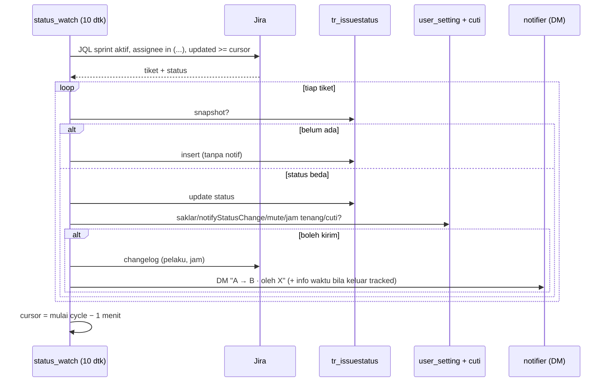

# Tech Spec — Notifikasi Perubahan Status Tiket

> **Date:** 2026-11-15
> **PRD Link:** — (request langsung dari user, 2026-11-15)
> **STP Link:** —
> **Epic / Task:** Nudge — Notifikasi
> **Document Status:** `Implemented`
> **Document Owner:** Yusuf Wijaya
> **Need Review:** —

---

## 📋 Background, Problem & Solution

| | |
|---|---|
| **Why** | User ingin tahu setiap kali status tiketnya berubah — baik digeser sendiri (Jira, Papan Tiket, `/n-geser`) maupun oleh orang lain (QA, reviewer). Card "Jenis notifikasi" di Pengaturan (selesai lebih awal / balik ke To Do) dianggap tidak lagi diperlukan. |
| **Current condition** | Notif status hanya ada untuk tiket yang **sedang dihitung waktunya** saat **keluar** dari status tracked: poller memanggil `NotifyIfEarlyCompletion` (status "done" project) atau `NotifyReturnedToTodo` (`modules/poller/poller_service/poller_service_impl.go` ±baris 200–235), masing-masing di-gate `ms_user_setting.notifyEarlyFinish` / `notifyReturnedToTodo` (`reminder_engine_service_impl.go` ±411, ±443). Perpindahan lain (To Do → Code Process, Code Completed → SIT, dst.) tidak pernah dinotif. Poller hanya mengambil tiket berstatus tracked (`SearchCodeProcessIssues`). |
| **Solution** | Modul baru `status_watch`: tiap 10 detik satu JQL untuk tiket sprint aktif milik semua user terdaftar yang baru di-update, dibandingkan dengan snapshot `tr_issuestatus`; setiap perubahan status → DM ke assignee berisi status lama → baru, pelaku (dari changelog), dan — bila tiket keluar dari status tracked — info waktu (menggantikan dua notif lama). Card "Jenis notifikasi" diganti satu toggle **"Perubahan status tiket"** (`notifyStatusChange`). |

### Keputusan

| # | Pertanyaan | Keputusan |
|---|---|---|
| 1 | Tiket yang dinotif | **Tiket saya di sprint aktif** CORE/OMS (termasuk subtask). |
| 2 | Digeser sendiri | **Tetap dinotif**; pesan menyebut pelaku. |
| 3 | Notif lama (selesai lebih awal, balik ke To Do) | **Dilebur** ke notif baru — satu notif per perpindahan, info waktu ditambahkan bila keluar status tracked. |
| 4 | Kecepatan | **±10 detik** (interval watcher 10 detik). |
| 6 | Pilihan user (tambahan user) | Toggle on/off **ditambah checklist status tujuan**: notif hanya saat tiket pindah KE status yang dicentang; kosong = semua status. Berlaku juga di Admin › Detail User. |
| 7 | Format durasi (tambahan user) | Pakai `FormatDuration` yang sama dengan DM lain ("0 hari 1 jam 0 menit 0 detik"). |
| 5 | Pendekatan | Watcher + snapshot (bukan webhook Jira — butuh admin Jira & endpoint publik; bukan melebarkan poller — risiko ke tracking waktu). |

---

## 🗺️ Domain Mapping

| User Story | Domain | Sub-module |
|------------|--------|------------|
| US-1 Notif setiap status tiket berubah | Nudge Bot | modul baru `status_watch`, `jira_client`, `google_chat_notifier` |
| US-2 Notif lama dilebur | Nudge Bot | `poller`, `reminder_engine` |
| US-3 Toggle tunggal di Pengaturan | Nudge Bot + Frontend | `user_setting`, `settings` |

### Acceptance Criteria

**US-1 — Notif perubahan status**
- **AC1.1** Tiap 10 detik bot menjalankan satu JQL (POST `/rest/api/3/search/jql`, kredensial bot): `project in (CORE, OMS) AND sprint in openSprints() AND assignee in (<accountId user terdaftar & aktif>) AND updated >= "-<N>m"` — N = menit sejak cycle sukses terakhir + 1 (format relatif, tidak bergantung timezone profil Jira bot). Cycle pertama dan sekali tiap jam membaca **semua** tiket (tanpa filter `updated`) agar snapshot tetap segar. Maks 20 halaman × 100; bila terpotong, ditulis ke log.
- **AC1.2** Untuk setiap tiket hasil JQL: bila belum ada di `tr_issuestatus` → simpan saja (**tanpa notif**). Bila status beda dengan snapshot → snapshot diperbarui **lalu** notif dikirim satu kali (perbandingan nama status case-insensitive).
- **AC1.3** Pesan DM ke assignee (routing sama dengan reminder: `pickNotifier`):
  ```
  🔀 *OMS-12626* — Lock Linked (External) Payments on Edit Payment
  *To Do* → *Code Process* · oleh Anwar · 10:15 WIB
  <link Jira>
  ```
  Pelaku & jam = entri changelog status terbaru (`author.displayName`, `created`) dari halaman changelog **terakhir** (`/issue/{key}/changelog`, bukan `expand=changelog` yang hanya memuat entri terlama); bila changelog gagal diambil → tanpa "oleh …" dan jam = waktu deteksi.
- **AC1.4** Perubahan beruntun dalam satu cycle (A → B → C) menghasilkan satu notif `A → C`.
- **AC1.5** Tiket yang keluar dari sprint aktif tidak dinotif. Bila status **dan** assignee berubah bersamaan (hand-off, mis. dev memindah ke Code Review sambil assign reviewer), notif dikirim ke assignee baru **dan** assignee sebelumnya (bila terdaftar). Baris waktu memakai session & kalender pemilik session.
- **AC1.6** Tidak dikirim (snapshot tetap diperbarui, tidak ditunda) bila untuk assignee: saklar notifikasi utama OFF, `notifyStatusChange` OFF (setting efektif board tiket), sedang mute (global/board), jam tenang, atau hari cuti. Tidak dibatasi jam kerja.
- **AC1.7** Gagal JQL/DM hanya di-log; cycle berikutnya jalan normal. DM gagal **tidak** diulang (snapshot sudah diperbarui) — menghindari notif dobel.
- **AC1.8** Snapshot tiket yang tidak terlihat > 30 hari dihapus sekali sehari.

**US-2 — Notif lama dilebur**
- **AC2.1** Poller **tidak lagi** memanggil `NotifyIfEarlyCompletion` / `NotifyReturnedToTodo`; penutupan session tidak berubah.
- **AC2.2** Bila perubahan status adalah **keluar** dari status tracked (aturan project: OMS Code Process; CORE Code Process + CODE REVIEW) ke status non-tracked dan tiket punya session, pesan ditambah satu baris:
  - elapsed < budget → `⏱ Selesai <sisa> lebih awal dari budget <budget>` (untuk status "done" project), atau `⏱ Waktu terpakai <elapsed> dari budget <budget>` (status lain, mis. To Do);
  - elapsed ≥ budget → `⏱ Waktu terpakai <elapsed> dari budget <budget> (lewat <selisih>)`.
  Elapsed = `CalculateElapsedSeconds` dengan kalender user (sama baik session sudah ditutup poller atau belum).
- **AC2.3** Perpindahan di dalam status tracked (CORE: Code Process ↔ CODE REVIEW) dinotif tanpa baris waktu.

**US-3 — Pengaturan**
- **AC3.1** Card "Jenis notifikasi" diganti card **"Perubahan status tiket"** dengan satu toggle: "Kirim DM setiap status tiket saya berubah (di Jira maupun di Nudge)".
- **AC3.2** Kolom baru `ms_user_setting.notifyStatusChange` default 1; migrasi mengisi `notifyStatusChange = notifyEarlyFinish OR notifyReturnedToTodo` untuk baris yang ada. Kolom lama tidak dipakai lagi (tidak dihapus).
- **AC3.3** API settings: field `notifyStatusChange` menggantikan `notifyEarlyFinish` & `notifyReturnedToTodo` di GET/PUT `/settings/notification` (user & admin). Body lama dengan dua field itu diabaikan tanpa error.
- **AC3.4** Per board mengikuti aturan yang ada (board tanpa pengaturan khusus mengikuti default).
- **AC3.5** Saat toggle ON, tampil checklist status tujuan sesuai workflow project board terpilih (CORE / OMS / gabungan untuk "Semua board"); default semua tercentang (`statusChangeStatuses = []`). Minimal satu status tetap tercentang; tombol "Pilih semua" mengembalikan ke semua status. Notif hanya dikirim bila status tujuan cocok (case-insensitive) — `UserSetting.WantsStatusChange`.
- **AC3.6** Teks saklar utama "Notifikasi Nudge" & pop up consent menyebut "reminder budget dan perubahan status tiket".

---

## 🔀 Cross-repo Impact

| Repo | Impact | Detail | Priority |
|------|--------|--------|----------|
| `jira-u-bot` (Nudge) | `YES` | modul baru `status_watch`, `jira_client` (search + changelog author), `poller`, `reminder_engine`, `user_setting`, frontend settings | `HIGH` |
| `fnb-backend` / `go-core-api` / `phantom-lancer` | `NO` | — | — |

---

## 🗄️ DB Schema Changes

```sql
-- migrations/0016_status_change_notif.sql (cek ulang nomor sebelum dibuat — agent lain aktif)

-- Table   : tr_issuestatus
-- Action  : NEW TABLE — snapshot status terakhir yang dilihat watcher
CREATE TABLE IF NOT EXISTS tr_issuestatus (
  issueKey      VARCHAR(32)  NOT NULL PRIMARY KEY,
  status        VARCHAR(100) NOT NULL,
  assigneeEmail VARCHAR(255) NOT NULL,
  lastSeenDate  DATETIME     NOT NULL,
  editedDate    DATETIME     NOT NULL DEFAULT CURRENT_TIMESTAMP ON UPDATE CURRENT_TIMESTAMP,
  KEY idx_issuestatus_lastseen (lastSeenDate)
);

-- Table   : ms_user_setting
-- Action  : ADD COLUMN (+ isi dari dua toggle lama)
ALTER TABLE ms_user_setting
  ADD COLUMN notifyStatusChange TINYINT(1) NOT NULL DEFAULT 1 AFTER notifyReturnedToTodo,
  ADD COLUMN statusChangeStatuses VARCHAR(500) NULL AFTER notifyStatusChange; -- CSV status tujuan, NULL/'' = semua
UPDATE ms_user_setting SET notifyStatusChange = (notifyEarlyFinish OR notifyReturnedToTodo);
```

> UPDATE pemindahan nilai toggle lama dijalankan tepat sekali lewat penanda di tabel baru `ms_migration_marker` (migrasi `0016c`), dalam satu transaksi — bila gagal, diulang saat start berikutnya. Filter status divalidasi maks 30 status dan total ≤ 500 karakter (ukuran kolom).

---

## 📡 API Contract

### `GET /nudge/api/dashboard/settings` · `PUT /nudge/api/dashboard/settings/notification` *(diubah; juga versi admin `/admin/users/:userID/...`)*

Objek `notification`:
```json
{
  "reminderTiers": ["2h", "1h"],
  "overageTiers": ["15m"],
  "overageRepeatMinutes": 30,
  "notifyStatusChange": true,
  "statusChangeStatuses": ["CODE REVIEW", "Done"],
  "quietHours": { "start": "12:00", "end": "13:00" }
}
```
`notifyEarlyFinish` / `notifyReturnedToTodo` dihapus dari respons; bila masih dikirim di body PUT → diabaikan.

---

## 🔐 Access Control Matrix

| Action | Aturan | Behavior if Denied |
|--------|--------|--------------------|
| Terima notif | hanya assignee tiket (user terdaftar & aktif) | — |
| Ubah toggle | user sendiri, atau admin lewat `/admin/users/:userID/settings/notification` | sama seperti setting lain |

---

## 🔄 Sequence Diagram



---

## 🧠 State Management & UI Logic

```
Watcher cursor
  Start bot      : kosong → JQL tanpa filter updated (sinkronisasi penuh, tiket baru tanpa notif,
                   tiket yang statusnya berubah selama bot mati → dinotif sekali)
  Cycle sukses   : cursor = waktu mulai cycle − 1 menit
  Cycle gagal    : cursor tidak maju (cycle berikutnya mengulang jendela yang sama)

Daftar accountId : dari ms_user (flagActive = 1, jiraAccountID tidak kosong), dimuat ulang tiap 5 menit;
                   JQL dipecah per 50 accountId bila perlu.

Toggle "Perubahan status tiket" (Pengaturan)
  Default        : ON
  Board khusus   : mengikuti pola tombol "Atur khusus board ini" yang ada
  On change      : disimpan dengan tombol Simpan card itu (pola card lain)
```

---

## ✅ Breakdown Task & Effort

| # | Task | Repo | AC Coverage | 🤖 AI | 👨‍💻 Dev Verify | Blocked By |
|---|------|------|-------------|-------|----------------|------------|
| 1 | Migrasi 0016 (`tr_issuestatus`, `notifyStatusChange` + isi) + `migrate.go` | `jira-u-bot` | AC3.2 | `~30s` | `~10m` | — |
| 2 | `user_setting`: field `NotifyStatusChange` di dto/repo/JSON (ganti dua field lama) + test | `jira-u-bot` | AC3.2–AC3.4 | `~1m` | `~30m` | #1 |
| 3 | `jira_client`: search status-watch JQL + changelog entri status terbaru (author, created) + test | `jira-u-bot` | AC1.1, AC1.3 | `~1m` | `~30m` | — |
| 4 | Modul `status_watch`: repo snapshot, service cycle (cursor, diff, gate, pesan, info waktu), Run 10 dtk, cleanup harian + test | `jira-u-bot` | AC1.1–AC1.8, AC2.2–AC2.3 | `~3m` | `~2h` | #2, #3 |
| 5 | Poller berhenti memanggil notif lama; hapus `NotifyIfEarlyCompletion`/`NotifyReturnedToTodo` + test | `jira-u-bot` | AC2.1 | `~1m` | `~30m` | #4 |
| 6 | Wiring `main.go` (worker baru) | `jira-u-bot` | AC1.1 | `~30s` | `~10m` | #4 |
| 7 | Frontend Pengaturan: card "Perubahan status tiket" + spec (user & admin detail) | `jira-u-bot` | AC3.1 | `~1m` | `~30m` | #2 |
| 8 | README + status spec + verifikasi live | `jira-u-bot` | — | `~30s` | `~20m` | #5–#7 |

> **🤖 AI generates code: ~9m**
>
> **👨‍💻 Dev verify & fix: ~4.5h** — uji geser di Jira & di Papan Tiket, cek tidak ada notif dobel dengan poller, cek mute/cuti
>
> **Combined: ~4.7h** (~0,6 hari kerja)

---

## 🔗 Dependencies

**Internal:** `registration_repository.FindAll`, `user_setting_service.GetEffectiveForEmail` (+ `IsSilenced`, saklar utama), `user_leave_service.ForEmail`, `issue_session` + `CalculateElapsedSeconds`, `jira_client_dto.RuleForIssue`, `google_chat_notifier` (`SendPlainTextDM` / webhook untuk akun bot sendiri).

**External:** Jira Cloud REST `GET /rest/api/3/search/jql`, `GET /rest/api/3/issue/{key}/changelog`.

---

## 🚀 Milestone / Deployment Strategy

1. Migrasi 0016 jalan otomatis saat start.
2. Cycle pertama = sinkronisasi penuh tanpa notif untuk tiket baru → tidak ada banjir notif saat deploy.
3. **Rollback plan:** revert commit; tabel `tr_issuestatus` & kolom baru boleh dibiarkan.

---

## ⚠️ Drawbacks / Risks

| Category | Risk |
|----------|------|
| **Rate limit Jira** | 6 JQL/menit + 1 changelog per perubahan. Filter `updated >= cursor` menjaga hasil tetap kecil. Bila Jira membalas 429, cycle dilewati dan cursor tidak maju. |
| **Akurasi** | Perubahan ganda di antara dua cycle hanya terlihat sebagai A → C (AC1.4). |
| **Bot mati** | Perubahan selama mati dinotif sekali saat start (bisa terasa telat) — disengaja agar tidak ada yang terlewat. |
| **Notif sendiri** | User menerima DM atas aksinya sendiri (keputusan #2) — bisa terasa ramai; bisa dimatikan lewat toggle. |
| **Paralel agent** | Agent lain sedang mengubah `reminder_engine` — Task #5 menyentuh file yang sama; cek status git sebelum edit. |

---

## ❓ Unresolved / Pending Clarification

| # | Location | Contradiction / Ambiguity | Assumption Made |
|---|----------|---------------------------|-----------------|
| 1 | AC1.6 | Notif saat di luar jam kerja | Tetap dikirim (status bisa digeser kapan saja), kecuali jam tenang/mute/cuti. |
| 2 | AC1.7 | DM gagal | Tidak diulang, demi menghindari dobel. |
| 3 | AC1.5 | Hand-off (status + assignee berubah bersamaan) | ✅ Hasil review: notif ke assignee baru dan sebelumnya. |

> **Future possibilities:** notif in-app (lonceng di topbar); pilih status mana saja yang dinotif; webhook Jira bila Nudge punya endpoint publik.

---

## 📁 Files to Modify

| File | Change |
|------|--------|
| `migrations/0016_status_change_notif.sql`, `migrations/migrate.go` | Tabel snapshot + kolom toggle |
| `modules/status_watch/...` (baru) | dto, repository, service (+ test) |
| `modules/jira_client/jira_client_service/jira_agile_client.go` | JQL status-watch, changelog author |
| `modules/user_setting/...` | `NotifyStatusChange` |
| `modules/user_dashboard/user_dashboard_handler/user_dashboard_handler_impl.go` | JSON `notification` |
| `modules/poller/poller_service/poller_service_impl.go` | Hapus panggilan notif lama |
| `modules/reminder_engine/reminder_engine_service/*` | Hapus `NotifyIfEarlyCompletion` / `NotifyReturnedToTodo` |
| `main.go` | Worker `status_watch` |
| `frontend/src/app/core/services/board.service.ts`, `features/dashboard/settings/settings.component.{ts,html}` (+ spec) | Card "Perubahan status tiket" |
| `README.md` | Dokumentasi |
