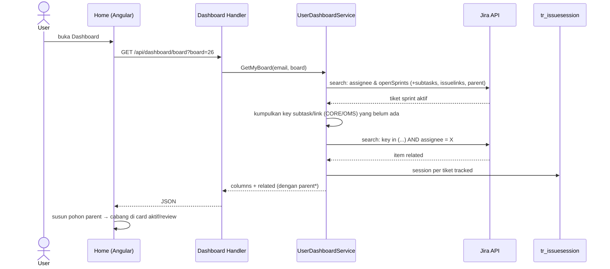

# Tech Spec — Subtask & Linked Item sebagai Cabang di Dashboard

> **Date:** 2026-11-15
> **PRD Link:** — (request langsung dari user, sesi brainstorming 2026-11-15)
> **STP Link:** —
> **Epic / Task:** Nudge — Dashboard enhancement
> **Document Status:** `Implemented`
> **Document Owner:** Yusuf Wijaya
> **Need Review:** —

---

## 📋 Background, Problem & Solution

| | |
|---|---|
| **Why** | Pekerjaan sering dipecah ke subtask atau tiket ter-link (mis. `[TECH SPEC]` relates to tiket utama). Tiket-tiket itu sedang dikerjakan (Code Process / CODE REVIEW) tapi tidak muncul di Dashboard, jadi budget & sisa waktunya tidak terlihat. |
| **Current condition** | Dashboard hanya memakai JQL `project in (CORE, OMS) AND assignee = X AND sprint in openSprints()` (`modules/jira_client/jira_client_service/jira_agile_client.go:42`). Subtask/linked item yang tidak tercatat di sprint aktif tidak ikut terambil; field `subtasks`, `issuelinks`, `parent` tidak diminta. Card "Sedang dikerjakan"/"Sedang di-review" (`frontend/src/app/features/dashboard/home/home.component.*`) membaca kolom board saja. |
| **Solution** | Backend mengambil subtask + semua issue link dari tiket sprint aktif user, lalu satu JQL tambahan untuk item yang **di-assign ke user** (semua status). Item itu dikirim sebagai `related` (tidak masuk kolom status), masing-masing membawa info parent. Frontend menampilkan card aktif/review sebagai pohon parent → cabang (hanya item tracked), dan cabang semua status di "Tiket saya per status". |

### Keputusan dari brainstorming

| # | Pertanyaan | Keputusan |
|---|---|---|
| 1 | Bagian dashboard yang terpengaruh | Card **Sedang dikerjakan** & **Sedang di-review** (stat "Sedang dikerjakan" & "Lewat budget" ikut karena diturunkan dari card itu), dan **Tiket saya per status** (cabang semua status, ditambahkan user saat implementasi). Total tiket, jumlah per status, Sprint aktif **tidak berubah**. |
| 2 | Assignee | Hanya yang di-assign ke user login. |
| 3 | Jenis relasi | Subtask + **semua** issue link (dua arah), project CORE/OMS saja. |

---

## 🗺️ Domain Mapping

| User Story | Domain | Sub-module |
|------------|--------|------------|
| US-1 Lihat subtask/linked yang sedang dikerjakan di Dashboard | Nudge Dashboard | `user_dashboard` + `jira_client` (agile) |
| US-2 Lihat hubungan parent → cabang | Nudge Frontend | `features/dashboard/home` |

### Acceptance Criteria

- **AC1.1** Subtask milik user dari tiket sprint aktif user, berstatus tracked (OMS: Code Process; CORE: Code Process / CODE REVIEW), tampil di card yang sesuai walaupun subtask tidak ada di sprint aktif.
- **AC1.2** Linked item (semua tipe link, inward & outward) dengan syarat sama seperti AC1.1 juga tampil.
- **AC1.3** Item milik orang lain **tidak** tampil.
- **AC1.4** Item berstatus tidak tracked (To Do, Done, Code Review OMS, dll.) **tidak** tampil di card aktif/review, tapi tetap tampil sebagai cabang di "Tiket saya per status" (AC2.7).
- **AC1.5** Item dari project selain CORE/OMS diabaikan.
- **AC1.6** Budget/sisa/deadline item dihitung dari session-nya sendiri (sama seperti tiket biasa); tanpa session → "Budget belum terhitung".
- **AC1.7** Total tiket, jumlah tiket per status, Sprint aktif tidak berubah.
- **AC1.8** Kalau query related gagal, dashboard tetap tampil tanpa cabang (log error, bukan 500).
- **AC2.1** Cabang tampil di bawah parent-nya dengan label relasi (`subtask` / nama link mis. `relates to`).
- **AC2.2** Parent yang juga tracked & ada di card yang sama → baris penuh, cabang menggantung di bawahnya.
- **AC2.3** Parent yang tidak ada di card itu → header ringkas (key, judul, status) lalu cabang.
- **AC2.4** Tiket sprint aktif yang merupakan subtask dari tiket sprint aktif lain juga digantung di parent-nya (tidak dobel).
- **AC2.5** Item yang ter-link ke beberapa parent hanya tampil sekali (parent pertama sesuai urutan query).
- **AC2.6** Filter board: cabang ikut board parent; tombol geser status tetap ada di baris cabang.
- **AC2.7** Di "Tiket saya per status", setiap tiket sprint menampilkan cabang related-nya (semua status) dengan chip relasi + chip status; cabang tidak menambah jumlah grup.

---

## 🔀 Cross-repo Impact

| Repo | Impact | Detail | Priority |
|------|--------|--------|----------|
| `jira-u-bot` (Nudge) | `YES` | backend `jira_client`, `user_dashboard`; frontend `home` | `HIGH` |
| `fnb-backend` / `go-core-api` / `phantom-lancer` | `NO` | — | — |

---

## 🗄️ DB Schema Changes

**No schema changes required.** *(relasi diambil langsung dari Jira; budget memakai `tr_issuesession` yang sudah ada)*

---

## 📡 API Contract

### `GET /nudge/api/dashboard/board?board=<id>` (diubah, additive)

**Auth:** session cookie (Sign in with Google)

**Response 200:**
```json
{
  "columns": [
    {
      "status": "Code Process",
      "cards": [
        {
          "issueKey": "OMS-11938",
          "parentKey": "OMS-11727",
          "parentSummary": "Upload Queue: Master Menu Upload Create",
          "parentStatus": "Code Review",
          "relation": "subtask",
          "...": "field card lama tidak berubah"
        }
      ]
    }
  ],
  "related": [
    {
      "issueKey": "OMS-11905",
      "summary": "[TECH SPEC] OMS-SETTING: Queue Upload - Upload Insert Menu Package",
      "status": "Code Process",
      "boardId": 28,
      "parentKey": "OMS-11727",
      "parentSummary": "Upload Queue: Master Menu Upload Create",
      "parentStatus": "Code Review",
      "relation": "relates to",
      "hasBudgetDetail": true,
      "elapsedSeconds": 5040,
      "budgetSeconds": 7200
    }
  ]
}
```

- `parentKey`, `parentSummary`, `parentStatus`, `relation`: string, `omitempty` — hanya terisi pada cabang.
- `related`: card yang **bukan** tiket sprint aktif user; tidak dihitung di Total tiket / Tiket per status.

**Error Responses:** tidak berubah (`401` tanpa sesi, `500` kalau query sprint aktif gagal). Kegagalan query related **tidak** menghasilkan error (AC1.8).

---

## 🔐 Access Control Matrix

| Action | Rule | Behavior if Denied |
|--------|------|--------------------|
| View Dashboard | login `@esb.co.id` | redirect login |
| Data related | JQL dibatasi `assignee = <accountID user login>` | item orang lain tidak pernah dikirim |

> Tidak ada entry UAC baru.

---

## 🔄 Sequence Diagram



---

## 🧠 State Management & UI Logic

```
Data: rows card aktif = (cards kolom + related) dengan status Code Process
      rows card review = (cards kolom + related) dengan status CODE REVIEW (board reviewTracked)

Grouping (per card):
  Card tanpa parentKey            → node parent (baris penuh)
  Card dengan parentKey P
    P ada di card yang sama       → cabang di bawah baris penuh P
    P tidak ada di card itu       → node header ringkas P (key, parentSummary, parentStatus), cabang di bawahnya
  Urutan node: sama seperti sekarang (lewat budget dulu); urutan node header = urutan cabang terburuk

Filter board (selected):
  related ikut filter boardId (boardId = board parent)

Stat atas:
  "Sedang dikerjakan" & "Lewat budget" dihitung dari rows aktif+review (termasuk related)
  "Total tiket saya", "Tiket per status", "Sprint aktif" → hanya columns (related diabaikan)
```

UI cabang: garis vertikal + siku (`├─` / `└─`) di kiri baris cabang, chip relasi kecil (`subtask`, `relates to`) sebelum key.

---

## ✅ Breakdown Task & Effort

| # | Task | Repo | AC Coverage | 🤖 AI | 👨‍💻 Dev Verify | Blocked By |
|---|------|------|-------------|-------|----------------|------------|
| 1 | DTO Jira: field `parent`, `subtasks`, `issuelinks` + helper `RelatedKeys()` | `jira-u-bot` | AC1.1, AC1.2, AC1.5 | `~1m` | `~15m` | — |
| 2 | Agile client: minta field relasi + `SearchIssuesByKeysForAssignee(keys, accountID)` | `jira-u-bot` | AC1.1–AC1.4 | `~1m` | `~20m` | #1 |
| 3 | Service: bangun `related`, info parent, dedupe, board ikut parent, fallback error | `jira-u-bot` | AC1.1–AC1.8, AC2.4–AC2.6 | `~2m` | `~45m` | #2 |
| 4 | Frontend: tipe card, pohon parent → cabang di card aktif/review, stat | `jira-u-bot` | AC1.7, AC2.1–AC2.6 | `~2m` | `~45m` | #3 |
| 5 | Test Go + Angular, visual QA mock, README | `jira-u-bot` | semua | `~2m` | `~30m` | #4 |

> **🤖 AI generates code: ~0.2h**
>
> **👨‍💻 Dev verify & fix: ~2.6h**
>
> **Combined: ~2.8h** (~0.5 working day)

---

## 🔗 Dependencies

**Internal:** `issue_session` (budget), `jira_client_dto.RuleForIssue` (status tracked per project), `board` (filter board).

**External:** Jira Cloud REST `GET /rest/api/3/search/jql` (field `subtasks`, `issuelinks`, `parent`).

---

## 🚀 Milestone / Deployment Strategy

1. Tidak ada migrasi.
2. Deploy backend + frontend bersamaan (field baru additive; frontend lama mengabaikan `related`).
3. **Rollback plan:** deploy build sebelumnya.

---

## ⚠️ Drawbacks / Risks

| Category | Risk |
|----------|------|
| **Performance** | +1 request Jira per load Dashboard (hanya bila ada key related). Key dibatasi maks. 100 per query (dipotong bila lebih). |
| **Data** | Subtask/link di project lain diabaikan; link ke item yang tidak bisa dibaca kredensial user tidak muncul. |
| **Konsistensi** | Stat "Total tiket saya" tidak menghitung related — sengaja (keputusan #1). |

---

## ❓ Unresolved / Pending Clarification

| # | Location | Contradiction / Ambiguity | Assumption Made |
|---|----------|---------------------------|-----------------|
| 1 | AC2.5 | Item ter-link ke >1 parent | Tampil sekali di parent pertama (urutan query sprint aktif). |
| 2 | AC1.2 | Link dari item related ke item lain (cabang bertingkat) | Hanya 1 level; tidak menelusuri link dari cabang. |
| 3 | AC2.6 | Board item related yang punya sprint aktif sendiri di board lain | Tetap ikut board parent. |

> **Future possibilities:** menghitung related di statistik total & ringkasan sprint; cabang bertingkat.

---

## 📝 Implementation Notes

- `GET /api/dashboard/board` kini mengembalikan `related` (selalu array).
- Tiket sprint yang subtask dari tiket sprint lain tetap di kolom statusnya (tidak dobel sebagai cabang di per status); di card aktif/review ia digantung ke parent-nya.
- Query related memakai kredensial yang sama dengan query sprint aktif (pribadi bila ada, fallback pusat).

---

## 📁 Files to Modify

| File | Change |
|------|--------|
| `modules/jira_client/jira_client_dto/jira_client_dto.go` | field `Parent`, `Subtasks`, `IssueLinks` + tipe pendukung |
| `modules/jira_client/jira_client_dto/issue_relations.go` (baru) | `RelatedKeys()` / relasi per key + test |
| `modules/jira_client/jira_client_service/jira_agile_client.go` | field relasi di query sprint aktif + `SearchIssuesByKeysForAssignee` |
| `modules/user_dashboard/user_dashboard_handler/user_dashboard_handler_impl.go` | response `related` (`[]` bukan `null`) |
| `modules/user_dashboard/user_dashboard_dto/user_dashboard_dto.go` | `Card.ParentKey/ParentSummary/ParentStatus/Relation`, `Board.Related` |
| `modules/user_dashboard/user_dashboard_service/user_dashboard_service_impl.go` | bangun `related` + parent info |
| `modules/user_dashboard/user_dashboard_service/user_dashboard_service_test.go` | test AC1.x / AC2.4–2.6 |
| `frontend/src/app/core/services/dashboard.service.ts` | tipe `TicketCard` + `BoardResponse.related` |
| `frontend/src/app/features/dashboard/home/home.component.{ts,html,spec.ts}` | pohon parent → cabang, stat |
| `frontend/src/styles.scss` | style cabang |
| `README.md` | dokumentasi fitur |
